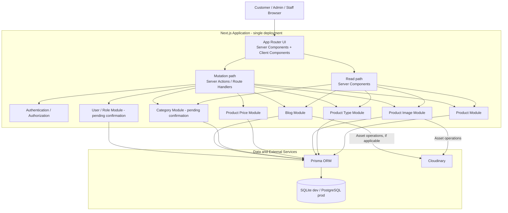
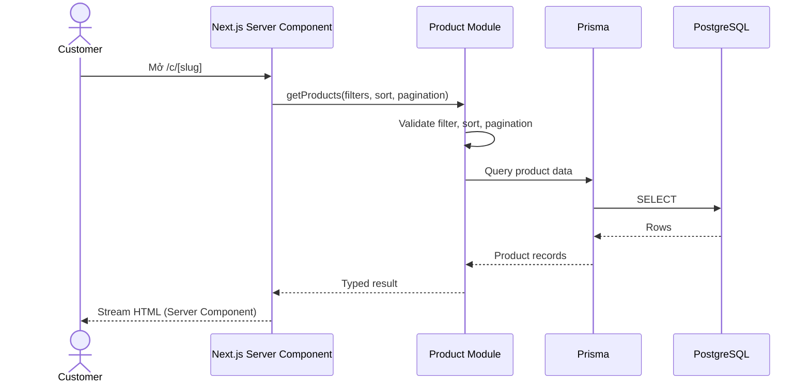
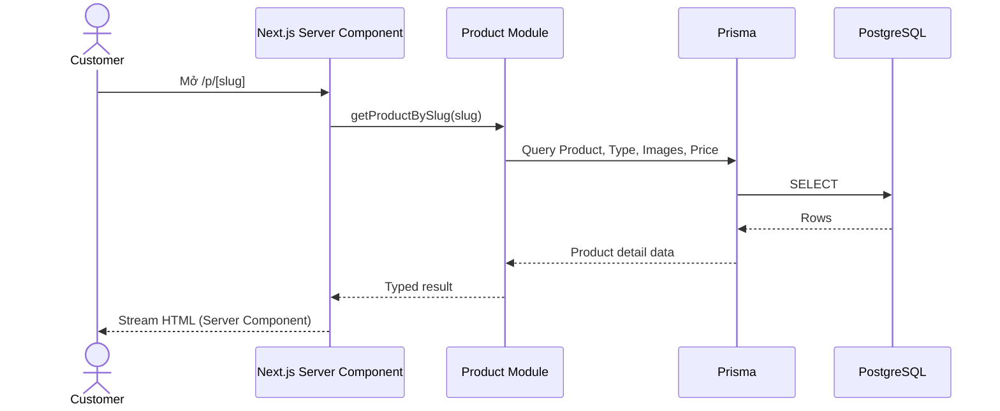
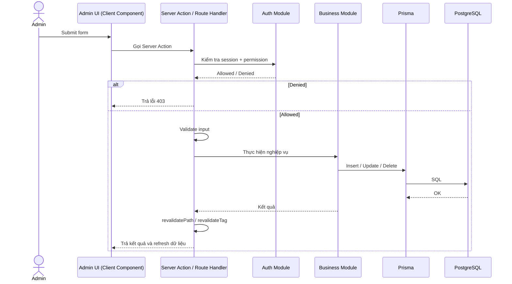
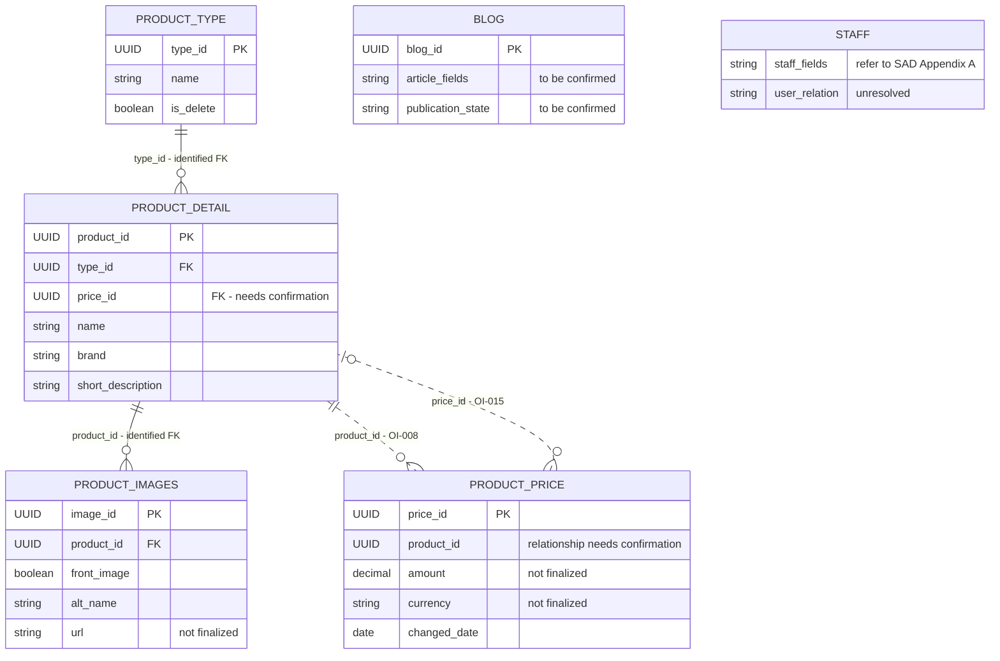

# AN JEWELRY — ARCHITECTURE

> **Trạng thái tài liệu:** Kiến trúc đề xuất, đã đối chiếu với work tree hiện tại  
> **Tài liệu nguồn:** `AN_JEWELRY_SAD_v1.1.docx`  
> **Cập nhật theo work tree:** 2026-11-09  
> **Trạng thái work tree:** Có một Next.js application duy nhất (16.4.5, App Router) với React 19.3.0, Tailwind CSS v4, TypeScript strict, ESLint 9, Prettier 3 và Vitest 5. `src/types/domain.ts` định nghĩa `Product`, `ProductColor`, `ProductImage`, `Category`, `BlogPost`, `HeroSlide`, `Settings` và `Role`; `src/lib/mock/` chứa mock data có type và `src/lib/queries/` là tầng truy cập dữ liệu duy nhất cho page. `.env.example` và `.github/pull_request_template.md` đã có. Chưa có Database, Prisma, Authentication, Server Action, Route Handler nghiệp vụ hoặc workflow nghiệp vụ.
> **Ngôn ngữ:** Nội dung diễn giải bằng tiếng Việt; giữ nguyên các technical terms, tên công nghệ, tên module, tên bảng, tên API, identifier và code terms bằng tiếng Anh.

---

## 1. Mục đích tài liệu

Tài liệu này chuyển các nội dung phân tích và thiết kế trong `AN_JEWELRY_SAD_v1.1.docx` thành bản định hướng kiến trúc kỹ thuật ban đầu cho dự án AN JEWELRY. Tài liệu được sử dụng làm cơ sở để:

- Thống nhất cách nhìn tổng thể về hệ thống trước khi bắt đầu lập trình.
- Xác định các thành phần chính, trách nhiệm của từng thành phần và cách chúng tương tác.
- Định hướng phân chia module trong một Next.js application duy nhất.
- Mô tả mô hình dữ liệu logic ở mức hiện có trong SAD.
- Định hướng Server Components cho read, Server Actions / Route Handlers cho mutation, Authentication, Authorization và lưu trữ hình ảnh.
- Ghi nhận các quyết định kỹ thuật còn cần xác nhận để tránh tự ý biến giả định thành yêu cầu chính thức.
- Làm cơ sở cập nhật kiến trúc khi codebase được mở rộng và các quyết định thiết kế được phê duyệt.

### 1.1. Nguyên tắc xây dựng tài liệu

Tài liệu bám theo phạm vi, thuật ngữ và trạng thái yêu cầu trong SAD v1.1. Không tự bổ sung các nghiệp vụ chưa được xác nhận.

Các trạng thái được sử dụng:

| Trạng thái | Ý nghĩa |
|---|---|
| Đã khảo sát / Đã xác định | Có cơ sở từ website được khảo sát hoặc nội dung nghiệp vụ đã được làm rõ trong SAD |
| Cần xác nhận | Cần chủ dự án hoặc đơn vị vận hành xác nhận trước khi thiết kế chi tiết hoặc triển khai |
| Đề xuất | Phương án kỹ thuật được đưa ra để tham khảo, chưa được xem là quyết định đã phê duyệt |

### 1.2. Giới hạn của tài liệu

Work tree hiện tại mới có bộ khung Next.js ở thư mục gốc và trang mặc định của `create-next-app`; Database chưa tồn tại. Vì vậy, tài liệu không khẳng định:

- Cấu trúc module đã hoàn chỉnh; các thư mục `src/components/`, `src/features/`, `src/lib/` và `src/server/` vẫn là đề xuất.
- Phiên bản framework hoặc package ngoài các dependency đang có trong `package.json`.
- Database schema vật lý, migrations, indexes hoặc constraints đã tồn tại.
- Các Server Component, Server Action hoặc Route Handler nghiệp vụ đã được triển khai.
- Cấu hình Authentication, Authorization hoặc bảo mật đã hoạt động.
- Hạ tầng Hosting, Deployment, CI/CD, Logging hoặc Monitoring thực tế.

Các sơ đồ, module và cấu trúc thư mục trong tài liệu là định hướng đề xuất, trừ khi được ghi rõ là đã có trong work tree. Phần hiện trạng chỉ mô tả đúng những gì đang tồn tại tại thời điểm cập nhật.

---

## 2. Tổng quan hệ thống

### 2.1. Giới thiệu

AN JEWELRY là website giới thiệu các sản phẩm trang sức. Website cung cấp thông tin để khách hàng tham khảo sản phẩm, tìm hiểu nội dung liên quan và liên hệ trực tiếp với cửa hàng.

Theo phạm vi đã được chủ dự án làm rõ trong SAD:

- Khách hàng có thể xem thông tin sản phẩm.
- Khách hàng có thể xem nội dung Blog.
- Khách hàng có thể xem số điện thoại và các liên kết Facebook, Instagram để liên hệ trực tiếp.

Website **không** hỗ trợ các chức năng sau trong phạm vi hiện tại:

- Shopping Cart.
- Online Ordering.
- Online Payment.
- Online Transaction.
- Custom Jewelry Design hoặc đặt thiết kế/sản xuất sản phẩm theo yêu cầu riêng.

Không được tự ý đưa các chức năng nằm ngoài phạm vi trên vào kiến trúc hoặc kế hoạch triển khai nếu chưa có thay đổi yêu cầu chính thức từ chủ dự án.

Trong work tree hiện tại, website mới là bộ khung Next.js với trang mặc định của `create-next-app`. Chưa có trang sản phẩm, Blog, thông tin liên hệ hoặc khu vực quản trị nào được triển khai.

### 2.2. Mục tiêu hệ thống

1. Cung cấp giao diện trực tuyến để giới thiệu sản phẩm trang sức.
2. Hỗ trợ khách hàng tìm kiếm, lọc, sắp xếp và xem chi tiết sản phẩm theo các yêu cầu được xác định.
3. Cung cấp nội dung Blog để khách hàng tham khảo.
4. Định hướng xây dựng khu vực quản trị để người có quyền quản lý nội dung website.
5. Tạo nền tảng kỹ thuật có thể bảo trì và mở rộng theo phạm vi được phê duyệt.

### 2.3. Phạm vi chức năng chính

Trạng thái trong bảng phản ánh mức độ xác định của yêu cầu trong SAD, **không phải** trạng thái triển khai. Tất cả chức năng nghiệp vụ dưới đây hiện chưa có trong work tree.

| Nhóm chức năng | Nội dung | Actor chính | Trạng thái yêu cầu |
|---|---|---|---|
| Trang chủ | Hiển thị nội dung giới thiệu và điều hướng website | Customer | Nội dung tĩnh hay lấy từ dữ liệu server cần xác nhận |
| Sản phẩm | Xem danh sách sản phẩm | Customer | Đã xác định |
| Lọc sản phẩm | Lọc theo danh mục hoặc Product Type | Customer | Một phần cần xác nhận do Category chưa có mô hình dữ liệu |
| Sắp xếp sản phẩm | Sắp xếp theo giá hoặc tên | Customer | Đã khảo sát; quy tắc mặc định cần xác nhận |
| Chi tiết sản phẩm | Xem thông tin và hình ảnh sản phẩm | Customer | Đã xác định; trường mô tả và thông số cần xác nhận |
| Product Type | Cung cấp danh sách loại trang sức | Customer / Admin | Có bảng logic; nhu cầu quản trị cần xác nhận |
| Blog | Xem danh sách bài viết | Customer | Đã khảo sát |
| Blog Detail | Xem nội dung chi tiết bài viết | Customer | Đã khảo sát; trạng thái công khai cần xác nhận |
| Contact Information | Xem số điện thoại và liên kết Facebook, Instagram để liên hệ trực tiếp | Customer | Giá trị chính thức cần BA xác nhận |
| Product Management | Quản lý sản phẩm | Admin / Staff | Quyền và thao tác cụ thể cần xác nhận |
| Blog Management | Quản lý bài viết | Admin / Staff | Quyền và trạng thái xuất bản cần xác nhận |
| User Management | Quản lý người dùng và quyền | Admin | Cấu trúc User/Role cần xác nhận |

---

## 3. Actor và vai trò

> Work tree hiện chưa có Authentication, User/Role model hoặc giao diện Admin/Staff. Các vai trò dưới đây là định hướng nghiệp vụ từ SAD.

### 3.1. Customer

Customer là người truy cập website để tìm hiểu thông tin sản phẩm và liên hệ trực tiếp với cửa hàng qua các kênh được công bố.

Các chức năng đã xác định:

- Xem danh sách sản phẩm.
- Xem sản phẩm theo danh mục.
- Sắp xếp sản phẩm theo giá hoặc tên.
- Xem thông tin chi tiết sản phẩm.
- Xem danh sách Blog.
- Xem chi tiết Blog.
- Xem số điện thoại và các liên kết Facebook, Instagram.

Customer không tạo đơn hàng và không thực hiện thanh toán trên website.


### 3.2. Admin

Admin là người quản lý và kiểm soát hoạt động của hệ thống.

Các nghiệp vụ dự kiến:

- Quản lý sản phẩm.
- Quản lý danh mục.
- Quản lý bài viết Blog.
- Quản lý người dùng.

Vai trò Admin đã được xác định ở mức Actor, nhưng quyền hạn cụ thể vẫn cần xác nhận, bao gồm:

- Quyền quản lý Staff.
- Quyền tạo và quản lý Role.
- Quyền phân quyền.
- Quyền cấu hình hệ thống.

### 3.3. Staff

Staff là người tham gia vận hành và hỗ trợ hoạt động của website.

Các nghiệp vụ dự kiến:

- Kiểm tra thông tin sản phẩm.
- Cập nhật thông tin sản phẩm hoặc bài viết theo quyền được cấp.

Quyền cụ thể của Staff và mối quan hệ giữa Staff với User/Role chưa được xác định đầy đủ trong SAD.

---

## 4. Định hướng công nghệ

### 4.1. Technology Stack

SAD v1.1 nêu định hướng sử dụng Next.js. Kiến trúc đã chốt dùng **một Next.js application duy nhất**, Prisma với SQLite cho dev và PostgreSQL cho production; Authentication và Image Storage vẫn là phương án đề xuất, chưa được cấu hình.

| Thành phần | Công nghệ | Vai trò | Trạng thái trong work tree |
|---|---|---|---|
| Application | Next.js 16.4.5 (App Router) | Giao diện và server-side logic trong cùng một ứng dụng | Đã cài đặt |
| UI runtime | React 19.3.0 | Render giao diện | Đã cài đặt |
| Read path | React Server Components (App Router) | Đọc dữ liệu và render phía server | Runtime đã có; chưa có query nghiệp vụ |
| Mutation path | Server Actions; Route Handlers chỉ cho upload | Xử lý form, mutation và upload | Đã chốt; chưa triển khai |
| Styling | Tailwind CSS v4 qua `@tailwindcss/turbopack` | Utility CSS | Đã cấu hình |
| Ngôn ngữ | TypeScript 5 (`strict`) | Type safety | Đã cấu hình |
| Lint | ESLint 9 + `eslint-config-next` | Kiểm tra chất lượng mã | Đã cấu hình |
| Format | Prettier 3 | Format mã nguồn | Đã cấu hình |
| Test | Vitest 5 | Unit test | Đã cấu hình |
| Package manager | npm (`package-lock.json`) | Quản lý dependencies | Đang sử dụng |
| Database | SQLite (dev) / PostgreSQL (production) | Lưu trữ dữ liệu hệ thống | Đã chốt, chưa cấu hình |
| ORM | Prisma | Truy vấn và quản lý dữ liệu | Đã chốt, chưa cấu hình |
| Validation | Zod | Validate input tại server boundary | Đã chốt, chưa cài đặt |
| Authentication | JWT | Xác thực người dùng nội bộ | Đề xuất, chưa cấu hình |
| Image Storage | Cloudinary | Lưu trữ hình ảnh sản phẩm và Blog | Đề xuất, chưa cấu hình |
| Version Control | Git / GitHub | Quản lý mã nguồn và cộng tác | Đang sử dụng |

Cần đánh giá và chốt Image Storage và phương thức Authentication trước khi thiết kế kỹ thuật chi tiết.

### 4.2. Vai trò của từng công nghệ

**Next.js**

- Xây dựng toàn bộ ứng dụng, gồm cả public website và khu vực Admin/Staff.
- Dùng Server Components cho các luồng read: render danh sách, chi tiết sản phẩm, Blog và nội dung liên hệ.
- Dùng Server Actions cho mutation từ form quản trị; dùng Route Handlers cho upload, webhook hoặc tích hợp cần HTTP endpoint.
- Thực thi nghiệp vụ, kiểm tra Authentication/Authorization và truy cập Database trong cùng process server-side.
- Không tạo tầng API riêng hoặc ứng dụng backend tách biệt.

Trong work tree hiện tại, Next.js mới chứa trang mặc định của `create-next-app`; các trang public, Admin/Staff và server-side logic nêu trên chưa được triển khai.

**SQLite / PostgreSQL**

- SQLite dùng cho local development; PostgreSQL dùng cho production.
- Lưu trữ dữ liệu sản phẩm.
- Lưu trữ Product Type.
- Lưu trữ thông tin hình ảnh và giá sản phẩm.
- Lưu trữ Blog.
- Lưu trữ dữ liệu User/Role sau khi mô hình được xác nhận.

**Prisma**

- Định nghĩa data model ở tầng ORM.
- Truy vấn dữ liệu từ SQLite (dev) hoặc PostgreSQL (production).
- Quản lý database migrations sau khi schema được phê duyệt.
- Hỗ trợ thao tác dữ liệu trong các module server-side.

**JWT**

- Là phương án xác thực người dùng nội bộ được đề xuất.
- Không thay thế việc kiểm tra quyền truy cập ở server-side.
- Cần xác định thêm token expiration, refresh token, logout và thu hồi token trước khi triển khai.

**Cloudinary**

- Là phương án lưu trữ và phân phối image assets.
- Server-side code trong Next.js quản lý nghiệp vụ liên kết hình ảnh với Product hoặc Blog.
- Database lưu metadata hoặc reference của asset sau khi cấu trúc dữ liệu được xác nhận.

**Git / GitHub**

- Quản lý source code.
- Theo dõi lịch sử thay đổi.
- Hỗ trợ làm việc nhóm và review code.
- Có thể được sử dụng để quản lý tài liệu kỹ thuật và quy trình phát triển.

---

## 5. Tổng quan kiến trúc hệ thống

### 5.1. Hiện trạng work tree

Cấu trúc thực tế tại thời điểm cập nhật:

```text
ant-jewelry/
├── .github/
│   └── pull_request_template.md  # Mẫu mô tả Pull Request
├── src/
│   ├── app/              # layout.tsx, page.tsx, globals.css
│   ├── lib/
│   │   ├── mock/         # Mock data có type (products, categories, blog, hero, settings)
│   │   └── queries/      # Query functions cho storefront/admin
│   ├── types/            # Domain contracts (Product, Category, BlogPost, HeroSlide, Settings, Role)
│   └── config.test.ts    # Test cấu hình project
├── public/               # Static assets
├── docs/                 # Tài liệu dự án
├── next.config.ts        # Cấu hình Next.js
├── eslint.config.mjs     # Cấu hình ESLint
├── vitest.config.mts     # Cấu hình Vitest
├── tsconfig.json         # Cấu hình TypeScript
├── package.json          # Dependencies và scripts
├── package-lock.json     # Khóa phiên bản dependencies
├── .prettierrc           # Cấu hình Prettier
├── .prettierignore       # File Prettier bỏ qua
├── .env.example          # Biến môi trường mẫu
├── AGENTS.md             # Quy tắc làm việc với Next.js
└── .gitignore
```

- Chỉ có một Next.js application ở thư mục gốc, source code trong `src/`; chưa có thư mục `frontend/` hoặc `backend/`.
- `src/app/page.tsx` đang là trang mặc định của `create-next-app`; `src/app/layout.tsx` khai báo metadata mặc định.
- `src/lib/mock/` chứa 24 sản phẩm (23 hiển thị, 1 ẩn) thuộc 4 `ProductType` kiêm danh mục (WEDDING RING, ENGAGEMENT RING, NECKLACE, OTHER JEWELRY), 6 bài Blog (5 published, 1 draft), 3 hero slide (2 hiển thị, 1 ẩn) và Settings giả lập.
- Ảnh sản phẩm mock dùng `public/mock/products/ring-*.webp`; `ring-2-1` và `ring-5-2` là ảnh phụ (góc chụp thứ hai) của `ring-2` và `ring-5`. Sản phẩm chưa có ảnh riêng dùng SVG placeholder theo `ProductType`.
- `src/lib/queries/` là tầng truy cập dữ liệu duy nhất cho page; query trả bản clone, lọc danh mục bằng `ProductType` và loại bản ghi hidden/draft khỏi storefront.
- ESLint chặn `src/app/**` import trực tiếp `@/lib/mock`.
- Chưa có Server Action, Route Handler nghiệp vụ, Database, Prisma, Authentication hoặc Cloudinary.
- Các script hiện có: `dev`, `build`, `start`, `lint`, `typecheck`, `format`, `format:check`, `test`, `test:watch`.

### 5.2. Kiến trúc đề xuất

Hệ thống được tổ chức trong **một Next.js application duy nhất**, không có tầng API riêng:

1. **Presentation / UI Layer:** Next.js App Router, gồm Server Components và Client Components.
2. **Application / Server Layer:** Server Components cho read; Server Actions và Route Handlers cho mutation.
3. **Domain / Module Layer:** các module nghiệp vụ TypeScript.
4. **Data Access Layer:** Prisma.
5. **Data Layer:** SQLite cho dev; PostgreSQL cho production.
6. **External Service:** Cloudinary cho hình ảnh nếu được lựa chọn.

Sơ đồ dưới đây là kiến trúc logic đề xuất, chưa có trong work tree:



### 5.3. Presentation Layer

Presentation Layer chịu trách nhiệm giao tiếp với người dùng thông qua giao diện Next.js App Router.

Có thể chia giao diện thành hai khu vực:

Public Website
- Home Page.
- Product Listing.
- Product Detail.
- Blog Listing.
- Blog Detail.
- Contact Information (phone and Facebook/Instagram links).

Admin / Staff Interface
- Product Management.
- Product Image Management.
- Product Price Management.
- Product Type / Category Management nếu được xác nhận.
- Blog Management.
- User / Role Management theo quyền được cấp.

SAD chưa xác định Home Page và Contact Information là nội dung tĩnh trong Server Component hay lấy từ dữ liệu server. Cần xác nhận trước khi quyết định cách tổ chức data fetching.

### 5.4. Application / Server Layer

Không có tầng API riêng. Next.js đảm nhận cả read và mutation trong cùng application:

- **Read:** Server Components gọi trực tiếp các query function server-side; không cần public REST endpoint.
- **Mutation:** Server Actions xử lý form quản trị; Route Handlers chỉ dùng cho upload, webhook hoặc tích hợp cần HTTP endpoint.
- Kiểm tra dữ liệu đầu vào tại server boundary.
- Xác thực người dùng đối với chức năng nội bộ.
- Kiểm tra quyền thực hiện thao tác trước khi gọi module nghiệp vụ.
- Gọi module nghiệp vụ tương ứng và truy cập dữ liệu thông qua Prisma.
- Gọi `revalidatePath` / `revalidateTag` sau mutation để làm mới dữ liệu read.

### 5.5. Domain / Module Layer

Các module nghiệp vụ được tổ chức trong cùng Next.js application, không tách Backend. Chi tiết được trình bày tại mục 6.

### 5.6. Data Access Layer

Prisma là ORM đã chốt để giao tiếp với SQLite (dev) và PostgreSQL (production).

Trách nhiệm dự kiến:
- Ánh xạ data model.
- Thực hiện truy vấn.
- Thực hiện thao tác tạo, cập nhật và xóa dữ liệu theo nghiệp vụ.
- Quản lý migrations sau khi Database Schema được phê duyệt.

### 5.7. Data Layer

SQLite (dev) và PostgreSQL (production) là Database đã chốt. Các bảng logic hiện có chưa đủ điều kiện để coi là Database Schema vật lý cuối cùng.

Không tạo migrations production dựa trên các quan hệ còn đang được đánh dấu Cần xác nhận.

## 6. Module Architecture
Các module dưới đây là ranh giới nghiệp vụ đề xuất trong cùng Next.js application. Chúng chưa phải danh sách thư mục hoặc class đã tồn tại trong source code.
### 6.1. Product Module
Mục đích: Quản lý và cung cấp dữ liệu sản phẩm.

Các trách nhiệm dự kiến:
- Lấy danh sách sản phẩm công khai.
- Lấy chi tiết sản phẩm.
- Lọc và sắp xếp sản phẩm theo các tiêu chí được xác nhận.
- Tạo sản phẩm.
- Cập nhật thông tin sản phẩm.
- Xóa hoặc đánh dấu xóa sản phẩm theo quy tắc nghiệp vụ.
- Kiểm tra trạng thái hiển thị sản phẩm.
Data entity chính: product_detail.

Các điểm cần xác nhận:
- Category và quan hệ với Product.
- Trường mô tả đầy đủ.
- Cấu trúc thông số sản phẩm.
- Slug và URL routing.
- Quy tắc giá hiện tại.
- Quy tắc xóa mềm và hiển thị sản phẩm.
### 6.2. Product Type Module
Mục đích: Cung cấp và quản lý loại trang sức.

Ví dụ Product Type theo SAD:
- Ring.
- Necklace.
Data entity: product_type.

SAD có đề cập trường is_delete. Tuy nhiên, chức năng quản trị Product Type và yêu cầu tương ứng chưa được xác định đầy đủ.
### 6.3. Product Image Module
Mục đích: Quản lý các hình ảnh liên kết với sản phẩm.

Data entity: product_images.

SAD cho biết một sản phẩm có thể có nhiều hình ảnh và có trường front_image để nhận diện hình đại diện.

Các điểm cần xác nhận:
- Trường lưu URL hoặc file reference.
- Thứ tự hiển thị hình ảnh.
- Quy tắc chọn ảnh đại diện.
- Quy trình upload, thay thế và xóa ảnh.
- Các metadata cần lưu trong Database.
- Cách tích hợp Cloudinary nếu được lựa chọn.
### 6.4. Product Price Module
Mục đích: Quản lý thông tin giá sản phẩm.

Data entity: product_price.

SAD ghi nhận trường changed_date, có thể gợi ý việc lưu lịch sử thay đổi giá. Tuy nhiên, mô hình price history chưa được xác nhận.

Các điểm cần xác nhận:
- Trường số tiền.
- Kiểu dữ liệu và độ chính xác.
- Mã tiền tệ.
- Quy tắc xác định giá hiện tại.
- Quan hệ giữa product_detail.price_id và product_price.product_id.
- Có cần lưu lịch sử giá hay chỉ lưu giá hiện tại.

### 6.5. Category Module
Mục đích: Quản lý danh mục kinh doanh nếu chức năng này được xác nhận.

SAD phân biệt:
- Product Type: loại hình trang sức, ví dụ Ring, Necklace.
- Product Category: nhóm kinh doanh, ví dụ Wedding Bands, Engagement, Everyday.

**Quyết định triển khai 2026-11-09:** hai khái niệm được hợp nhất. Mỗi sản phẩm có một `ProductType` đóng vai trò danh mục; Category record giữ `type: ProductType` để điều hướng và sắp thứ tự, còn bộ lọc danh mục dùng `ProductType`.

Tuy nhiên, Category entity và quan hệ giữa Category với Product chưa có trong cấu trúc dữ liệu được rà soát. Do đó, Category Module chỉ là module dự kiến, chưa phải thành phần đã được chốt.
### 6.6. Blog Module
Mục đích: Cung cấp nội dung Blog công khai và hỗ trợ quản trị bài viết.

Data entity: blog.

Các trách nhiệm dự kiến:
- Lấy danh sách bài viết công khai.
- Lấy chi tiết bài viết.
- Tạo bài viết.
- Cập nhật bài viết.
- Xóa hoặc ẩn bài viết theo quy tắc được duyệt.
- Quản lý trạng thái công khai nếu có.
Các điểm cần xác nhận:
- Trường dữ liệu nội dung chi tiết.
- Trạng thái bài viết được xem là công khai.
- Slug của bài viết.
- Blog có một ảnh hay nhiều ảnh.
- Quy tắc hiển thị bài viết đã xóa hoặc chưa xuất bản.
### 6.7. Authentication / User / Role Module
Mục đích: Xác thực người dùng nội bộ và quản lý quyền truy cập.

SAD đề xuất JWT cho Authentication nhưng cấu trúc User/Role và quan hệ với staff chưa được xác định.

Các trách nhiệm dự kiến:
- Đăng nhập tài khoản nội bộ.
- Xác thực request/session ở server-side.
- Quản lý tài khoản.
- Quản lý Role và Permission sau khi mô hình được phê duyệt.
- Kiểm tra quyền truy cập chức năng quản trị.
Không được coi JWT là toàn bộ giải pháp bảo mật. Server-side code vẫn phải kiểm tra quyền trên từng Server Action / Route Handler hoặc nhóm thao tác được bảo vệ.

## 7. System Request Flow

> Work tree chưa có Database hoặc luồng dữ liệu nào được triển khai. Các sơ đồ dưới đây là luồng đề xuất; read đi qua Server Components, mutation đi qua Server Actions / Route Handlers.

### 7.1. Luồng read — xem danh sách sản phẩm



Không có public API trung gian. Các query parameters, pagination, sort mặc định và cách xác định giá cần được xác nhận trước khi hoàn thiện contract của query function.

### 7.2. Luồng read — xem chi tiết sản phẩm



SAD đề xuất product_id dạng UUID. Sitemap hiện dùng slug trên URL; quy tắc tra cứu slug vẫn cần xác nhận (OI-011, OI-025).

### 7.3. Luồng mutation — quản trị nội dung



Route Handlers chỉ dùng cho upload, webhook hoặc tích hợp cần HTTP endpoint; không tạo một tầng REST API riêng cho toàn bộ ứng dụng. JWT là phương án được đề xuất trong SAD. Token lifecycle, refresh token, logout, thu hồi token và chính sách bảo mật tài khoản cần được xác định trước khi triển khai.

## 8. Logical Data Architecture

> Work tree chưa có Database hoặc Prisma. Các entity, quan hệ và ERD dưới đây là mô hình logic từ SAD, không phải schema vật lý. `src/types/domain.ts` định nghĩa TypeScript contracts cho `Product`, `Category` và `BlogPost`; các type này không hàm ý rằng persistence hoặc workflow đã được triển khai.

### 8.1. Các entity được xác định trong SAD
SAD Appendix A và Section 6 đề cập các bảng logic sau:

| Entity / Table | Vai trò theo SAD | Trạng thái / Ghi chú |
|---|---|---|
| product_detail | Lưu thông tin sản phẩm như tên, nhãn hiệu, loại và giới thiệu ngắn | Có cấu trúc logic; một số trường chi tiết còn thiếu |
| product_type | Lưu loại trang sức như Ring, Necklace | Có cấu trúc logic; chức năng quản trị cần xác nhận |
| product_images | Lưu các hình ảnh thuộc sản phẩm; có front_image | Chưa có đầy đủ URL/path và thứ tự hiển thị |
| product_price | Lưu thông tin giá sản phẩm | Quan hệ, trường tiền và quy tắc giá hiện tại cần xác nhận |
| blog | Lưu bài viết Blog | Trường nội dung, trạng thái công khai và image model cần xác nhận |
| staff | Lưu thông tin nhân viên | Quan hệ với User/Role chưa xác định |

### 8.2. Các quan hệ logic đã được rà soát
SAD Section 6 và Appendix A ghi nhận các quan hệ sau:

| Quan hệ | Khóa / Reference | Trạng thái |
|---|---|---|
| product_type 1 – N product_detail | product_detail.type_id → product_type.type_id | Theo cấu trúc rà soát |
| product_detail 1 – N product_images | product_images.product_id → product_detail.product_id | Theo cấu trúc rà soát |
| product_detail 1 – N product_price | product_price.product_id → product_detail.product_id | Cần xác nhận OI-008 |
| product_price và product_detail | product_detail.price_id → product_price.price_id | Cần xác nhận; có nguy cơ tạo vòng tham chiếu OI-015 |

Các bảng blog và staff chưa có quan hệ khóa ngoại được xác định trong cấu trúc rà soát hiện tại.

Các thực thể/quan hệ chưa xác định:
- Category và quan hệ với Product (OI-009).
- User/Role và quan hệ với Staff (OI-021).
- Chức năng quản trị Product Type dù bảng product_type có cờ is_delete.
### 8.3. ERD logic
Sơ đồ dưới đây chỉ mô tả các entity và quan hệ được ghi nhận trong SAD. Quan hệ nét đứt là quan hệ còn cần xác nhận. Đây không phải Database Schema vật lý đã được phê duyệt.



Lưu ý: Các thuộc tính amount, currency, url trong sơ đồ chỉ là nhãn mô tả phần dữ liệu còn thiếu, không phải tên cột hoặc kiểu dữ liệu đã được SAD phê duyệt.

### 8.4. Product Type và Product Category
SAD phân tích hai khái niệm riêng, nhưng quyết định triển khai ngày 2026-11-09 hợp nhất chúng: `ProductType` của sản phẩm đồng thời là danh mục, và bộ lọc danh mục dùng `ProductType`.

| Khái niệm | Ý nghĩa | Ví dụ |
|---|---|---|
| Product Type / Category | Loại sản phẩm kiêm danh mục | WEDDING RING, ENGAGEMENT RING, NECKLACE, OTHER JEWELRY |

Category record giữ thêm `name`, `slug`, `sortOrder` và `status` để hiển thị menu và sắp thứ tự.
### 8.5. Các vấn đề Database cần giải quyết
Price relationship

Cấu trúc hiện tại có product_price.product_id tham chiếu product_detail.product_id, đồng thời product_detail.price_id được mô tả là FK đến product_price.price_id. Điều này có thể tạo vòng tham chiếu.

Cần xác nhận hướng quan hệ chuẩn và xác định có thực sự cần price_id trong product_detail hay không.

Price history

Trường changed_date gợi ý khả năng lưu lịch sử thay đổi giá, nhưng SAD chưa chốt mô hình này. Cần xác định:
- Một Product có nhiều Price records hay chỉ một giá hiện tại.
- Quy tắc chọn giá hiện tại.
- Có cần truy vấn giá tại một thời điểm trong quá khứ hay không.
Money representation

Cần xác nhận trường số tiền, kiểu dữ liệu, precision, scale và currency. Không sử dụng một trường có tên currency để lưu số tiền nếu ý nghĩa nghiệp vụ chưa được xác định.

Product image

Cần xác nhận URL/path, Cloudinary reference, thứ tự hiển thị và quy tắc ảnh đại diện.

Blog

Cần xác nhận cấu trúc nội dung, trạng thái xuất bản và Blog có một hay nhiều hình ảnh.

User / Role / Staff

Cần xác định User, Role, Permission và quan hệ giữa User với Staff trước khi thiết kế Authentication và Authorization.
### 8.6. Database design readiness
Theo SAD, Database physical design chỉ nên được thực hiện sau khi các vấn đề quan trọng được giải quyết, đặc biệt:
- OI-008: quan hệ Product và Price.
- OI-015: vòng tham chiếu price_id và product_id.
- OI-016: cấu trúc số tiền và currency.
- OI-017: Database engine và quy ước kiểu chuỗi.
- OI-018: cấu trúc lưu trữ hình ảnh.
Do đó, ERD trong tài liệu này chỉ là Logical Data Model để rà soát, không được dùng thay thế cho DDL hoặc Prisma Schema đã phê duyệt.

## 9. Server Data Access and Mutation Architecture

> Work tree chưa có Server Action hoặc Route Handler nào. SAD có đề xuất endpoint HTTP, nhưng kiến trúc hiện tại **không tạo tầng REST API riêng**: read đi qua Server Components, mutation đi qua Server Actions / Route Handlers.

### 9.1. Nguyên tắc chung

| Hạng mục | Nội dung | Trạng thái |
|---|---|---|
| Read path | Server Components gọi query function server-side | Đề xuất |
| Mutation path | Server Actions; Route Handlers cho upload/webhook | Đề xuất |
| Public HTTP API | Không có tầng public API riêng | Đã chốt |
| Admin HTTP API | Không có tầng admin API riêng; mutation qua Server Actions | Đã chốt |
| Payload | Typed arguments / `FormData`; JSON cho Route Handlers | Đề xuất |
| Validation | Validate tại server boundary trước khi gọi module | Đề xuất |
| Resource Identifier | UUID cho product_id và blog_id | Theo mô hình logic; cần đồng bộ với schema cuối |
| Pagination / Sorting | Typed parameters cho query function | Cần xác nhận OI-023 |
| Error Handling | Typed result hoặc redirect; format lỗi thống nhất | Cần xác nhận OI-023 |
| Revalidation | `revalidatePath` / `revalidateTag` sau mutation | Đề xuất |

### 9.2. Read path — Server Components

- Page/layout Server Components gọi trực tiếp query function của module nghiệp vụ.
- Query function trả về typed domain model; không cần JSON response contract trung gian.
- Filter, sort và pagination được truyền dưới dạng typed parameters.
- Không expose public endpoint chỉ để phục vụ read trong cùng ứng dụng.

| Nhu cầu read | Nơi xử lý | Dữ liệu dự kiến |
|---|---|---|
| Trang chủ | Server Component + query function | Hero content, sản phẩm nổi bật, Blog nổi bật |
| Danh sách theo danh mục `/c/[slug]` | Server Component + `getProducts` | product_detail, product_type, product_images, product_price |
| Chi tiết sản phẩm `/p/[slug]` | Server Component + `getProductBySlug` | product_detail, product_type, product_images, product_price |
| Danh sách Blog `/blog` | Server Component + `getBlogPosts` | blog |
| Chi tiết Blog `/blog/[slug]` | Server Component + `getBlogPostBySlug` | blog |
| Trang tĩnh footer | Server Component | Nội dung tĩnh hoặc dữ liệu cấu hình |

Các trường dữ liệu chi tiết (price, image URL, description, specifications, publication state) vẫn phụ thuộc các OI tương ứng.

### 9.3. Mutation path — Server Actions / Route Handlers

| Nhóm thao tác | Cơ chế | Ghi chú |
|---|---|---|
| Login / logout | Server Action | Tạo hoặc hủy session cookie; kiểm tra role |
| Product CRUD | Server Action | Validate input, authorization, `revalidatePath` |
| Product image upload | Route Handler | `multipart/form-data`; upload Cloudinary nếu được duyệt |
| Product price | Server Action | Validate số tiền và quyền |
| Category CRUD | Server Action | Chỉ sau khi Category model được xác nhận |
| Blog CRUD và publish | Server Action | Validate trạng thái `DRAFT` / `PUBLISHED` |
| User / Role | Server Action | Chỉ role `ADMIN`; validate quyền |
| Hero slides / settings | Server Action | Validate input và authorization |

Quy tắc bắt buộc:
- Kiểm tra Authentication và Authorization ở server-side cho mọi Server Action / Route Handler.
- Validate toàn bộ input trước khi gọi module nghiệp vụ.
- Không truy cập Database trực tiếp từ Client Component.
- Trả typed result hoặc redirect; không trả JSON contract công khai nếu không cần.
- Gọi `revalidatePath` / `revalidateTag` sau mutation để đồng bộ read path.
- Ghi audit log cho thao tác quản trị khi chính sách được chốt.

### 9.4. Đối chiếu với endpoint SAD đề xuất

Bảng dưới đây ghi lại cách thay thế các nhóm endpoint trong SAD; đây không phải danh sách route đã triển khai.

| Nhóm trong SAD | Cách xử lý trong kiến trúc hiện tại |
|---|---|
| API-P01 đến API-P06 (public read) | Server Components + query functions; không public HTTP endpoint |
| API-A01, API-A02 (login/logout) | Server Action + session cookie |
| API-A03 đến API-A08 (product) | Server Actions cho CRUD; Route Handler cho upload ảnh |
| API-A12 (price) | Server Action |
| API-A13 đến API-A16 (category) | Server Actions |
| API-A17 đến API-A21 (blog) | Server Actions |
| API-A25 đến API-A28 (user/role) | Server Actions |

Pagination, sorting, validation rules và error format vẫn cần chốt theo OI-023 trước khi hoàn thiện query function và Server Action contract.

## 10. Authentication và Authorization

> Work tree chưa có Authentication, Authorization hoặc User/Role model. Nội dung dưới đây là định hướng đề xuất.

### 10.1. Định hướng
SAD đề xuất JWT để xác thực người dùng nội bộ. Tuy nhiên, cấu trúc User/Role và quan hệ với Staff chưa được xác định đầy đủ.

Cần phân biệt:
- Authentication: xác định người dùng là ai.
- Authorization: xác định người dùng được phép thực hiện thao tác nào.
Đăng nhập thành công không đồng nghĩa người dùng có quyền thực hiện mọi thao tác quản trị.
### 10.2. Ma trận quyền truy cập sơ bộ
Bảng dưới đây là định hướng suy ra từ mô tả Actor trong SAD, không phải Permission Matrix đã được phê duyệt.

| Chức năng | Customer | Staff | Admin |
|---|---|---|---|
| Xem Product và Blog công khai | Có | Có | Có |
| Quản lý Product | Không | Theo quyền được cấp | Dự kiến |
| Quản lý Product Image / Price | Không | Theo quyền được cấp | Dự kiến |
| Quản lý Product Type / Category | Không | Cần xác nhận | Cần xác nhận |
| Quản lý Blog | Không | Theo quyền được cấp | Dự kiến |
| Quản lý User / Role | Không | Chưa xác định | Dự kiến |

### 10.3. Các quyết định bảo mật cần xác nhận
- Cấu trúc User entity.
- Quan hệ giữa User và Staff.
- Role và Permission model.
- Một User có thể có nhiều Role hay không.
- Password hashing.
- Password reset.
- JWT expiration.
- Refresh token strategy.
- Token revocation và logout.
- Login rate limiting.
- Account lockout.
- Audit log cho thao tác quản trị.
Không đưa ra thiết kế chi tiết cho các nội dung này như thể đã được chủ dự án phê duyệt.

## 11. Image Storage Architecture

> Work tree chưa cấu hình Cloudinary hoặc bất kỳ dịch vụ lưu trữ hình ảnh nào. Nội dung dưới đây là định hướng đề xuất.

### 11.1. Định hướng
Cloudinary là công nghệ lưu trữ hình ảnh được đề xuất trong SAD. Việc sử dụng Cloudinary cần được xác nhận trước khi triển khai.

Phân chia trách nhiệm dự kiến:

| Thành phần | Trách nhiệm |
|---|---|
| Cloudinary | Lưu trữ và phân phối image assets nếu được chọn |
| PostgreSQL | Lưu thông tin tham chiếu và metadata của ảnh |
| Next.js server-side (Server Action / Route Handler) | Kiểm tra thao tác quản lý ảnh và liên kết ảnh với Product/Blog |
| Next.js Server Component / Image component | Hiển thị ảnh theo URL/reference đọc từ Database hoặc Cloudinary |

### 11.2. Luồng xử lý ảnh đề xuất
1. Admin hoặc Staff có quyền thực hiện thao tác thêm ảnh.
2. Admin UI gửi yêu cầu upload qua Server Action hoặc Route Handler.
3. Server-side code kiểm tra quyền và quy tắc file.
4. Asset được lưu tại Cloudinary nếu dịch vụ này được phê duyệt.
5. Server-side code lưu metadata/reference vào PostgreSQL.
6. Server Component đọc metadata/reference và render ảnh.
Luồng cụ thể, bao gồm upload trực tiếp từ browser lên Cloudinary hay thông qua Route Handler, chưa được SAD quyết định.
### 11.3. Các nội dung cần xác nhận
- URL/path hoặc asset identifier được lưu.
- Cloudinary public ID và các metadata cần thiết.
- Image ordering.
- Quy tắc chọn front_image.
- Allowed file formats.
- Maximum file size.
- Image dimensions.
- Thay thế ảnh.
- Xóa ảnh trong Cloudinary và Database.
- Blog hỗ trợ một ảnh hay nhiều ảnh.
- Cách xử lý asset không còn được tham chiếu.

## 12. Non-functional Architecture
SAD đề cập các vấn đề phi chức năng nhưng chưa có dữ liệu khảo sát quy mô sản phẩm, số lượng người dùng đồng thời và lưu lượng truy cập. Vì vậy, chưa có cơ sở để đưa ra các chỉ tiêu hiệu năng định lượng chính thức.

Bảng dưới đây tổng hợp các mối quan tâm kiến trúc và những việc cần làm rõ.

| Mối quan tâm | Cơ sở trong SAD | Định hướng kiến trúc / Việc cần xác nhận |
|---|---|---|
| Responsive | Website cần hiển thị phù hợp các kích thước màn hình | Thiết kế giao diện Next.js responsive; breakpoint cụ thể thuộc UI design |
| Performance | Chưa có số liệu về scale và traffic | Khảo sát số sản phẩm, lượng truy cập và concurrent users; xác định target trước capacity planning |
| Security | Authentication và quyền nội bộ còn cần xác nhận | Bảo vệ route Admin và Server Actions tại server-side; chốt JWT, Role và Permission |
| Data Integrity | Quan hệ Product/Price và các trường dữ liệu chưa hoàn chỉnh | Chốt PK, FK, constraints và price rules trước physical schema |
| Availability | SAD chưa nêu SLA | Xác định yêu cầu uptime và phương án vận hành |
| Backup / Recovery | Chưa có chính sách | Xác định lịch backup, retention và quy trình restore |
| Observability | Chưa có quyết định | Lựa chọn Logging, Error Tracking và Monitoring khi lập kế hoạch triển khai |
| Maintainability | Định hướng module server-side và ORM | Tách module theo nghiệp vụ; duy trì data contracts |
| Scalability | Chưa có số liệu tải | Đánh giá sau khi có traffic assumptions và yêu cầu hiệu năng |

Không tự đặt SLA, throughput, response time, availability target hoặc Recovery Objective khi chưa có yêu cầu được xác nhận.

## 13. Cấu trúc Repository

### 13.1. Cấu trúc hiện tại

SAD không quy định cấu trúc thư mục source code. Work tree hiện tại chỉ có một Next.js application ở thư mục gốc:

```text
ant-jewelry/
├── .github/              # pull_request_template.md
├── src/
│   ├── app/              # App Router: layout, page, globals.css
│   ├── lib/
│   │   ├── mock/         # Mock data có type
│   │   └── queries/      # Query functions
│   ├── types/            # Domain contracts (Product, Category, BlogPost, HeroSlide, Settings, Role)
│   └── config.test.ts    # Test cấu hình project
├── public/               # Static assets
├── docs/                 # Tài liệu dự án
├── next.config.ts        # Cấu hình Next.js
├── eslint.config.mjs     # Cấu hình ESLint
├── vitest.config.mts     # Cấu hình Vitest
├── tsconfig.json         # Cấu hình TypeScript
├── package.json          # Dependencies và scripts
├── package-lock.json     # Khóa phiên bản dependencies
├── .prettierrc           # Cấu hình Prettier
├── .prettierignore       # File Prettier bỏ qua
├── .env.example          # Biến môi trường mẫu
├── AGENTS.md             # Quy tắc làm việc với Next.js
└── .gitignore
```

Đã có `src/lib/mock/` và `src/lib/queries/`. Chưa có thư mục `src/components/`, `src/features/`, `src/server/` hoặc `prisma/`.

### 13.2. Cấu trúc đề xuất cho single Next.js app

```text
ant-jewelry/
├── src/
│   ├── app/
│   │   ├── (storefront)/              # /, /c/[slug], /p/[slug], /blog, /blog/[slug], footer pages
│   │   ├── (admin)/admin/              # Admin routes: login, products, categories, blog, hero-slides, settings, users
│   │   └── api/                        # Route Handlers: upload, webhook, integration only
│   ├── components/                     # Shared UI components
│   ├── features/                       # Domain modules: products, blog, admin, auth
│   ├── lib/                            # Prisma client, validation, shared utilities
│   └── types/                          # Domain contracts
├── prisma/
│   ├── schema.prisma
│   ├── migrations/
│   └── seed/
├── public/                             # Static assets
├── docs/                               # Tài liệu dự án
├── next.config.ts
├── eslint.config.mjs
├── tsconfig.json
├── package.json
└── package-lock.json
```

### 13.3. Nguyên tắc tổ chức
- Chỉ có một Next.js application; không tạo `frontend/` và `backend/` tách biệt.
- `src/app/` chứa route, layout và ranh giới Server/Client Component.
- `src/features/` gom module nghiệp vụ, query function và Server Action theo từng domain.
- `src/lib/` chứa Prisma client, validation schema và utility dùng chung.
- `src/app/api/` chỉ chứa Route Handlers cho upload, webhook hoặc tích hợp; không phải tầng REST API cho toàn bộ ứng dụng.
- `prisma/` chứa Prisma Schema, migrations và seed data sau khi Database Model được phê duyệt.
- `docs/` chứa tài liệu dự án.
Cấu trúc cuối cùng có thể thay đổi khi các module được triển khai thực tế; cập nhật tài liệu theo work tree.

## 14. Environment và Deployment

> Work tree đã có `.env.example`; chưa có `.env.local`, cấu hình triển khai hoặc biến môi trường bắt buộc. `.env*` nằm trong `.gitignore`, riêng `.env.example` được commit. Các nội dung dưới đây là việc cần quyết định khi chuẩn bị triển khai.

SAD chưa xác định hạ tầng triển khai. Các nội dung sau cần được lựa chọn trong giai đoạn chuẩn bị triển khai.
### 14.1. Các thành phần cần quyết định
- Hosting platform cho Next.js (bao gồm server-side runtime cho Server Components, Server Actions và Route Handlers).
- Managed hoặc self-hosted PostgreSQL.
- Cloudinary account và môi trường sử dụng.
- Domain, DNS và HTTPS.
- Quản lý secrets.
- CI/CD pipeline.
- Database migration strategy.
- Backup và restore procedure.
- Development, Staging và Production environments.
### 14.2. Environment variables
Tên biến môi trường cụ thể chưa được SAD xác định. Khi triển khai cần quản lý riêng các thông tin nhạy cảm như:
- Database connection string.
- JWT secret hoặc signing key.
- Cloudinary credentials.
- Các API keys khác nếu có.
Không commit credentials, passwords, tokens hoặc secrets vào Git repository. Sử dụng environment variables hoặc secret manager phù hợp với hạ tầng được chọn.
### 14.3. Deployment topology
Chưa có cơ sở để chốt một topology cụ thể. Có thể xem xét cách triển khai Next.js application và Database độc lập hoặc trên cùng một nền tảng, nhưng cần căn cứ vào yêu cầu vận hành, ngân sách, traffic và năng lực quản trị hạ tầng.

Không coi bất kỳ Hosting Provider hoặc Cloud Provider cụ thể nào là quyết định của dự án khi SAD chưa nêu.

## 15. Open Issues ảnh hưởng đến Architecture
Phụ lục D của SAD là danh sách Open Issues chính thức. Bảng dưới đây tổng hợp các vấn đề quan trọng có ảnh hưởng trực tiếp đến kiến trúc, Database, data access và bảo mật. Bảng này không thay thế toàn bộ nội dung Phụ lục D.

| Open Issue | Nội dung cần xác nhận | Ảnh hưởng đến kiến trúc |
|---|---|---|
| OI-004 | Phân quyền Admin/Staff | Authentication, Authorization, Admin UI |
| OI-005 | Phạm vi và thao tác Product Management | Product Module và Server Actions |
| OI-006 | Phạm vi Blog Management và quy tắc nội dung | Blog Module, publication workflow |
| OI-008 | Quan hệ Product và Price, mô hình giá | Database relationship, price query |
| OI-009 | Category entity và quan hệ với Product | Category Module, Product filters, query functions |
| OI-010 | Thông số riêng của sản phẩm, ví dụ thuộc tính nhẫn/đá | Product Detail data model và UI |
| OI-011 | URL Routing và slug | App Router routing, slug lookup |
| OI-012 | Hiệu năng và yêu cầu định lượng | NFR, capacity planning |
| OI-015 | Vòng tham chiếu price_id / product_id | Physical Database Design |
| OI-016 | Số tiền, currency, kiểu dữ liệu và độ chính xác | Price model, sorting, display |
| OI-017 | Database chính thức và quy ước kiểu chuỗi | Database schema consistency |
| OI-018 | Image URL/path, thứ tự ảnh và cấu trúc ảnh Blog | Image Storage, Product Detail, Blog |
| OI-021 | User/Role model và quan hệ với Staff | Authentication, Authorization, User Management |
| OI-023 | Pagination, Sorting, validation, timezone và Error Format | Server data/mutation standards |
| OI-024 | Quy tắc xác định Blog được công khai | Blog public query và publication workflow |
| OI-025 | Slug và định danh trên URL | Routing và slug lookup |

### 15.1. Các vấn đề chặn thiết kế Database
Theo SAD, cần giải quyết các vấn đề trọng yếu trước khi hoàn thiện physical Database Design, đặc biệt OI-008, OI-015, OI-016, OI-017 và OI-018.
### 15.2. Các vấn đề chặn thiết kế data access và mutation
- Giá chưa có trường số tiền và quy tắc giá hiện tại rõ ràng.
- Hình ảnh chưa có đầy đủ URL/path và thứ tự hiển thị.
- Slug trên URL chưa được đối chiếu với cấu trúc dữ liệu.
- Admin Permission, User/Role và Authentication chưa hoàn chỉnh.
- Pagination, Sorting, validation rules, timezone và Error Format chưa được chốt.
### 15.3. Các tài liệu còn thiếu theo SAD
SAD nêu rõ đây chưa phải bộ tài liệu thiết kế triển khai cuối cùng. Các nội dung còn thiếu hoặc chưa hoàn thiện gồm:
- Physical Database Design.
- Chi tiết input/output của Server Actions và query functions.
- UI Specification.
- Test Specification.
Các tài liệu này cần được hoàn thiện sau khi những Open Issues liên quan được xác nhận.

## 16. Recommended Implementation Sequence
Trình tự dưới đây là khuyến nghị triển khai dựa trên các phụ thuộc trong SAD, không phải tiến độ hoặc cam kết thời gian đã được phê duyệt.
Phase 1 — Xác nhận nghiệp vụ
- Xác nhận quyền Admin/Staff.
- Xác nhận Product Management.
- Xác nhận Blog Management và publication status.
- Xác nhận Category và Product Type.
- Xác nhận Product Price và Image model.
Phase 2 — Hoàn thiện Data Model
- Giải quyết quan hệ product_detail và product_price.
- Xác định price history hoặc current price.
- Chốt amount, currency, precision và scale.
- Chốt Product Image metadata.
- Bổ sung Category nếu được duyệt.
- Xác định User/Role/Staff relationship.
- Rà soát PK, FK, indexes và constraints.
- Phê duyệt Physical Database Design.
Phase 3 — Hoàn thiện Server Data và Mutation Contract
- Chốt query functions cho read path (Server Components).
- Chốt Server Actions và Route Handlers cho mutation path.
- Chốt typed input/output.
- Chốt validation rules.
- Chốt Pagination và Sorting.
- Chốt Error Response.
- Chốt Authentication và Authorization behavior.
Phase 4 — Khởi tạo Project
- [x] Khởi tạo Next.js application (16.4.5, App Router) ở thư mục gốc.
- [x] Cấu hình Tailwind CSS v4, TypeScript strict và ESLint 9.
- [x] Cấu hình Prettier và Vitest.
- [x] Thiết lập Git workflow và Pull Request template.
- [x] Tạo tài liệu dự án trong `docs/`.
- [x] Tạo `.env.example`.
- [ ] Tổ chức module server-side trong `src/features/` và `src/lib/`.
- [ ] Cấu hình Prisma với SQLite cho dev.
- [ ] Cấu hình PostgreSQL cho production.
- [ ] Cấu hình environment variables thực tế.
Phase 5 — Xây dựng Public Website
- Home Page.
- Product Listing.
- Product Detail.
- Product Type và Category filters theo phạm vi đã duyệt.
- Blog Listing.
- Blog Detail.
- Contact Information.
- Responsive UI.
Phase 6 — Xây dựng Internal Access
- Authentication.
- User Management.
- Role / Permission.
- Server-side Authorization.
- Admin / Staff UI.
- Các workflow nội bộ được phê duyệt.
Phase 7 — Xây dựng Content Management
- Product Management.
- Product Image Management.
- Product Price Management.
- Category Management nếu được duyệt.
- Blog Management.
Phase 8 — Testing và Release
- Unit Tests.
- Integration Tests.
- Server Action / Route Handler Tests.
- Authorization Tests.
- UI Tests.
- Responsive checks.
- Security review.
- Database backup/restore verification.
- Deployment checklist.
- UAT và nghiệm thu theo Test Specification.

## 17. Architecture Guardrails
Các nguyên tắc cần tuân thủ trong quá trình phát triển:
1. Giữ phạm vi nền tảng là website giới thiệu sản phẩm trang sức; khách hàng liên hệ trực tiếp qua số điện thoại và các liên kết Facebook, Instagram được công bố.
2. Không tự ý thêm Shopping Cart, Online Ordering, Online Payment, Order Management hoặc Custom Design.
3. Dùng một Next.js application duy nhất; read qua Server Components, mutation qua Server Actions / Route Handlers. Database, ORM, Authentication và Image Storage vẫn cần được chốt.
4. Không coi các endpoint SAD đề xuất là route hoặc Server Action đã được triển khai.
5. Không tạo Database migrations cuối cùng khi quan hệ và trường dữ liệu quan trọng còn chưa được xác nhận.
6. Thực hiện Authorization ở server-side; không chỉ dựa vào việc ẩn giao diện trên client.
7. Giữ Product Type và Product Category là hai khái niệm riêng nếu nghiệp vụ cần quản lý độc lập.
8. Phân biệt nội dung đã có trong work tree với nội dung Đã xác định, Cần xác nhận và Đề xuất.
9. Mọi thay đổi phạm vi nghiệp vụ cần được xác nhận và cập nhật vào tài liệu liên quan.
10. Khi implementation thay đổi, cập nhật tài liệu này theo work tree thực tế; không giữ các đề xuất cũ nếu kiến trúc triển khai đã được quyết định khác.
11. Ghi lại các quyết định kiến trúc quan trọng cùng lý do và ảnh hưởng.
12. Không đưa secrets hoặc credentials vào source control.

## 18. Architecture Decision Log
Bảng này dùng để theo dõi các quyết định đã có trong work tree và các quyết định còn cần được phê duyệt.

| Decision ID | Nội dung | Phương án hiện tại | Trạng thái |
|---|---|---|---|
| ADR-001 | Application framework | Next.js 16.4.5 (App Router) | Đã cài đặt ở thư mục gốc |
| ADR-002 | Application topology | Một Next.js application duy nhất; không có backend tách biệt | Đã chốt |
| ADR-003 | Database | SQLite cho dev; PostgreSQL cho production | Đã chốt, chưa cấu hình |
| ADR-004 | ORM | Prisma | Đã chốt, chưa cấu hình |
| ADR-005 | Internal Authentication | JWT | Đề xuất, cần thiết kế chi tiết |
| ADR-006 | Image Storage | Cloudinary | Đề xuất, cần chốt |
| ADR-007 | Data access và mutation | Server Components cho read; Server Actions / Route Handlers cho mutation | Đã chốt |
| ADR-008 | Repository structure | Một Next.js app trong `src/`; không tách frontend/backend | Đã chốt |
| ADR-010 | Category model | Tách khỏi Product Type nếu nghiệp vụ cần | Cần xác nhận |
| ADR-011 | Styling | Tailwind CSS v4 qua `@tailwindcss/turbopack` | Đã cấu hình |
| ADR-012 | Language | TypeScript 5, chế độ `strict` | Đã cấu hình |
| ADR-013 | Validation | Zod | Đã chốt, chưa cài đặt |
| ADR-014 | Formatting | Prettier 3 | Đã cấu hình |
| ADR-015 | Testing | Vitest 5 | Đã cấu hình |

Khi có quyết định chính thức, cần cập nhật phương án, trạng thái, ngày quyết định, người phê duyệt và lý do lựa chọn.

## 19. Tài liệu tham chiếu
Tài liệu nguồn chính:

- AN_JEWELRY_SAD_v1.1.docx
- Section 1 — System Survey.
- Section 2 — Business Analysis.
- Section 3 — System Requirements Analysis.
- Section 4 — Use Case Model.
- Section 5 — Activity & Sequence Models.
- Section 6 — System Architecture and Logical Data Model.
- Section 7 — API Specification.
- Appendix A — Database Design Review.
- Appendix B — Architecture Considerations.
- Appendix C — Review Conclusion.
- Appendix D — Open Issues.
- Appendix E — Change Log.
SAD v1.1 là bản dự thảo phục vụ rà soát và xác nhận nghiệp vụ. Tài liệu nêu rõ Physical Database Design, chi tiết input/output của Server Actions, UI Specification và Test Specification chưa hoàn thiện.

Vì vậy, ARCHITECTURE.md này vẫn là kiến trúc đề xuất cho các phần chưa triển khai. Phần hiện trạng đã được cập nhật theo bộ khung Next.js trong work tree; nội dung cần tiếp tục được cập nhật khi các Open Issues được đóng và khi có thêm source code thực tế.