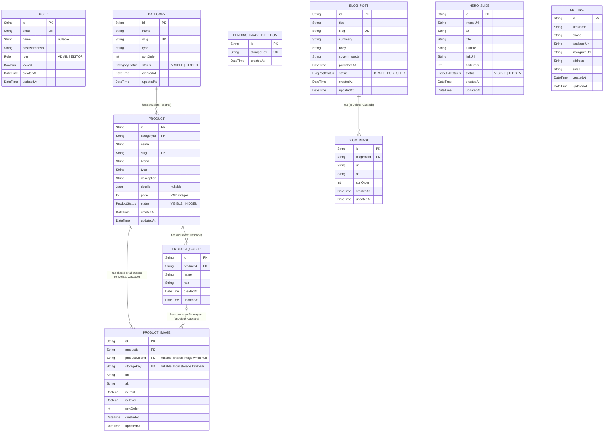

# G2.1 — ERD (Mermaid)

Logical/entity relationship diagram for the ANT JEWELRY data model.

## Notes

- **Price:** `PRODUCT.price` is stored as an integer (`Int`) in VND.
- **Unique slugs:** `CATEGORY.slug`, `PRODUCT.slug`, and `BLOG_POST.slug` are unique.
- **Product images:** `PRODUCT_IMAGE` always belongs to a `PRODUCT` (`productId`) and may optionally belong to a `PRODUCT_COLOR` (`productColorId`).
  - `productColorId = null`: shared/common image for the product.
  - `productColorId != null`: image attached to a specific color.
  - `sortOrder` defines image order; `isFront` marks the front/primary image and `isHover` marks the image shown on card hover.
  - `storageKey` is nullable and unique; for uploaded images it stores the local storage key (served from `/uploads/<storageKey>`). Seed/demo images may use an external `url` without a storage key.
- **Pending image deletions:** `PENDING_IMAGE_DELETION` queues local image storage keys whose database rows were removed, so file cleanup can retry until the file is deleted. It has no relation to `PRODUCT_IMAGE`; `storageKey` matches the removed image key.
- **Delete behavior:**
  - Deleting a `PRODUCT` cascades to its `PRODUCT_COLOR` and `PRODUCT_IMAGE` records.
  - Deleting a `PRODUCT_COLOR` cascades to its color-specific `PRODUCT_IMAGE` records.
  - A `CATEGORY` cannot be deleted while related `PRODUCT` records exist (`onDelete: Restrict` on `PRODUCT.categoryId`).
- **Blog images:** `BLOG_POST` can have multiple images via `BLOG_IMAGE` records (ordered by `sortOrder`, deleted when the blog post is deleted). `coverImageUrl` remains on `BLOG_POST` for the cover/primary image reference.
- **Roles:** `USER.role` is `ADMIN` or `EDITOR`; `USER.locked` disables sign-in and invalidates an existing session on its next request.
- **Schema file:** Prisma schema is defined in `prisma/schema.prisma`. Production PostgreSQL mirrors it in `prisma/postgresql/schema.prisma`.
