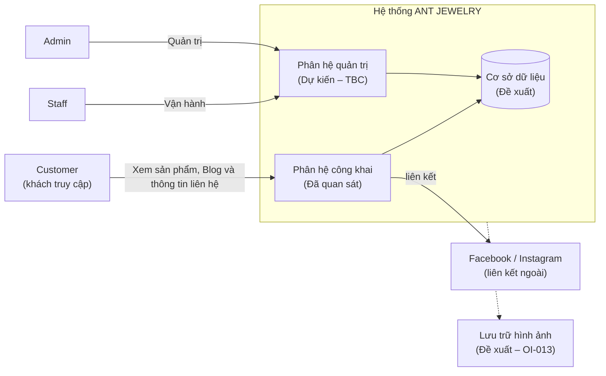
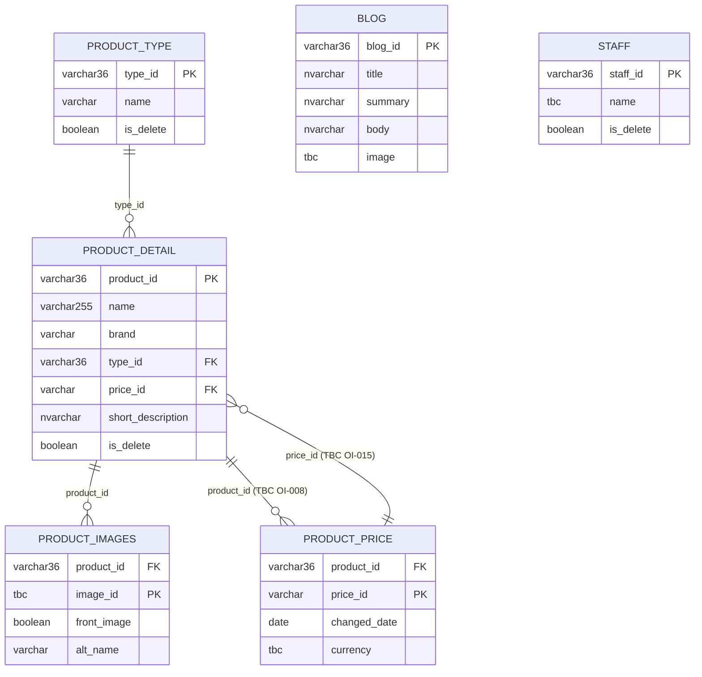

# ĐẶC TẢ YÊU CẦU HỆ THỐNG (REQUIREMENTS) – ANT JEWELRY
 
| Thuộc tính | Giá trị |
|---|---|
| Dự án | ANT JEWELRY – website giới thiệu sản phẩm trang sức |
| Tài liệu | `REQUIREMENTS.md` – Đặc tả yêu cầu phần mềm (Software Requirements Specification) |
| Phiên bản | 1.0 – Dự thảo phục vụ rà soát và xác nhận nghiệp vụ |
| Ngày lập | 05/11/2026 |
| Vai trò biên soạn | Senior Business Analyst |
| Nguồn chính | `ANT_JEWELRY_SAD_v1.1.docx` (System Analysis and Design v1.1); đối chiếu website công khai `antjewelry.vn` ngày 05/11/2026 |
| Ngôn ngữ | Tiếng Việt |
 
> **Cảnh báo về cơ sở bằng chứng (đọc trước khi sử dụng tài liệu)**
>
> Tại thời điểm lập tài liệu, **môi trường làm việc không chứa mã nguồn, cơ sở dữ liệu, API đang chạy hoặc thành phần giao diện (UI) nào** của dự án. Vì vậy tài liệu **không** dựa trên việc đọc mã nguồn. Cơ sở phân tích gồm hai nguồn:
>
> 1. **SAD v1.1** (văn bản và 9 sơ đồ): khảo sát, phân tích nghiệp vụ, yêu cầu, use case, mô hình dữ liệu logic và đặc tả API ở mức đề xuất.
> 2. **Đối chiếu 5 trang công khai** của website vào ngày 05/11/2026 (trang chủ, danh sách sản phẩm, một trang chi tiết sản phẩm, danh sách Blog, một bài Blog), bằng công cụ đọc nội dung trang. Cách này **chưa** kiểm thử tương tác bằng trình duyệt, **chưa** kiểm tra được nội dung sinh bằng JavaScript, và **không** truy cập được khu vực quản trị.
>
> Hệ quả: nhãn **"Đã triển khai"** trong tài liệu chỉ có nghĩa là *"quan sát được trên website công khai"*. Mọi chức năng quản trị, API, cơ sở dữ liệu và công nghệ nêu trong tài liệu là **định hướng hoặc đề xuất của SAD**, chưa được xác minh là đã triển khai. Quan hệ giữa hệ thống theo SAD và website đang chạy cần được xác nhận (OI-030).
 
## Mục lục
 
1. Giới thiệu
2. Tổng quan hệ thống
3. Các bên liên quan và vai trò người dùng
4. Yêu cầu chức năng
5. Yêu cầu phi chức năng
6. Quy tắc nghiệp vụ
7. Đặc tả Use Case
8. Yêu cầu dữ liệu
9. Yêu cầu giao diện ngoài
10. Ràng buộc và giả định
11. Tiêu chí nghiệm thu
12. Ma trận truy vết yêu cầu
- Phụ lục A – Danh sách vấn đề cần xác nhận (Open Issues)
- Phụ lục B – Chênh lệch giữa SAD và website quan sát được
- Phụ lục C – Tổng hợp số liệu tài liệu
---
 
## 1. Giới thiệu
 
### 1.1. Mục đích của hệ thống
 
ANT JEWELRY là website giới thiệu các sản phẩm trang sức. Hệ thống cho phép khách hàng tham khảo thông tin sản phẩm theo danh mục, đọc các bài viết Blog, xem số điện thoại và các liên kết Facebook, Instagram để liên hệ trực tiếp với ANT JEWELRY. Phía nội bộ, hệ thống định hướng hỗ trợ quản trị viên (Admin) và nhân viên (Staff) quản lý nội dung sản phẩm và bài viết.
 
Theo phạm vi do chủ dự án làm rõ (SAD mục 1.1, 2.2.2), website **không** hỗ trợ giỏ hàng, đặt hàng trực tuyến, thanh toán, giao dịch trực tuyến hay đặt thiết kế/sản xuất theo yêu cầu riêng.
 
### 1.2. Mục tiêu dự án
 
| Mã | Mục tiêu | Chỉ báo đo lường (xem mục 11) | Trạng thái |
|---|---|---|---|
| OBJ-01 | Cho phép khách hàng xem danh sách, danh mục, chi tiết sản phẩm và sắp xếp theo giá hoặc tên | AC-004 đến AC-010 | Đã quan sát |
| OBJ-02 | Cung cấp nội dung Blog để khách hàng tìm hiểu thông tin liên quan đến trang sức | AC-011, AC-012 | Đã quan sát |
| OBJ-03 | Hỗ trợ Admin/Staff quản lý sản phẩm, danh mục, Blog và tài khoản nội bộ | AC-023 đến AC-036 | Đã xác định ở mức nhóm chức năng; thao tác chi tiết TBC |
| OBJ-04 | Làm cơ sở cho phát triển, kiểm thử và nghiệm thu hệ thống | Toàn bộ mục 11 và 12 | Đề xuất |
 
### 1.3. Phạm vi dự án
 
Phạm vi được phân loại theo mức độ xác nhận của SAD (mục 2.2.3), có bổ sung kết quả đối chiếu website.
 
| Phân loại | Nội dung |
|---|---|
| **Trong phạm vi – Đã quan sát trên website công khai** | Trang chủ; danh sách sản phẩm; xem sản phẩm theo danh mục; sắp xếp theo giá và tên; chi tiết sản phẩm (hình ảnh, thông tin, thông số); danh sách và chi tiết Blog; số điện thoại và liên kết Facebook, Instagram; điều hướng giữa các trang |
| **Trong phạm vi – Đã xác định (chủ dự án xác nhận ở mức nhóm chức năng)** | Quản trị sản phẩm và Blog; vai trò `ADMIN` và `EDITOR` (`EDITOR` ánh xạ actor Staff của SAD) |
| **Ngoài phạm vi** | Giỏ hàng; đặt hàng trực tuyến; thanh toán trực tuyến; giao dịch trực tuyến; sản phẩm thiết kế/sản xuất theo yêu cầu riêng |
| **Đề xuất mở rộng (không bắt buộc ở phiên bản hiện tại)** | Quản lý tồn kho; khuyến mãi; bảo hành; vận chuyển; chăm sóc khách hàng |
| **TBC** | Ma trận quyền chi tiết giữa `ADMIN` và `EDITOR`; các vấn đề còn lại tại Phụ lục A |

Nguyên tắc: không đưa giỏ hàng, đặt hàng, thanh toán, giao dịch trực tuyến hoặc thiết kế riêng trở lại phạm vi nếu chưa có thay đổi yêu cầu chính thức từ chủ dự án (SAD, Ghi chú cuối).

### 1.3.1. Quyết định đã chốt (2026-11-09)

Bảng dưới ghi các quyết định đã được chốt cho phiên bản triển khai. Các quyết định này thay thế nội dung TBC tương ứng trong tài liệu; các mục còn lại vẫn theo Phụ lục A.

| Hạng mục | Quyết định |
|---|---|
| Kiến trúc | Một Next.js App Router + TypeScript strict. Read bằng Server Components; mutation bằng Server Actions; Route Handlers chỉ dùng cho upload. Không NestJS, không tầng REST API riêng. |
| Dữ liệu | Prisma. SQLite cho development, PostgreSQL cho production. Validate bằng Zod. |
| Vai trò | `ADMIN` toàn quyền. `EDITOR` quản lý sản phẩm (trừ giá), danh mục, Blog và hero slide; không sửa giá, không vào Settings / Users. `EDITOR` ánh xạ actor Staff của SAD. |
| Khách liên hệ | Không có Inquiry hoặc form gửi yêu cầu. Nút "ORDER NOW" mở Contact popover gồm số điện thoại, Facebook và Instagram lấy từ Settings. |
| Giá | Số nguyên VND (`Int`), hiển thị dạng `10.000.000`, không ký hiệu tiền tệ. |
| Responsive | Figma chỉ có desktop 1920px; tự thiết kế mobile/tablet nhất quán với style và đính kèm ảnh chụp trong PR. |
| Ngoài phạm vi | Giỏ hàng, thanh toán, tài khoản khách hàng, wishlist, đa ngôn ngữ. |
| Nhãn giao diện | Figma ghi "Short by" ở màn Category; triển khai dùng "Sort by". |
| Phân loại sản phẩm | ProductType hợp nhất với Category: mỗi danh mục tương ứng một `ProductType`, và bộ lọc danh mục dùng chính `ProductType` đó. |

**Design tokens lấy từ Figma:**

| Token | Giá trị | Dùng ở |
|---|---|---|
| Nền trang | `#FEFDF8` | body, header, footer |
| Nền ảnh sản phẩm | `#EFEEEC` | khung ảnh vuông của card và gallery |
| Đường kẻ | `#93AAA0` | viền dưới header, viền trên footer, divider trang sản phẩm |
| Chữ chính | `#000000` | tên sản phẩm, giá, đoạn văn |
| Font heading / nav | Monospace, VIẾT HOA | tiêu đề section, menu, nút; đối chiếu tên font chính xác trong Figma |
| Font nội dung | Sans-serif | mô tả, Blog, footer |
 
### 1.4. Đối tượng sử dụng tài liệu
 
| Đối tượng | Mục đích sử dụng |
|---|---|
| Chủ dự án / đơn vị vận hành ANT JEWELRY | Rà soát, xác nhận nghiệp vụ, quyết định các mục TBC (Phụ lục A) |
| Business Analyst | Duy trì yêu cầu, quản lý thay đổi, truy vết |
| Nhà phát triển (Frontend, Backend) | Hiểu yêu cầu để thiết kế và lập trình; không dùng các mục TBC làm căn cứ triển khai cuối |
| Kiểm thử viên (QA/Tester) | Xây dựng kịch bản kiểm thử từ yêu cầu và tiêu chí nghiệm thu (mục 11) |
| Quản trị hệ thống / DevOps | Hiểu yêu cầu phi chức năng, bảo mật, sao lưu, tính sẵn sàng |
| Nhà thiết kế UI/UX | Hiểu luồng người dùng; UI Specification chưa được xây dựng |
 
### 1.5. Định nghĩa và từ viết tắt
 
| Thuật ngữ | Định nghĩa |
|---|---|
| ANT JEWELRY | Tên hệ thống/website giới thiệu sản phẩm trang sức. Tên miền `antjewelry.vn`; website hiển thị tên "AntJewelry". Tên chính thức cần xác nhận (OI-014) |
| SAD | System Analysis and Design – tài liệu phân tích và thiết kế hệ thống (phiên bản 1.1) |
| SRS | Software Requirements Specification – đặc tả yêu cầu phần mềm |
| BA | Business Analyst |
| Customer | Khách hàng/khách truy cập website |
| Admin | Quản trị viên hệ thống; trong triển khai dùng role `ADMIN` |
| Staff | Nhân viên vận hành; trong triển khai dùng role `EDITOR` |
| EDITOR | Role nội bộ quản lý nội dung (sản phẩm trừ giá, danh mục, Blog, hero slide); ánh xạ actor Staff của SAD |
| Product (Sản phẩm) | Sản phẩm trang sức |
| Product Type (Loại sản phẩm) | Loại trang sức, ví dụ Ring (nhẫn), Necklace (dây chuyền) |
| Category (Danh mục) | Danh mục kinh doanh, ví dụ Wedding Bands, Engagement, Everyday, Ready to ship |
| Blog | Bài viết giới thiệu, chia sẻ thông tin |
| Soft delete (Xóa mềm) | Đánh dấu bản ghi đã xóa bằng cờ `is_delete` thay vì xóa vật lý |
| Slug | Chuỗi định danh thân thiện trong URL, ví dụ `/blog/o-nhan-bezel-...` |
| FR | Functional Requirement – yêu cầu chức năng |
| NFR | Non-Functional Requirement – yêu cầu phi chức năng |
| BR | Business Rule – quy tắc nghiệp vụ |
| UC | Use Case |
| AC | Acceptance Criteria – tiêu chí nghiệm thu |
| OI | Open Issue – vấn đề cần xác nhận (Phụ lục A) |
| MOD | Module – phân hệ chức năng |
| API | Application Programming Interface – giao diện lập trình ứng dụng |
| UUID | Universally Unique Identifier – định danh duy nhất của bản ghi |
| PK / FK | Primary Key / Foreign Key – khóa chính / khóa ngoại |
| CRUD | Create, Read, Update, Delete – thêm, xem, sửa, xóa |
| PII | Personally Identifiable Information – dữ liệu cá nhân |
| LCP | Largest Contentful Paint – chỉ số thời gian hiển thị nội dung chính (Core Web Vitals) |
| RPO / RTO | Recovery Point Objective / Recovery Time Objective – mục tiêu điểm/thời gian phục hồi dữ liệu |
| TBC | To Be Confirmed – cần xác nhận |
 
### 1.6. Phương pháp và quy ước trình bày
 
**Nguồn bằng chứng**
 
| Mã | Nguồn | Độ tin cậy |
|---|---|---|
| E1 | SAD v1.1 do nhóm phân tích lập, có tính chất dự thảo | Cao đối với phạm vi và nghiệp vụ đã xác nhận; thấp đối với nội dung đánh dấu đề xuất/cần xác nhận |
| E2 | Nội dung 5 trang công khai của `antjewelry.vn` đọc ngày 05/11/2026 | Trung bình: đọc bằng công cụ trích xuất nội dung, chưa kiểm thử tương tác |
| E3 | Suy luận của BA dựa trên E1 và E2 | Thấp: luôn được gắn nhãn "Đề xuất" hoặc TBC |
 
**Trạng thái yêu cầu**
 
| Trạng thái | Ý nghĩa |
|---|---|
| Đã quan sát | Chức năng hiển thị trên website công khai (E1 và E2) |
| Đã xác định | Chủ dự án làm rõ ở mức nghiệp vụ; chưa có bằng chứng triển khai |
| TBC | Cần xác nhận với đơn vị vận hành trước khi triển khai (kèm mã OI) |
| Đề xuất | Giải pháp tham khảo của SAD hoặc BA, chưa được phê duyệt |
 
**Hiện trạng triển khai**
 
| Giá trị | Ý nghĩa |
|---|---|
| Đã triển khai (quan sát công khai) | Thấy trên website công khai ngày 05/11/2026 |
| Chưa xác minh | Không có bằng chứng quan sát được (gồm toàn bộ khu vực quản trị) |
 
**Quy ước khác**
 
- Mã yêu cầu chức năng `FR-001…` và phi chức năng `NFR-001…` được đánh số tuần tự trong tài liệu này. Cột "Mã SAD" cho biết mã tương ứng trong SAD (ví dụ `FR-CUS-002`). Mã `UC-xx`, `BR-xxx`, `OI-xxx` giữ nguyên theo SAD; các mã bổ sung được đánh dấu "bổ sung".
- **Ưu tiên (High/Medium/Low) do BA đề xuất**, vì SAD không gán mức ưu tiên; cần chủ dự án xác nhận. Căn cứ: mức độ phục vụ trực tiếp mục tiêu OBJ-01 đến OBJ-03 và mức độ phụ thuộc của các chức năng khác.
- Giá trị mục tiêu định lượng trong yêu cầu phi chức năng là **đề xuất của BA** vì SAD chưa có chỉ tiêu (SAD mục 2.6); đều gắn TBC.
---
 
## 2. Tổng quan hệ thống
 
### 2.1. Bối cảnh kinh doanh
 
ANT JEWELRY là thương hiệu trang sức có cửa hàng tại Hà Nội (theo thông tin công khai trên website). Sản phẩm quan sát được gồm nhẫn (Wedding Bands, Engagement, Everyday, Ready to ship) và dây chuyền. Khách hàng tìm hiểu sản phẩm trực tuyến và liên hệ trực tiếp với ANT JEWELRY qua số điện thoại hoặc liên kết Facebook, Instagram được công bố; không có giao dịch trực tuyến.
 
Quy mô dữ liệu và lưu lượng truy cập chưa có số liệu khảo sát (SAD mục 2.6). Trên trang chủ quan sát được khoảng 41 sản phẩm được trưng bày (6 Wedding Bands, 15 Engagement, 20 Everyday); đây chỉ là con số quan sát một thời điểm, không phải tổng số sản phẩm của hệ thống.
 
### 2.2. Mô tả hệ thống
 
Hệ thống gồm hai phân hệ:
 
- **Phân hệ công khai (Customer):** Trang chủ, danh sách và chi tiết sản phẩm, Blog, số điện thoại và liên kết Facebook, Instagram để liên hệ trực tiếp. Không yêu cầu đăng nhập.
- **Phân hệ quản trị (Admin, Staff) – dự kiến:** Đăng nhập, quản lý sản phẩm, danh mục, hình ảnh, giá, Blog, quản lý tài khoản và phân quyền. Phân hệ này chưa được xác minh trên thực tế và các thao tác chi tiết ở trạng thái TBC.

 
*Hình 2.1 – Bối cảnh hệ thống (nét đứt: đề xuất hoặc TBC).*
 
### 2.3. Ranh giới hệ thống
 
| Thuộc hệ thống | Nằm ngoài hệ thống |
|---|---|
| Hiển thị trang chủ, sản phẩm, Blog, thông tin liên hệ | Giỏ hàng, đặt hàng, thanh toán, giao dịch trực tuyến |
| Quản trị nội dung sản phẩm, Blog, tài khoản nội bộ (dự kiến) | Thiết kế/sản xuất trang sức theo yêu cầu riêng |
| Lưu trữ dữ liệu sản phẩm và Blog | Hạ tầng mạng xã hội Facebook, Instagram (chỉ liên kết đến) |
| | Quản lý tồn kho, khuyến mãi, bảo hành, vận chuyển, chăm sóc khách hàng (đề xuất mở rộng) |
 
### 2.4. Các module và tính năng chính
 
| Mã module | Tên module | Tính năng chính | Yêu cầu chức năng | Hiện trạng triển khai |
|---|---|---|---|---|
| MOD-01 | Trang công khai | Trang chủ; điều hướng; số điện thoại và liên kết Facebook, Instagram | FR-001 đến FR-003 | Đã triển khai (quan sát công khai) |
| MOD-02 | Danh mục và chi tiết sản phẩm | Danh sách; lọc theo danh mục; sắp xếp theo giá/tên; chi tiết, hình ảnh, thông số | FR-004 đến FR-009 | Đã triển khai (quan sát công khai) |
| MOD-03 | Blog công khai | Danh sách và chi tiết bài viết | FR-010, FR-011 | Đã triển khai (quan sát công khai) |
| MOD-06 | Quản trị sản phẩm | CRUD sản phẩm; danh mục; hình ảnh; giá; trạng thái hiển thị | FR-020 đến FR-027 | Chưa xác minh |
| MOD-07 | Quản trị Blog | CRUD bài viết; hình ảnh; trạng thái | FR-028 đến FR-032 | Chưa xác minh |
| MOD-08 | Người dùng và phân quyền | Đăng nhập/đăng xuất; quản lý tài khoản; phân quyền | FR-033 đến FR-036 | Chưa xác minh |

### 2.5. Chức năng quan sát trên website nhưng chưa có trong SAD
 
Qua đối chiếu ngày 05/11/2026, các nội dung sau xuất hiện trên website nhưng **không** có yêu cầu tương ứng trong SAD. Tài liệu **không** biến chúng thành yêu cầu chính thức; chúng được ghi nhận để xác nhận phạm vi.
 
| STT | Quan sát trên website | Vấn đề | Mã OI |
|---|---|---|---|
| 1 | Trang chi tiết sản phẩm có nút **"ORDER NOW"** | Đã chốt: mở Contact popover (số điện thoại, Facebook, Instagram từ Settings), không tạo đơn trực tuyến, phù hợp BR-003 | OI-031 |
| 2 | Trang chi tiết sản phẩm có khối **"quyền lợi khi mua"** (chứng nhận, bảo hành, thu mua lại, thời gian chế tác) và khối **"YOU MIGHT ALSO LIKE"** (sản phẩm liên quan) | Không có trường dữ liệu tương ứng trong cấu trúc SAD; chưa rõ có thuộc phạm vi không, quy tắc chọn sản phẩm liên quan | OI-032, OI-010 |
| 3 | Chân trang có các trang **Điều khoản và điều kiện, Chính sách bảo mật, Vận chuyển và Đổi trả, Chăm sóc trang sức** | Chưa rõ có thuộc phạm vi, ai quản trị nội dung; nội dung "Vận chuyển và Đổi trả" cần đối chiếu BR-003, BR-004 | OI-028 |
| 4 | Giao diện dùng nhãn tiếng Anh (HOME, PRODUCTS, EXPLORE NOW…) trong khi bài Blog bằng tiếng Việt | Chưa rõ ngôn ngữ giao diện/nội dung (đơn ngữ hay đa ngữ) | OI-029 |
| 5 | Chi tiết bài Blog có khối **"OTHER BLOGS"** (bài viết khác) và hiển thị ngày đăng | Cấu trúc dữ liệu Blog của SAD chưa có ngày đăng | OI-024 |
 
---
 
## 3. Các bên liên quan và vai trò người dùng
 
### 3.1. Các bên liên quan (Stakeholders)
 
| Bên liên quan | Vai trò | Mối quan tâm chính |
|---|---|---|
| Chủ dự án / đơn vị vận hành ANT JEWELRY | Người quyết định phạm vi, phê duyệt yêu cầu và đóng các OI | Phạm vi và quyền hạn Admin/Staff |
| Customer | Người dùng cuối của phân hệ công khai | Tìm hiểu sản phẩm và liên hệ trực tiếp với cửa hàng |
| Admin | Người dùng nội bộ quản lý hệ thống | Kiểm soát nội dung, tài khoản, quyền |
| Staff | Người dùng nội bộ vận hành | Cập nhật nội dung theo quyền được cấp |
| Nhóm BA, phát triển, kiểm thử | Xây dựng và nghiệm thu hệ thống | Yêu cầu rõ ràng, kiểm thử được, không mâu thuẫn |
| Dịch vụ lưu trữ hình ảnh | Thành phần bên ngoài, mới ở mức đề xuất (SAD mục 4.1) | Không được mô hình hóa như Actor |
 
### 3.2. Các tác nhân (Actors) và trách nhiệm
 
SAD xác định **3 actor**: Customer, Admin, Staff. **SAD không có vai trò Manager**; tài liệu này không tự thêm vai trò đó. Vai trò "Employee" tương ứng với **Staff**. Trong triển khai, hai role nội bộ dùng tên `ADMIN` và `EDITOR`; `EDITOR` ánh xạ actor Staff và chỉ quản lý nội dung, không sửa giá, không vào Settings / Users. Nếu đơn vị vận hành cần cấp quản lý trung gian, cần bổ sung qua OI-004.
 
| Actor | Mô tả | Trách nhiệm | Phạm vi quyền (theo SAD) | Trạng thái |
|---|---|---|---|---|
| **Customer** | Người truy cập website để xem thông tin sản phẩm và liên hệ trực tiếp | Xem sản phẩm, danh mục, Blog, số điện thoại và liên kết Facebook, Instagram | Truy cập công khai, không cần tài khoản. Không tạo đơn hàng, không thanh toán | Đã xác định |
| **Admin** | Quản trị viên, quản lý và kiểm soát hoạt động hệ thống | Quản lý sản phẩm, danh mục, Blog và người dùng | Quyền chi tiết (nhân viên, phân quyền, cấu hình hệ thống) chưa xác nhận | Vai trò đã xác định; quyền chi tiết TBC (OI-004) |
| **Staff** | Nhân viên tham gia vận hành và hỗ trợ website | Hỗ trợ vận hành website; kiểm tra thông tin sản phẩm; cập nhật sản phẩm hoặc bài viết theo quyền được cấp | "Theo quyền được cấp"; không mặc định có cùng quyền với Admin | Vai trò đã xác định; quyền chi tiết TBC (OI-004) |
 
### 3.3. Ma trận quyền (đề xuất, TBC)
 
SAD chưa có ma trận quyền (OI-004). Bảng dưới chỉ tổng hợp những gì SAD nêu; ô **"TBC"** nghĩa là SAD chưa đủ căn cứ để quyết định. Không mặc định Admin và Staff có cùng quyền.
 
| Chức năng | Customer | Admin | Staff | Mã yêu cầu |
|---|---|---|---|---|
| Xem nội dung công khai (trang chủ, sản phẩm, Blog, liên hệ) | Có | Có | Có | FR-001 đến FR-011 |
| Đăng nhập/đăng xuất khu vực quản trị | Không | Có (TBC) | Có (TBC) | FR-033, FR-034 |
| Quản lý sản phẩm | Không | Có (TBC) | Theo quyền (TBC) | FR-020 đến FR-024 |
| Quản lý hình ảnh, giá sản phẩm | Không | TBC | TBC | FR-025, FR-026 |
| Quản lý danh mục | Không | Có (TBC) | TBC | FR-027 |
| Quản lý Blog | Không | Có (TBC) | Theo quyền (TBC) | FR-028 đến FR-032 |
| Quản lý tài khoản nội bộ, phân quyền | Không | Có (TBC) | Không (TBC) | FR-035, FR-036 |

---
## 4. Yêu cầu chức năng
 
Tài liệu có **28 yêu cầu chức năng** chia thành 6 module. Mã FR bị loại khỏi phạm vi cập nhật được giữ nguyên vị trí không sử dụng để duy trì khả năng truy vết với tài liệu nguồn. Mỗi yêu cầu gồm: mô tả, actor, tiền điều kiện, luồng chính, luồng thay thế, hậu điều kiện, mức ưu tiên (do BA đề xuất), trạng thái và hiện trạng triển khai.
 
**Cách đọc:**
 
- Luồng chính và luồng thay thế của phân hệ công khai dựa trên quan sát website và đặc tả UC của SAD. Với phân hệ quản trị, luồng được suy ra từ UC của SAD và **chưa được xác minh trên hệ thống thực**.
- Chi tiết chưa có căn cứ được ghi "**TBC**" kèm mã OI (Phụ lục A); không được hiểu là yêu cầu đã chốt.
- SAD có 44 mã yêu cầu chức năng. Sáu cặp yêu cầu trùng hoặc chồng lấn được hợp nhất; thêm yêu cầu điều hướng FR-002. Tổng số yêu cầu chức năng còn 28; mã các yêu cầu còn lại được giữ nguyên để duy trì truy vết.
### 4.1. MOD-01 – Trang công khai
 
#### FR-001 – Xem trang chủ
 
| Thuộc tính | Nội dung |
|---|---|
| Mô tả | Hệ thống hiển thị trang chủ giới thiệu ANT JEWELRY, gồm banner, các khối sản phẩm theo danh mục, khối Blog nổi bật, khối thông tin liên hệ và chân trang. |
| Actor | Customer |
| Tiền điều kiện | Không có (truy cập công khai); website đang hoạt động. |
| Luồng chính | 1. Customer truy cập địa chỉ gốc của website. 2. Hệ thống hiển thị trang chủ gồm: menu điều hướng; banner dạng trượt; các khối sản phẩm theo danh mục (quan sát: Wedding Bands, Engagement, Everyday, mỗi sản phẩm hiển thị tên và giá); khối Blog nổi bật (quan sát: 2 bài); khối liên hệ; chân trang. 3. Customer chọn một liên kết để chuyển đến trang đích. |
| Luồng thay thế | 2a. Một khối nội dung không tải được: hệ thống vẫn hiển thị các khối còn lại, không làm lỗi toàn trang (đề xuất). |
| Hậu điều kiện | Trang chủ được hiển thị. Dữ liệu hệ thống không thay đổi. |
| Ưu tiên | High |
| Trạng thái | Đã quan sát |
| Hiện trạng triển khai | Đã triển khai (quan sát công khai) |
| Liên quan | SAD: FR-CUS-001; UC-01; BR-001; OI-026 (nguồn nội dung tĩnh hay quản trị được), số slide và số sản phẩm nổi bật: TBC |
 
#### FR-002 – Điều hướng website
 
| Thuộc tính | Nội dung |
|---|---|
| Mô tả | Hệ thống cung cấp menu chính và chân trang trên các trang công khai để Customer chuyển giữa Trang chủ, Sản phẩm (kèm danh mục con), Blog và Liên hệ. |
| Actor | Customer |
| Tiền điều kiện | Không có. |
| Luồng chính | 1. Customer chọn một mục trên menu hoặc chân trang. 2. Hệ thống chuyển đến trang tương ứng. 3. Mục Sản phẩm hiển thị các danh mục (quan sát: Necklace, Ring; trong đó Wedding Bands, Engagement, Everyday, Ready to ship). |
| Luồng thay thế | 2a. Đường dẫn không tồn tại: hệ thống hiển thị trang báo lỗi không tìm thấy (đề xuất; nội dung TBC). |
| Hậu điều kiện | Customer đến đúng trang đã chọn. |
| Ưu tiên | High |
| Trạng thái | Đã quan sát |
| Hiện trạng triển khai | Đã triển khai (quan sát công khai) |
| Liên quan | SAD: mục 1.2, 1.3 (nhóm Navigation, chưa có mã FR); UC-01 đến UC-08; NFR-014, NFR-015; OI-011 (URL), OI-028 (trang tĩnh ở chân trang) |
 
#### FR-003 – Xem thông tin liên hệ và mạng xã hội
 
| Thuộc tính | Nội dung |
|---|---|
| Mô tả | Hệ thống hiển thị số điện thoại và các liên kết Facebook, Instagram để Customer liên hệ trực tiếp với ANT JEWELRY. [CONFIRMATION REQUIRED] BA xác nhận số điện thoại và URL Facebook/Instagram chính thức cần công bố. |
| Actor | Customer |
| Tiền điều kiện | Không có. |
| Luồng chính | 1. Customer truy cập khối "Liên hệ" trên trang. 2. Hệ thống hiển thị số điện thoại và các liên kết Facebook, Instagram đã được xác nhận. 3. Customer chọn liên kết Facebook hoặc Instagram để liên hệ trực tiếp với ANT JEWELRY. |
| Luồng thay thế | Không có luồng riêng được SAD ghi nhận. |
| Hậu điều kiện | Số điện thoại và các liên kết Facebook, Instagram được hiển thị. Dữ liệu hệ thống không thay đổi. |
| Ưu tiên | High |
| Trạng thái | Đã quan sát |
| Hiện trạng triển khai | Đã triển khai (quan sát công khai: khối "Contact us" xuất hiện ở trang chủ, chi tiết sản phẩm, chi tiết Blog) |
| Liên quan | SAD: FR-CUS-012; UC-08; OI-026 (nội dung tĩnh hay lấy từ dữ liệu) |
 
### 4.2. MOD-02 – Danh mục và chi tiết sản phẩm
 
#### FR-004 – Xem danh sách sản phẩm
 
| Thuộc tính | Nội dung |
|---|---|
| Mô tả | Hệ thống hiển thị danh sách sản phẩm trang sức đang được công khai. Mỗi sản phẩm hiển thị ảnh đại diện, tên (có liên kết đến chi tiết) và giá. |
| Actor | Customer |
| Tiền điều kiện | Không có. |
| Luồng chính | 1. Customer mở trang danh sách sản phẩm (đường dẫn quan sát: `/public/c`). 2. Hệ thống hiển thị danh sách các sản phẩm chưa bị xóa mềm. 3. Customer chọn "SEE MORE" để xem thêm sản phẩm (quan sát; cơ chế phân trang TBC). 4. Customer chọn một sản phẩm để chuyển sang FR-007. |
| Luồng thay thế | 2a. Không có sản phẩm nào để hiển thị: hệ thống hiển thị thông báo danh sách trống (cách hiển thị TBC trong UI Specification). |
| Hậu điều kiện | Danh sách sản phẩm được hiển thị. Dữ liệu hệ thống không thay đổi. |
| Ưu tiên | High |
| Trạng thái | Đã quan sát |
| Hiện trạng triển khai | Đã triển khai (quan sát công khai) |
| Liên quan | SAD: FR-CUS-002; UC-02; API-P01, API-P03; BR-001, BR-010, BR-020; OI-016 (định dạng giá: quan sát thấy dạng `3,680,000` không kèm đơn vị tiền), OI-023 (phân trang) |
 
#### FR-005 – Xem sản phẩm theo danh mục
 
| Thuộc tính | Nội dung |
|---|---|
| Mô tả | Customer chọn một danh mục để xem các sản phẩm thuộc danh mục đó. |
| Actor | Customer |
| Tiền điều kiện | Không có; danh mục được chọn tồn tại. |
| Luồng chính | 1. Customer chọn một danh mục từ menu Sản phẩm hoặc từ khối "VIEW PRODUCTS" trên trang chủ. 2. Hệ thống hiển thị các sản phẩm thuộc danh mục đó (route theo sitemap: `/c/[slug]`, ví dụ `/c/wedding-bands`; đường dẫn quan sát cũ: `/public/c/{tên-danh-mục}`). |
| Luồng thay thế | 2a. Danh mục không có sản phẩm: hiển thị trạng thái danh sách trống (TBC). 2b. Danh mục không tồn tại: hiển thị trang báo lỗi không tìm thấy (đề xuất). |
| Hậu điều kiện | Danh sách hiển thị đúng danh mục đã chọn. Dữ liệu hệ thống không thay đổi. |
| Ưu tiên | High |
| Trạng thái | Đã quan sát |
| Hiện trạng triển khai | Đã triển khai (quan sát công khai) |
| Liên quan | SAD: FR-CUS-003; UC-03; API-P01, API-P04; BR-006; OI-009 (danh mục dựa trên Category hay Product Type: quan sát thấy "Necklace", "Ring" và "Wedding Bands"… cùng dùng tiền tố `/public/c/`), OI-025 (slug hay id) |
 
#### FR-006 – Sắp xếp sản phẩm theo giá hoặc tên
 
| Thuộc tính | Nội dung |
|---|---|
| Mô tả | Customer sắp xếp danh sách sản phẩm theo giá tăng dần, giá giảm dần, tên A–Z hoặc tên Z–A. |
| Actor | Customer |
| Tiền điều kiện | Đang xem danh sách sản phẩm (FR-004) hoặc danh sách theo danh mục (FR-005). |
| Luồng chính | 1. Customer chọn một trong bốn tùy chọn sắp xếp (quan sát: "Price, Low to High", "Price, High to Low", "Name: A-Z", "Name: Z-A"). 2. Hệ thống hiển thị lại danh sách theo thứ tự đã chọn, giữ nguyên danh mục đang xem. |
| Luồng thay thế | 1a. Customer không chọn tùy chọn nào: hệ thống dùng thứ tự mặc định (TBC, OI-023). |
| Hậu điều kiện | Danh sách hiển thị theo thứ tự đã chọn. Dữ liệu hệ thống không thay đổi. |
| Ưu tiên | Medium |
| Trạng thái | Đã quan sát |
| Hiện trạng triển khai | Đã triển khai (quan sát công khai) |
| Liên quan | SAD: FR-CUS-004, FR-CUS-005; UC-04; API-P01 (tham số `sort`: `price_asc`, `price_desc`, `name_asc`, `name_desc` – đề xuất); BR-012, BR-013; OI-008, OI-016 (xác định "giá" dùng để sắp xếp), OI-023 |
 
#### FR-007 – Xem chi tiết sản phẩm
 
| Thuộc tính | Nội dung |
|---|---|
| Mô tả | Customer xem trang chi tiết của một sản phẩm, gồm tên, nhãn hiệu, loại sản phẩm, giới thiệu ngắn và giá. |
| Actor | Customer |
| Tiền điều kiện | Sản phẩm tồn tại và đang được hiển thị công khai. |
| Luồng chính | 1. Customer chọn sản phẩm từ danh sách hoặc truy cập đường dẫn chi tiết (route theo sitemap: `/p/[slug]`; đường dẫn quan sát cũ: `/public/{tên-sản-phẩm}`). 2. Hệ thống hiển thị tên, nhãn hiệu, loại, giới thiệu ngắn và giá. 3. Hệ thống hiển thị hình ảnh (FR-008) và mô tả, thông số (FR-009). |
| Luồng thay thế | 1a. Sản phẩm không tồn tại hoặc đã xóa mềm: hệ thống không hiển thị chi tiết (trả về không tìm thấy); nội dung thông báo TBC. |
| Hậu điều kiện | Thông tin sản phẩm được hiển thị. Dữ liệu hệ thống không thay đổi. |
| Ưu tiên | High |
| Trạng thái | Đã quan sát |
| Hiện trạng triển khai | Đã triển khai (quan sát công khai) |
| Liên quan | SAD: FR-CUS-006; UC-05; API-P02; BR-006, BR-010, BR-020; OI-011, OI-025 (URL dùng tên/slug nhưng dữ liệu chưa có trường slug); **OI-031** ("ORDER NOW" mở Contact popover; đã chốt); **OI-032** (khối "YOU MIGHT ALSO LIKE" quan sát thấy nhưng chưa có yêu cầu) |
 
#### FR-008 – Xem hình ảnh sản phẩm
 
| Thuộc tính | Nội dung |
|---|---|
| Mô tả | Hệ thống hiển thị ảnh đại diện và các ảnh liên quan của sản phẩm; mỗi ảnh có văn bản thay thế (alt text). |
| Actor | Customer |
| Tiền điều kiện | Customer đang xem danh sách hoặc chi tiết sản phẩm. |
| Luồng chính | 1. Trong danh sách: hệ thống hiển thị ảnh đại diện của sản phẩm (quan sát: mỗi sản phẩm có 2 ảnh). 2. Trong chi tiết: hệ thống hiển thị ảnh đại diện và các ảnh còn lại dưới dạng thư viện có nút chuyển ảnh trước/sau (quan sát: sản phẩm mẫu có 9 ảnh). |
| Luồng thay thế | 1a. Sản phẩm không có ảnh: cách hiển thị TBC (OI-018). |
| Hậu điều kiện | Hình ảnh được hiển thị. Dữ liệu hệ thống không thay đổi. |
| Ưu tiên | High |
| Trạng thái | Đã quan sát |
| Hiện trạng triển khai | Đã triển khai (quan sát công khai) |
| Liên quan | SAD: FR-CUS-007; UC-05; API-P01 (thumbnail), API-P02 (images); BR-011; NFR-005, NFR-018; OI-018 (chưa có trường lưu đường dẫn ảnh và thứ tự hiển thị) |
 
#### FR-009 – Xem mô tả và thông số sản phẩm
 
| Thuộc tính | Nội dung |
|---|---|
| Mô tả | Hệ thống hiển thị mô tả và thông số được cung cấp cho sản phẩm. Quan sát trên trang chi tiết mẫu: bản nhẫn, kích thước đá, loại đá, chất liệu. |
| Actor | Customer |
| Tiền điều kiện | Sản phẩm tồn tại và đang được hiển thị công khai. |
| Luồng chính | 1. Customer mở trang chi tiết sản phẩm. 2. Hệ thống hiển thị phần mô tả và phần thông số của sản phẩm (những thông tin có dữ liệu). |
| Luồng thay thế | 2a. Sản phẩm không có thông số: hệ thống không hiển thị phần thông số (đề xuất). |
| Hậu điều kiện | Mô tả và thông số được hiển thị. Dữ liệu hệ thống không thay đổi. |
| Ưu tiên | Medium |
| Trạng thái | Đã quan sát (chức năng hiển thị); cấu trúc dữ liệu: TBC |
| Hiện trạng triển khai | Đã triển khai (quan sát công khai) |
| Liên quan | SAD: FR-CUS-008; UC-05; API-P02 (trường `description`, `specifications` chưa có trường dữ liệu tương ứng); OI-010 (thông số bản nhẫn/đá áp dụng cho nhóm sản phẩm nào), OI-032 (khối "quyền lợi khi mua") |
 
### 4.3. MOD-03 – Blog công khai
 
#### FR-010 – Xem danh sách Blog
 
| Thuộc tính | Nội dung |
|---|---|
| Mô tả | Hệ thống hiển thị danh sách các bài viết Blog đang được công khai. Mỗi bài hiển thị ảnh bìa, tiêu đề và đoạn tóm tắt có liên kết "LEARN MORE". |
| Actor | Customer |
| Tiền điều kiện | Không có. |
| Luồng chính | 1. Customer mở trang Blog (đường dẫn quan sát: `/blog`). 2. Hệ thống hiển thị danh sách bài viết công khai (quan sát: 3 bài, chưa có phân trang, chưa hiển thị ngày đăng). 3. Customer chọn một bài để chuyển sang FR-011. |
| Luồng thay thế | 2a. Chưa có bài viết công khai: hiển thị thông báo danh sách trống (TBC). |
| Hậu điều kiện | Danh sách bài viết được hiển thị. Dữ liệu hệ thống không thay đổi. |
| Ưu tiên | Medium |
| Trạng thái | Đã quan sát |
| Hiện trạng triển khai | Đã triển khai (quan sát công khai) |
| Liên quan | SAD: FR-CUS-010; UC-06; API-P05; OI-023 (phân trang), OI-024 (ngày đăng, trạng thái) |
 
#### FR-011 – Xem chi tiết Blog
 
| Thuộc tính | Nội dung |
|---|---|
| Mô tả | Customer đọc nội dung chi tiết của một bài viết Blog được công khai. |
| Actor | Customer |
| Tiền điều kiện | Bài viết tồn tại và được công khai. |
| Luồng chính | 1. Customer chọn bài viết từ danh sách Blog hoặc truy cập đường dẫn bài viết (quan sát: `/blog/{slug}`). 2. Hệ thống hiển thị tiêu đề, nội dung, ảnh của bài viết (quan sát thêm: ngày đăng và khối "OTHER BLOGS"). |
| Luồng thay thế | 1a. Bài viết không tồn tại hoặc không được công khai: hệ thống không hiển thị; nội dung thông báo TBC. |
| Hậu điều kiện | Bài viết được hiển thị. Dữ liệu hệ thống không thay đổi. |
| Ưu tiên | Medium |
| Trạng thái | Đã quan sát |
| Hiện trạng triển khai | Đã triển khai (quan sát công khai) |
| Liên quan | SAD: FR-CUS-011, FR-BLOG-007; UC-07; API-P06; OI-006, OI-024 (tiêu chí "được công khai"; trường ngày đăng và trạng thái chưa có trong cấu trúc), OI-025 (slug) |
 
### 4.4. MOD-06 – Quản trị sản phẩm (khu vực quản trị)
 
> **Lưu ý chung cho MOD-06:** "quản trị sản phẩm và Blog" được chủ dự án xác định ở mức **nhóm chức năng**; thao tác cụ thể (thêm, sửa, xóa, ẩn, cập nhật giá) và quyền của từng vai trò vẫn TBC (OI-004, OI-005). Luồng bên dưới là luồng đề xuất theo UC-11 của SAD, chưa xác minh trên hệ thống thực. Luồng thay thế chung cho mọi yêu cầu của module: người dùng chưa đăng nhập bị từ chối (HTTP 401); người dùng không đủ quyền bị từ chối (HTTP 403).
 
#### FR-020 – Xem danh sách sản phẩm quản trị
 
| Thuộc tính | Nội dung |
|---|---|
| Mô tả | Admin/Staff được phân quyền xem danh sách sản phẩm trong khu vực quản trị. |
| Actor | Admin, Staff |
| Tiền điều kiện | Đã đăng nhập; có quyền quản lý sản phẩm. |
| Luồng chính | 1. Người dùng mở mục quản lý sản phẩm. 2. Hệ thống hiển thị danh sách sản phẩm. Việc danh sách quản trị có hiển thị cả sản phẩm đã ẩn/xóa mềm hay không: TBC (OI-005). |
| Luồng thay thế | Theo luồng thay thế chung của module. |
| Hậu điều kiện | Danh sách được hiển thị. Dữ liệu hệ thống không thay đổi. |
| Ưu tiên | High |
| Trạng thái | TBC |
| Hiện trạng triển khai | Chưa xác minh |
| Liên quan | SAD: FR-PRO-001; UC-11; API-A03; BR-007, BR-008; OI-004, OI-005 |
 
#### FR-021 – Xem chi tiết sản phẩm quản trị
 
| Thuộc tính | Nội dung |
|---|---|
| Mô tả | Người có quyền xem đầy đủ thông tin một sản phẩm trong khu vực quản trị (kể cả giá, hình ảnh, trạng thái). |
| Actor | Admin, Staff |
| Tiền điều kiện | Như FR-020; sản phẩm được chọn tồn tại. |
| Luồng chính | 1. Người dùng chọn một sản phẩm trong danh sách. 2. Hệ thống hiển thị đầy đủ thông tin sản phẩm. |
| Luồng thay thế | Theo luồng chung; sản phẩm không tồn tại: HTTP 404. |
| Hậu điều kiện | Chi tiết được hiển thị. Dữ liệu hệ thống không thay đổi. |
| Ưu tiên | Medium |
| Trạng thái | TBC |
| Hiện trạng triển khai | Chưa xác minh |
| Liên quan | SAD: FR-PRO-009; UC-11; API-A04; OI-004, OI-005 |
 
#### FR-022 – Thêm sản phẩm
 
| Thuộc tính | Nội dung |
|---|---|
| Mô tả | Người có quyền tạo thông tin sản phẩm mới. |
| Actor | Admin; Staff theo quyền được cấp |
| Tiền điều kiện | Đã đăng nhập; có quyền thêm sản phẩm; Product Type liên quan đã tồn tại. |
| Luồng chính | 1. Người dùng chọn thêm sản phẩm. 2. Người dùng nhập thông tin: tên (bắt buộc, tối đa 255 ký tự), nhãn hiệu, loại sản phẩm (bắt buộc), giới thiệu ngắn, giá (FR-026), hình ảnh (FR-025). 3. Hệ thống kiểm tra và lưu dữ liệu. 4. Hệ thống thông báo kết quả. |
| Luồng thay thế | 3a. Dữ liệu không hợp lệ hoặc thiếu trường bắt buộc: hệ thống không lưu, thông báo lỗi theo từng trường (HTTP 400). Luồng chung của module. |
| Hậu điều kiện | Sản phẩm mới tồn tại trong hệ thống. Có hiển thị công khai ngay hay không phụ thuộc trạng thái hiển thị (FR-024, OI-005). |
| Ưu tiên | High |
| Trạng thái | TBC |
| Hiện trạng triển khai | Chưa xác minh |
| Liên quan | SAD: FR-PRO-002; UC-11; API-A05; Dữ liệu: product_detail (A.1); BR-006, BR-007; OI-005, OI-009 (Type/Category), OI-015 (trường `price_id` bắt buộc trong `product_detail` tạo vòng tham chiếu với `product_price`: thứ tự tạo bản ghi chưa chốt) |
 
#### FR-023 – Cập nhật sản phẩm
 
| Thuộc tính | Nội dung |
|---|---|
| Mô tả | Người có quyền chỉnh sửa thông tin của sản phẩm đã có. |
| Actor | Admin; Staff theo quyền được cấp |
| Tiền điều kiện | Như FR-021. |
| Luồng chính | 1. Người dùng mở sản phẩm và chọn chỉnh sửa. 2. Người dùng thay đổi thông tin (tên, nhãn hiệu, loại, giới thiệu ngắn). 3. Hệ thống kiểm tra và lưu. 4. Hệ thống thông báo kết quả. |
| Luồng thay thế | 3a. Dữ liệu không hợp lệ: không lưu, thông báo lỗi (HTTP 400). Luồng chung của module. |
| Hậu điều kiện | Thông tin sản phẩm được cập nhật; trang công khai phản ánh thay đổi. |
| Ưu tiên | High |
| Trạng thái | TBC |
| Hiện trạng triển khai | Chưa xác minh |
| Liên quan | SAD: FR-PRO-003; UC-11; API-A06; Dữ liệu: product_detail; OI-005 |
 
#### FR-024 – Xóa, ẩn và điều chỉnh trạng thái hiển thị sản phẩm
 
| Thuộc tính | Nội dung |
|---|---|
| Mô tả | Người có quyền xóa hoặc ẩn sản phẩm khỏi website, và điều chỉnh trạng thái hiển thị. Hợp nhất FR-PRO-004 và FR-PRO-008 của SAD. |
| Actor | Admin; Staff theo quyền được cấp |
| Tiền điều kiện | Như FR-021. |
| Luồng chính | 1. Người dùng chọn xóa hoặc ẩn sản phẩm. 2. Hệ thống yêu cầu xác nhận thao tác. 3. Người dùng xác nhận. 4. Hệ thống đặt cờ xóa mềm (`is_delete`) hoặc trạng thái ẩn theo cơ chế được chốt (TBC, OI-005) và thông báo kết quả. |
| Luồng thay thế | 3a. Người dùng hủy: không thay đổi dữ liệu. Luồng chung của module. |
| Hậu điều kiện | Sản phẩm không còn hiển thị trên website công khai (BR-010). Dữ liệu không bị xóa vật lý nếu dùng xóa mềm. |
| Ưu tiên | High |
| Trạng thái | TBC (phần "xóa/ẩn"); Đề xuất (phần "trạng thái hiển thị") |
| Hiện trạng triển khai | Chưa xác minh |
| Liên quan | SAD: FR-PRO-004, FR-PRO-008; UC-11; API-A07, API-A08; BR-010; OI-005 (xóa mềm hay ẩn) |
 
#### FR-025 – Quản lý hình ảnh sản phẩm
 
| Thuộc tính | Nội dung |
|---|---|
| Mô tả | Người có quyền thêm, thay đổi, xóa và sắp xếp hình ảnh của sản phẩm; chọn ảnh đại diện; nhập văn bản thay thế (alt text). |
| Actor | Theo quyền (OI-004) |
| Tiền điều kiện | Như FR-021. |
| Luồng chính | 1. Người dùng mở phần hình ảnh của sản phẩm. 2. Người dùng thêm ảnh mới, thay ảnh, xóa ảnh, đặt ảnh đại diện hoặc đổi thứ tự. 3. Hệ thống kiểm tra và lưu thay đổi. 4. Hệ thống thông báo kết quả. |
| Luồng thay thế | 3a. Tệp ảnh không hợp lệ (định dạng hoặc dung lượng vượt giới hạn): hệ thống từ chối và thông báo; giới hạn cụ thể TBC (OI-018). Luồng chung của module. |
| Hậu điều kiện | Hình ảnh sản phẩm được cập nhật. |
| Ưu tiên | High |
| Trạng thái | TBC |
| Hiện trạng triển khai | Chưa xác minh |
| Liên quan | SAD: FR-PRO-006; UC-13; API-A09, API-A10, API-A11; Dữ liệu: product_images (A.3); BR-011; NFR-005, NFR-018; OI-013 (dịch vụ lưu ảnh), OI-018 |
 
#### FR-026 – Quản lý giá sản phẩm
 
| Thuộc tính | Nội dung |
|---|---|
| Mô tả | Người có quyền cập nhật giá hiển thị của sản phẩm. |
| Actor | Theo quyền (OI-004) |
| Tiền điều kiện | Như FR-021. |
| Luồng chính | 1. Người dùng mở phần giá của sản phẩm. 2. Người dùng nhập giá mới. 3. Hệ thống kiểm tra và lưu theo cách được chốt: tạo bản ghi giá mới hoặc cập nhật bản ghi hiện tại (TBC, OI-008). 4. Hệ thống thông báo kết quả. |
| Luồng thay thế | 3a. Giá không hợp lệ: không lưu, thông báo lỗi; quy tắc hợp lệ TBC (OI-016). Luồng chung của module. |
| Hậu điều kiện | Giá hiển thị của sản phẩm được cập nhật trên website công khai. |
| Ưu tiên | High |
| Trạng thái | TBC |
| Hiện trạng triển khai | Chưa xác minh |
| Liên quan | SAD: FR-PRO-007; UC-14; API-A12; Dữ liệu: product_price (A.2); BR-012; OI-008, OI-015, OI-016 |
 
#### FR-027 – Quản lý danh mục
 
| Thuộc tính | Nội dung |
|---|---|
| Mô tả | Người có quyền thêm, sửa hoặc xóa danh mục sản phẩm. |
| Actor | Admin (UC-12); Staff: TBC |
| Tiền điều kiện | Đã đăng nhập; có quyền quản lý danh mục. |
| Luồng chính | 1. Người dùng mở mục danh mục. 2. Người dùng thêm, sửa hoặc xóa danh mục. 3. Hệ thống kiểm tra, lưu và thông báo kết quả. |
| Luồng thay thế | 3a. Xóa danh mục đang có sản phẩm: hành vi TBC (OI-009). Luồng chung của module. |
| Hậu điều kiện | Danh mục được cập nhật; menu và bộ lọc công khai phản ánh thay đổi. |
| Ưu tiên | Medium |
| Trạng thái | TBC |
| Hiện trạng triển khai | Chưa xác minh |
| Liên quan | SAD: FR-PRO-005; UC-12; API-A13 đến API-A16; Dữ liệu: Category (chưa có cấu trúc); BR-006; OI-009 |
 
### 4.7. MOD-07 – Quản trị Blog (khu vực quản trị)
 
> **Lưu ý chung cho MOD-07:** các thao tác quản trị Blog và trạng thái xuất bản TBC (OI-006). Cấu trúc dữ liệu Blog của SAD **chưa có** ngày đăng, trạng thái và cờ xóa mềm (OI-024). Luồng thay thế chung: người dùng chưa đăng nhập bị từ chối (HTTP 401); không đủ quyền bị từ chối (HTTP 403).
 
#### FR-028 – Xem danh sách Blog quản trị
 
| Thuộc tính | Nội dung |
|---|---|
| Mô tả | Người có quyền xem danh sách bài viết trong khu vực quản trị. |
| Actor | Admin; Staff theo quyền được cấp |
| Tiền điều kiện | Đã đăng nhập; có quyền quản lý Blog. |
| Luồng chính | 1. Người dùng mở mục quản lý Blog. 2. Hệ thống hiển thị danh sách bài viết. |
| Luồng thay thế | Theo luồng chung của module. |
| Hậu điều kiện | Danh sách được hiển thị. Dữ liệu hệ thống không thay đổi. |
| Ưu tiên | Medium |
| Trạng thái | TBC |
| Hiện trạng triển khai | Chưa xác minh |
| Liên quan | SAD: FR-BLOG-001; UC-15; API-A17; OI-004, OI-006 |
 
#### FR-029 – Thêm bài viết
 
| Thuộc tính | Nội dung |
|---|---|
| Mô tả | Người có quyền tạo bài viết mới. |
| Actor | Admin; Staff theo quyền được cấp |
| Tiền điều kiện | Như FR-028. |
| Luồng chính | 1. Người dùng chọn thêm bài viết. 2. Người dùng nhập tiêu đề, tóm tắt, nội dung (đều bắt buộc theo SAD A.7) và hình ảnh (FR-032). 3. Hệ thống kiểm tra và lưu. 4. Hệ thống thông báo kết quả. |
| Luồng thay thế | 3a. Thiếu trường bắt buộc hoặc dữ liệu không hợp lệ: không lưu, thông báo lỗi (HTTP 400). Luồng chung của module. |
| Hậu điều kiện | Bài viết mới tồn tại trong hệ thống; hiển thị công khai ngay hay không phụ thuộc trạng thái (FR-031, OI-006). |
| Ưu tiên | Medium |
| Trạng thái | TBC |
| Hiện trạng triển khai | Chưa xác minh |
| Liên quan | SAD: FR-BLOG-002; UC-15; API-A18; Dữ liệu: blog (A.7); OI-006, OI-024 |
 
#### FR-030 – Cập nhật bài viết
 
| Thuộc tính | Nội dung |
|---|---|
| Mô tả | Người có quyền chỉnh sửa tiêu đề, nội dung và thông tin bài viết. |
| Actor | Admin; Staff theo quyền được cấp |
| Tiền điều kiện | Như FR-028; bài viết được chọn tồn tại. |
| Luồng chính | 1. Người dùng mở bài viết và chọn chỉnh sửa. 2. Người dùng thay đổi tiêu đề, tóm tắt, nội dung. 3. Hệ thống kiểm tra, lưu và thông báo kết quả. |
| Luồng thay thế | 3a. Dữ liệu không hợp lệ: không lưu, thông báo lỗi (HTTP 400). Luồng chung của module. |
| Hậu điều kiện | Bài viết được cập nhật; trang công khai phản ánh thay đổi. |
| Ưu tiên | Medium |
| Trạng thái | TBC |
| Hiện trạng triển khai | Chưa xác minh |
| Liên quan | SAD: FR-BLOG-003; UC-15; API-A19; OI-006 |
 
#### FR-031 – Xóa, ẩn và điều chỉnh trạng thái bài viết
 
| Thuộc tính | Nội dung |
|---|---|
| Mô tả | Người có quyền xóa hoặc ẩn bài viết khỏi website và điều chỉnh trạng thái hiển thị. Hợp nhất FR-BLOG-004 và FR-BLOG-006 của SAD. |
| Actor | Admin; Staff theo quyền được cấp (quyền xuất bản: TBC) |
| Tiền điều kiện | Như FR-030. |
| Luồng chính | 1. Người dùng chọn xóa, ẩn hoặc đổi trạng thái hiển thị của bài viết. 2. Hệ thống yêu cầu xác nhận (với xóa/ẩn). 3. Người dùng xác nhận. 4. Hệ thống cập nhật trạng thái hoặc cờ tương ứng và thông báo kết quả. |
| Luồng thay thế | 3a. Người dùng hủy: không thay đổi dữ liệu. Luồng chung của module. |
| Hậu điều kiện | Bài viết không còn hiển thị công khai nếu bị ẩn/xóa. Cần bổ sung trường trạng thái và/hoặc cờ xóa mềm trong dữ liệu Blog nếu được xác nhận (OI-024). |
| Ưu tiên | Medium |
| Trạng thái | TBC (xóa/ẩn); Đề xuất (trạng thái hiển thị) |
| Hiện trạng triển khai | Chưa xác minh |
| Liên quan | SAD: FR-BLOG-004, FR-BLOG-006; UC-15; API-A20, API-A21; BR-010; OI-006, OI-024 |
 
#### FR-032 – Quản lý hình ảnh Blog
 
| Thuộc tính | Nội dung |
|---|---|
| Mô tả | Người có quyền thêm hoặc thay đổi hình ảnh của bài viết. |
| Actor | Admin; Staff theo quyền được cấp |
| Tiền điều kiện | Như FR-030. |
| Luồng chính | 1. Người dùng mở phần hình ảnh của bài viết. 2. Người dùng thêm hoặc thay ảnh. 3. Hệ thống kiểm tra, lưu và thông báo kết quả. |
| Luồng thay thế | 3a. Tệp ảnh không hợp lệ: từ chối và thông báo; giới hạn TBC. Luồng chung của module. |
| Hậu điều kiện | Hình ảnh bài viết được cập nhật. Số lượng ảnh mỗi bài (một hay nhiều) TBC (OI-018). |
| Ưu tiên | Medium |
| Trạng thái | TBC |
| Hiện trạng triển khai | Chưa xác minh |
| Liên quan | SAD: FR-BLOG-005; UC-15; API-A19; Dữ liệu: blog.image (A.7); NFR-005, NFR-018; OI-018 |
 
### 4.8. MOD-08 – Người dùng và phân quyền (khu vực quản trị)
 
#### FR-033 – Đăng nhập khu vực quản trị
 
| Thuộc tính | Nội dung |
|---|---|
| Mô tả | Admin/Staff đăng nhập khu vực quản trị bằng tài khoản được cấp. |
| Actor | Admin, Staff |
| Tiền điều kiện | Người dùng có tài khoản nội bộ được cấp. |
| Luồng chính | 1. Người dùng mở khu vực quản trị. 2. Người dùng cung cấp thông tin xác thực (loại thông tin: TBC, OI-021). 3. Hệ thống xác thực. 4. Xác thực thành công: hệ thống cho phép truy cập các chức năng theo quyền (FR-036). |
| Luồng thay thế | 3a. Xác thực thất bại: hệ thống từ chối truy cập (HTTP 401) và hiển thị thông báo không tiết lộ thông tin nào sai (đề xuất); chính sách khóa/giới hạn thử lại TBC (OI-021). 3b. Tài khoản bị khóa: hệ thống từ chối đăng nhập. |
| Hậu điều kiện | Phiên làm việc được tạo. |
| Ưu tiên | High |
| Trạng thái | TBC |
| Hiện trạng triển khai | Chưa xác minh |
| Liên quan | SAD: FR-USER-001; UC-10; API-A01; NFR-007, NFR-012; BR-017; OI-021 (JWT chỉ là đề xuất) |
 
#### FR-034 – Đăng xuất
 
| Thuộc tính | Nội dung |
|---|---|
| Mô tả | Người dùng nội bộ kết thúc phiên làm việc. |
| Actor | Admin, Staff |
| Tiền điều kiện | Đã đăng nhập. |
| Luồng chính | 1. Người dùng chọn đăng xuất. 2. Hệ thống kết thúc phiên làm việc và đưa người dùng về trang đăng nhập hoặc trang công khai. |
| Luồng thay thế | 2a. Phiên đã hết hạn: hệ thống vẫn đưa người dùng về trang đăng nhập (chính sách hết hạn phiên TBC, OI-021). |
| Hậu điều kiện | Phiên làm việc kết thúc; truy cập khu vực quản trị yêu cầu đăng nhập lại. |
| Ưu tiên | High |
| Trạng thái | TBC |
| Hiện trạng triển khai | Chưa xác minh |
| Liên quan | SAD: FR-USER-002; UC-10; API-A02; NFR-007; OI-021 |
 
#### FR-035 – Quản lý tài khoản nội bộ
 
| Thuộc tính | Nội dung |
|---|---|
| Mô tả | Admin xem, thêm, cập nhật hoặc khóa tài khoản nội bộ nếu chức năng này được hỗ trợ. |
| Actor | Admin |
| Tiền điều kiện | Đã đăng nhập với vai trò có quyền quản lý người dùng. |
| Luồng chính | 1. Admin xem danh sách tài khoản nội bộ. 2. Admin thêm, cập nhật hoặc khóa tài khoản. 3. Hệ thống kiểm tra, lưu và thông báo kết quả. |
| Luồng thay thế | 1a. Người dùng không phải Admin: hệ thống từ chối truy cập (HTTP 403). 3a. Dữ liệu không hợp lệ hoặc tên đăng nhập trùng: không lưu, thông báo lỗi (quy tắc TBC). |
| Hậu điều kiện | Tài khoản nội bộ được cập nhật. |
| Ưu tiên | Medium |
| Trạng thái | TBC |
| Hiện trạng triển khai | Chưa xác minh |
| Liên quan | SAD: FR-USER-003; UC-19; API-A25, API-A26, API-A27; Dữ liệu: User/Role (chưa có cấu trúc), staff (A.5: chỉ có `staff_id`, `name`, `is_delete`); NFR-012; OI-021 |
 
#### FR-036 – Phân quyền và kiểm soát truy cập
 
| Thuộc tính | Nội dung |
|---|---|
| Mô tả | Hệ thống phân biệt quyền truy cập của Admin và Staff và giới hạn chức năng theo quyền của tài khoản đăng nhập. Hợp nhất FR-USER-004 và FR-USER-005 của SAD. |
| Actor | Admin (thiết lập quyền); Hệ thống (thực thi) |
| Tiền điều kiện | Đã đăng nhập (FR-033); ma trận quyền đã được xác nhận (OI-004). |
| Luồng chính | 1. Admin thiết lập quyền truy cập theo vai trò. 2. Khi người dùng thao tác, hệ thống kiểm tra quyền của tài khoản đối với chức năng được yêu cầu. 3. Chức năng nằm trong quyền: hệ thống thực hiện thao tác. |
| Luồng thay thế | 3a. Chức năng nằm ngoài quyền: hệ thống từ chối (HTTP 403) và không thay đổi dữ liệu. 3b. Chưa đăng nhập: hệ thống từ chối (HTTP 401). |
| Hậu điều kiện | Quyền truy cập được áp dụng đúng theo vai trò. |
| Ưu tiên | High |
| Trạng thái | Vai trò: Đã xác định; quyền chi tiết: TBC; kiểm soát truy cập: Đề xuất |
| Hiện trạng triển khai | Chưa xác minh |
| Liên quan | SAD: FR-USER-004, FR-USER-005; UC-20; API-A28; BR-008, BR-018; NFR-008; OI-004 |
 
## 5. Yêu cầu phi chức năng
 
Tài liệu có **22 yêu cầu phi chức năng** thuộc 8 nhóm: tương thích, hiệu năng, bảo mật, khả năng sử dụng, độ tin cậy, tính sẵn sàng, khả năng mở rộng, khả năng bảo trì. Các mã NFR không được đánh lại để giữ truy vết với tài liệu nguồn.
 
**Lưu ý quan trọng về mức độ định lượng:** SAD **chưa** đặt chỉ tiêu định lượng nào vì chưa có số liệu khảo sát về lưu lượng, số người dùng đồng thời, trình duyệt mục tiêu (SAD mục 2.6, 3.3.2, OI-012). Các giá trị định lượng trong bảng dưới đây (ví dụ LCP ≤ 2,5 giây, khả dụng ≥ 99,5 %) là **đề xuất của BA** nhằm làm cho yêu cầu kiểm thử được; tất cả đều **TBC** và chỉ trở thành yêu cầu ràng buộc sau khi chủ dự án phê duyệt. Cột "Mã SAD" cho biết yêu cầu tương ứng trong SAD (SAD có NFR-001 đến NFR-017 với cách đánh số khác); "bổ sung" nghĩa là SAD chưa có yêu cầu này và BA bổ sung để bao phủ các nhóm chất lượng được yêu cầu.
 
### 5.1. Khả năng tương thích (Compatibility)
 
| ID | Tên | Mô tả và tiêu chí đo | Mã SAD | Trạng thái | Ưu tiên |
|---|---|---|---|---|---|
| NFR-001 | Responsive | Giao diện công khai hiển thị đầy đủ nội dung, không xuất hiện thanh cuộn ngang và không che khuất nội dung chính ở chiều rộng khung hiển thị 360 px (điện thoại), 768 px (máy tính bảng) và 1280 px (máy tính). Giao diện quản trị: TBC. | NFR-001 | Yêu cầu: Đã xác định. Mốc đo: Đề xuất | High |
| NFR-002 | Tương thích trình duyệt | Mọi chức năng công khai hoạt động đúng trên hai phiên bản ổn định mới nhất của Chrome, Edge, Firefox, Safari (macOS và iOS) và Chrome trên Android. | NFR-002 | Đề xuất; TBC (OI-012) | Medium |
| NFR-003 | Giao diện nhất quán | 100% trang công khai dùng chung thành phần đầu trang, chân trang, bảng màu và kiểu chữ; không có trang nào định nghĩa riêng các thành phần này. | NFR-003 | Đề xuất | Medium |
 
### 5.2. Hiệu năng (Performance)
 
| ID | Tên | Mô tả và tiêu chí đo | Mã SAD | Trạng thái | Ưu tiên |
|---|---|---|---|---|---|
| NFR-004 | Thời gian tải trang | Chỉ số LCP ≤ 2,5 giây tại phân vị 75 trên điện thoại kết nối 4G đối với trang chủ, danh sách sản phẩm, chi tiết sản phẩm và chi tiết Blog. | NFR-004 | TBC chỉ tiêu (OI-012); giá trị là đề xuất | High |
| NFR-005 | Tối ưu hình ảnh | Ảnh sản phẩm và Blog dùng định dạng nén hiện đại (ví dụ WebP; website hiện dùng `.webp` cho ảnh Blog), cung cấp kích thước phù hợp thiết bị, tải trễ với ảnh nằm ngoài màn hình đầu; ảnh thu nhỏ trong danh sách ≤ 200 KB mỗi ảnh. | NFR-005 | Đề xuất | Medium |
| NFR-006 | Thời gian xử lý yêu cầu | Trong điều kiện tải bình thường (NFR-024), API đọc dữ liệu công khai phản hồi ≤ 500 ms ở phân vị 95. | NFR-006 | Đề xuất | Medium |
 
### 5.3. Bảo mật (Security)
 
| ID | Tên | Mô tả và tiêu chí đo | Mã SAD | Trạng thái | Ưu tiên |
|---|---|---|---|---|---|
| NFR-007 | Xác thực | Mọi trang và API của khu vực quản trị yêu cầu xác thực; yêu cầu chưa xác thực nhận HTTP 401 và không nhận dữ liệu nghiệp vụ. | NFR-007 | Đề xuất; cơ chế TBC (OI-021) | High |
| NFR-008 | Phân quyền | Người dùng chỉ thực hiện được chức năng thuộc quyền được cấp; thao tác ngoài quyền nhận HTTP 403 và không làm thay đổi dữ liệu. Việc kiểm tra thực hiện ở phía máy chủ, không chỉ ẩn nút trên giao diện. | NFR-008 | Đề xuất; ma trận quyền TBC (OI-004) | High |
| NFR-010 | Kiểm tra dữ liệu đầu vào | Mọi API nhận dữ liệu từ người dùng kiểm tra kiểu, độ dài và định dạng ở phía máy chủ; dữ liệu chứa mã script hoặc câu lệnh truy vấn không được thực thi (truy vấn tham số hóa, mã hóa ký tự đặc biệt khi hiển thị). | NFR-010 | Đề xuất | High |
| NFR-011 | Truyền tải an toàn | Toàn bộ website được phục vụ qua HTTPS; yêu cầu HTTP tự động chuyển hướng sang HTTPS. | Bổ sung | Đề xuất (bổ sung bởi BA) | High |
| NFR-012 | Bảo vệ thông tin xác thực nội bộ | Mật khẩu tài khoản nội bộ được lưu dưới dạng băm có salt bằng thuật toán băm mật khẩu hiện hành (ví dụ bcrypt hoặc Argon2); không lưu hoặc ghi nhật ký mật khẩu dạng bản rõ. Chính sách độ mạnh mật khẩu và giới hạn số lần thử: TBC. | Bổ sung (liên quan OI-021) | Đề xuất (bổ sung bởi BA); TBC (OI-021) | High |
 
### 5.4. Khả năng sử dụng (Usability)
 
| ID | Tên | Mô tả và tiêu chí đo | Mã SAD | Trạng thái | Ưu tiên |
|---|---|---|---|---|---|
| NFR-014 | Dễ sử dụng | Customer từ trang chủ đến trang chi tiết của một sản phẩm bất kỳ trong tối đa 3 lần nhấp. | NFR-011 | Đề xuất | Medium |
| NFR-015 | Điều hướng rõ ràng | Menu chính (Trang chủ, Sản phẩm, Blog, Liên hệ) xuất hiện trên 100% trang công khai; mọi danh mục sản phẩm truy cập được từ menu Sản phẩm. | NFR-012 | Đề xuất | Medium |
| NFR-017 | Dễ quản trị | Từ màn hình danh sách, thao tác thêm, sửa hoặc ẩn một bản ghi (sản phẩm, bài viết) bắt đầu bằng tối đa 2 lần nhấp; thao tác xóa hoặc ẩn luôn có bước xác nhận. | NFR-014 | Đề xuất; TBC (khu vực quản trị chưa khảo sát) | Medium |
| NFR-018 | Văn bản thay thế của ảnh | 100% ảnh sản phẩm và ảnh Blog có văn bản thay thế (alt text) không rỗng (sản phẩm: trường `alt_name`; Blog: quan sát dùng tiêu đề bài viết). | Bổ sung (căn cứ trường `alt_name`, A.3) | Đề xuất (bổ sung bởi BA); TBC quy tắc null của `alt_name` (OI-018) | Medium |
 
### 5.5. Độ tin cậy (Reliability)
 
| ID | Tên | Mô tả và tiêu chí đo | Mã SAD | Trạng thái | Ưu tiên |
|---|---|---|---|---|---|
| NFR-020 | Xử lý lỗi | Lỗi hệ thống trả HTTP 500 với thông điệp chung, không để lộ chi tiết kỹ thuật (stack trace, câu truy vấn); mỗi lỗi được ghi nhận kèm thời điểm và mã tham chiếu. | Bổ sung | Đề xuất (bổ sung bởi BA) | Medium |
| NFR-021 | Sao lưu và phục hồi | Cơ sở dữ liệu và hình ảnh được sao lưu định kỳ và thử phục hồi ít nhất một lần trước nghiệm thu. Mục tiêu khởi điểm đề xuất: sao lưu hằng ngày, RPO ≤ 24 giờ, RTO ≤ 8 giờ. | Bổ sung | Đề xuất (bổ sung bởi BA); TBC | Medium |
 
### 5.6. Tính sẵn sàng (Availability)
 
| ID | Tên | Mô tả và tiêu chí đo | Mã SAD | Trạng thái | Ưu tiên |
|---|---|---|---|---|---|
| NFR-022 | Tính sẵn sàng của phân hệ công khai | Phân hệ công khai khả dụng ≥ 99,5% mỗi tháng dương lịch (tối đa khoảng 3,6 giờ ngừng hoạt động mỗi tháng), không tính bảo trì đã thông báo trước. | Bổ sung | Đề xuất (bổ sung bởi BA); TBC | Medium |
 
### 5.7. Khả năng mở rộng (Scalability)
 
| ID | Tên | Mô tả và tiêu chí đo | Mã SAD | Trạng thái | Ưu tiên |
|---|---|---|---|---|---|
| NFR-023 | Khả năng mở rộng | Có thể bổ sung module mới (ví dụ các hạng mục "đề xuất mở rộng") mà không phải thay đổi cấu trúc lõi của các module hiện có. Hệ thống vẫn đáp ứng NFR-004 khi số sản phẩm công khai tăng đến 1.000 (giá trị đề xuất; website hiện trưng bày khoảng 41 sản phẩm trên trang chủ). | NFR-017 | Đề xuất; TBC | Medium |
| NFR-024 | Lưu lượng và số người dùng đồng thời | Chỉ tiêu số người dùng đồng thời và lưu lượng truy cập: **TBC**, chưa có số liệu khảo sát (SAD mục 2.6). Phải được xác định trước khi nghiệm thu hiệu năng. | Bổ sung (SAD mục 2.6) | TBC | Medium |
 
### 5.8. Khả năng bảo trì (Maintainability)
 
| ID | Tên | Mô tả và tiêu chí đo | Mã SAD | Trạng thái | Ưu tiên |
|---|---|---|---|---|---|
| NFR-025 | Cấu trúc mã nguồn | Mã nguồn được chia theo module chức năng (tương ứng MOD-01 đến MOD-08), tách lớp giao diện, nghiệp vụ và truy cập dữ liệu; công cụ kiểm tra mã (linter) không báo lỗi mức nghiêm trọng khi build. | NFR-015 | Đề xuất | Medium |
| NFR-026 | Khả năng bảo trì | Tài liệu API được cập nhật cùng mã nguồn; thay đổi cấu trúc dữ liệu thực hiện qua migration có quản lý phiên bản; logic nghiệp vụ chính có kiểm thử tự động, độ phủ mục tiêu đề xuất ≥ 70% cho lớp nghiệp vụ. | NFR-016 | Đề xuất; TBC | Medium |
 
---
 
## 6. Quy tắc nghiệp vụ
 
Quy tắc nghiệp vụ còn hiệu lực gồm 6 quy tắc từ SAD và 9 quy tắc **bổ sung**. Các mã đã loại khỏi phạm vi cập nhật không được đánh lại để duy trì truy vết với tài liệu nguồn.
 
### 6.1. Ràng buộc và chính sách nghiệp vụ
 
| ID | Tên quy tắc | Nội dung | Nguồn | Trạng thái | Yêu cầu liên quan |
|---|---|---|---|---|---|
| BR-001 | Phạm vi website | Website phục vụ giới thiệu và cung cấp thông tin sản phẩm trang sức. | SAD 3.2 | Đã xác định | FR-001 đến FR-011 |
| BR-003 | Không đặt hàng trực tuyến | Hệ thống không cung cấp chức năng tạo đơn hàng trực tuyến. Nút "ORDER NOW" mở Contact popover (số điện thoại, Facebook, Instagram từ Settings), không tạo đơn và không gửi form. | SAD 3.2, 3.1.4; quyết định 2026-11-09 | Đã chốt | FR-007 |
| BR-004 | Không thanh toán trực tuyến | Hệ thống không tích hợp quy trình thanh toán hoặc ghi nhận giao dịch trực tuyến trong phạm vi hiện tại. | SAD 3.2 | Đã xác định | Toàn bộ |
| BR-005 | Không thiết kế riêng | Hệ thống không tiếp nhận đặt thiết kế hoặc sản xuất trang sức theo yêu cầu riêng. | SAD 3.2 | Đã xác định | Toàn bộ |
| BR-006 | Phân loại sản phẩm | Product Type và Product Category được hợp nhất cho phiên bản triển khai: mỗi sản phẩm có một `ProductType` đóng vai trò danh mục, và bộ lọc danh mục dùng `ProductType`. | SAD 3.2, 2.3, B.2; quyết định 2026-11-09 | Đã chốt hợp nhất | FR-005, FR-007, FR-022, FR-027 |
| BR-007 | Quản lý nội dung | Sản phẩm và bài viết được quản lý bởi tài khoản nội bộ có quyền phù hợp. | SAD 3.2 | Định hướng; TBC (OI-005, OI-006) | FR-020 đến FR-032 |
| BR-008 | Phân quyền | Admin và Staff được phân quyền theo trách nhiệm do đơn vị vận hành xác nhận. | SAD 3.2 | TBC (OI-004) | FR-020 đến FR-036 |
| BR-010 | Chỉ hiển thị nội dung công khai | Website công khai không hiển thị bản ghi đã xóa mềm (`is_delete = true`) hoặc đã được ẩn. Tiêu chí "được công khai" của bài viết: TBC. | SAD 7.1, FR-BLOG-007 | Đề xuất; TBC (OI-005, OI-006, OI-024) | FR-004, FR-005, FR-007, FR-010, FR-011, FR-024, FR-031 |
| BR-011 | Ảnh đại diện | Ảnh hiển thị trong danh sách sản phẩm là ảnh được đánh dấu `front_image = true`. Số lượng ảnh đại diện tối đa mỗi sản phẩm và thứ tự các ảnh còn lại: TBC. | SAD A.3, API-P01 | Đề xuất; TBC (OI-018) | FR-008, FR-025 |
| BR-012 | Cơ sở sắp xếp theo giá | Sắp xếp theo giá dùng giá hiện hành của sản phẩm. Giá là số nguyên VND (`Int`), hiển thị dạng `10.000.000`, không ký hiệu tiền tệ. | SAD FR-CUS-004, A.2; quyết định 2026-11-09 | Đã chốt | FR-006, FR-026 |
| BR-013 | Cơ sở sắp xếp theo tên | Sắp xếp theo tên theo thứ tự bảng chữ cái tăng (A–Z) hoặc giảm (Z–A). Cách xử lý tiếng Việt có dấu và phân biệt hoa/thường: TBC. | SAD FR-CUS-005 | Đề xuất; TBC | FR-006 |
| BR-017 | Xác thực trước khi quản trị | Chỉ tài khoản nội bộ đã xác thực mới được vào khu vực quản trị. | SAD NFR-007 | Đề xuất | FR-033, NFR-007 |
| BR-018 | Không mặc định cùng quyền | Admin và Staff không được mặc định có cùng quyền; ma trận quyền xây dựng sau khi xác định trách nhiệm từng vai trò. | SAD 3.1.5 | Đã xác định (nguyên tắc) | FR-036 |
| BR-019 | Chức năng mở rộng không bắt buộc | Quản lý tồn kho, khuyến mãi, bảo hành, vận chuyển, chăm sóc khách hàng không thuộc phạm vi bắt buộc của phiên bản hiện tại. | SAD 2.2.3 | Đã xác định | Toàn bộ |
| BR-020 | Giá chỉ để hiển thị | Giá là thông tin hiển thị tham khảo. Hệ thống không tính thuế, giảm giá, tổng tiền hay phí vận chuyển. | Suy ra từ BR-003, BR-004, SAD FR-PRO-007 | Đề xuất | FR-004, FR-007, FR-026 |
 
### 6.2. Quy tắc kiểm tra dữ liệu (Validation)
 
Các quy tắc kiểm tra dữ liệu chi tiết (độ dài, bắt buộc, định dạng) được tổng hợp ở **mục 8.3** (mã DV-001 trở đi) để tránh trùng lặp với yêu cầu chức năng. Phần lớn có trạng thái Đề xuất hoặc TBC do SAD chưa chốt (OI-017).
 
### 6.3. Quy tắc tính toán
 
Hệ thống **không có phép tính tài chính** (BR-020). Các phép tính duy nhất là:
 
| Phép tính | Mô tả | Yêu cầu | Trạng thái |
|---|---|---|---|
| Sắp xếp theo giá | Thứ tự tăng/giảm theo giá hiện hành (BR-012) | FR-006 | Đã quan sát; cơ sở dữ liệu giá TBC |
| Sắp xếp theo tên | Thứ tự bảng chữ cái (BR-013) | FR-006 | Đã quan sát |
 
### 6.4. Chính sách lưu giữ dữ liệu
 
SAD chưa xác định chính sách lưu giữ dữ liệu sản phẩm, hình ảnh và bài viết. Chân trang website hiện có trang "Chính sách bảo mật" (OI-028).
 
---
## 7. Đặc tả Use Case
 
Tài liệu còn 16 use case; các mã và tên còn lại được giữ nguyên theo SAD để duy trì truy vết. UC-03 và UC-04 được gộp trong UC-02. Các use case chưa có đặc tả gốc gồm UC-01, UC-06, UC-08, UC-12, UC-13 và UC-14; phần mô tả tương ứng là sơ bộ.

**Quan hệ giữa các UC (theo sơ đồ SAD):** UC-03 và UC-04 mở rộng (`extend`) UC-02; UC-11 bao gồm (`include`) UC-13 và UC-14. Các UC quản trị (UC-10 đến UC-20) **chưa thể chốt** cho đến khi OI-004 và OI-005 được xác nhận.
 
### 7.1. Danh sách use case
 
| ID | Tên use case | Primary Actor | Yêu cầu liên quan | Trạng thái | Đặc tả gốc trong SAD |
|---|---|---|---|---|---|
| UC-01 | Xem trang chủ | Customer | FR-001, FR-002 | Đã quan sát | Chưa có (Sơ bộ) |
| UC-02 | Xem danh sách sản phẩm | Customer | FR-004 | Đã quan sát | Có |
| UC-03 | Xem sản phẩm theo danh mục | Customer | FR-005 | Đã quan sát | Có (gộp trong UC-02) |
| UC-04 | Sắp xếp sản phẩm theo giá hoặc tên | Customer | FR-006 | Đã quan sát | Có (gộp trong UC-02) |
| UC-05 | Xem chi tiết sản phẩm | Customer | FR-007, FR-008, FR-009 | Đã quan sát | Có |
| UC-06 | Xem danh sách Blog | Customer | FR-010 | Đã quan sát | Chưa có (Sơ bộ) |
| UC-07 | Xem chi tiết Blog | Customer | FR-011 | Đã quan sát | Có |
| UC-08 | Xem thông tin liên hệ | Customer | FR-003 | Đã quan sát | Chưa có (Sơ bộ) |
| UC-10 | Đăng nhập / Đăng xuất | Admin, Staff | FR-033, FR-034 | TBC | Có |
| UC-11 | Quản lý sản phẩm | Admin; Staff theo quyền | FR-020 đến FR-024 | TBC | Có |
| UC-12 | Quản lý danh mục | Admin | FR-027 | TBC | Chưa có (Sơ bộ) |
| UC-13 | Quản lý hình ảnh sản phẩm | Theo quyền (OI-004) | FR-025 | TBC | Chưa có (Sơ bộ) |
| UC-14 | Quản lý giá sản phẩm | Theo quyền (OI-004) | FR-026 | TBC | Chưa có (Sơ bộ) |
| UC-15 | Quản lý bài viết Blog | Admin; Staff theo quyền | FR-028 đến FR-032 | TBC | Có |
| UC-19 | Quản lý tài khoản nội bộ | Admin | FR-035 | TBC | Có (gộp UC-19, UC-20) |
| UC-20 | Phân quyền truy cập | Admin | FR-036 | Vai trò đã xác định; quyền chi tiết TBC | Có (gộp UC-19, UC-20) |
 
### 7.2. Use case phân hệ công khai (Customer)
 
#### UC-01 – Xem trang chủ *(Sơ bộ)*
 
| Thuộc tính | Nội dung |
|---|---|
| Primary Actor | Customer |
| Điều kiện tiên quyết | Không có (truy cập công khai). |
| Main Success Scenario | 1. Customer truy cập địa chỉ gốc của website. 2. Hệ thống hiển thị trang chủ: menu, banner, các khối sản phẩm theo danh mục, khối Blog nổi bật, khối liên hệ, chân trang. 3. Customer chọn một liên kết để đến trang khác (UC-02, UC-06, UC-08…). |
| Alternative Flows | 2a. Một khối không tải được: hệ thống vẫn hiển thị các khối còn lại (đề xuất). |
| Postconditions | Trang chủ được hiển thị; dữ liệu hệ thống không thay đổi. |
| Điểm TBC | Nguồn nội dung trang chủ là tĩnh hay quản trị được (OI-026). |
 
#### UC-02 – Xem danh sách sản phẩm (gồm UC-03 lọc theo danh mục, UC-04 sắp xếp)
 
| Thuộc tính | Nội dung |
|---|---|
| Primary Actor | Customer |
| Điều kiện tiên quyết | Không có (truy cập công khai). |
| Main Success Scenario | 1. Customer mở trang danh sách sản phẩm. 2. Hệ thống hiển thị danh sách sản phẩm. 3. (UC-03) Customer chọn một danh mục; hệ thống hiển thị sản phẩm thuộc danh mục đó. 4. (UC-04) Customer chọn sắp xếp theo giá tăng/giảm hoặc theo tên A–Z/Z–A; hệ thống hiển thị lại danh sách theo thứ tự đã chọn. 5. Customer chọn một sản phẩm để chuyển sang UC-05. |
| Alternative Flows | 3a. Danh mục không có sản phẩm: cách hiển thị chốt trong UI Specification (TBC). |
| Postconditions | Danh sách hiển thị theo danh mục và thứ tự đã chọn; dữ liệu hệ thống không thay đổi. |
| Điểm TBC | Danh mục dựa trên Category hay Product Type (OI-009, OI-011); cách xác định giá hiển thị và sắp xếp (OI-008, OI-016); phân trang (OI-023). |
 
#### UC-03 – Xem sản phẩm theo danh mục *(mở rộng UC-02; đặc tả gộp trong UC-02)*
 
| Thuộc tính | Nội dung |
|---|---|
| Primary Actor | Customer |
| Điều kiện tiên quyết | Customer đang xem danh sách sản phẩm (UC-02); danh mục tồn tại. |
| Main Success Scenario | 1. Customer chọn một danh mục từ menu Sản phẩm hoặc khối trên trang chủ. 2. Hệ thống hiển thị các sản phẩm thuộc danh mục. |
| Alternative Flows | 2a. Danh mục không có sản phẩm: hiển thị trạng thái trống (TBC). 2b. Danh mục không tồn tại: trang báo lỗi không tìm thấy (đề xuất). |
| Postconditions | Danh sách hiển thị đúng danh mục; dữ liệu hệ thống không thay đổi. |
 
#### UC-04 – Sắp xếp sản phẩm theo giá hoặc tên *(mở rộng UC-02; đặc tả gộp trong UC-02)*
 
| Thuộc tính | Nội dung |
|---|---|
| Primary Actor | Customer |
| Điều kiện tiên quyết | Customer đang xem danh sách sản phẩm (UC-02 hoặc UC-03). |
| Main Success Scenario | 1. Customer chọn một trong bốn tùy chọn: giá tăng dần, giá giảm dần, tên A–Z, tên Z–A. 2. Hệ thống hiển thị lại danh sách theo thứ tự đã chọn, giữ nguyên danh mục đang xem. |
| Alternative Flows | 1a. Customer không chọn: dùng thứ tự mặc định (TBC, OI-023). |
| Postconditions | Danh sách theo thứ tự đã chọn; dữ liệu hệ thống không thay đổi. |
 
#### UC-05 – Xem chi tiết sản phẩm
 
| Thuộc tính | Nội dung |
|---|---|
| Primary Actor | Customer |
| Điều kiện tiên quyết | Sản phẩm tồn tại và đang được hiển thị trên website. |
| Main Success Scenario | 1. Customer chọn sản phẩm từ danh sách (hoặc truy cập đường dẫn chi tiết sản phẩm). 2. Hệ thống hiển thị thông tin sản phẩm theo dữ liệu `product_detail` (tên, nhãn hiệu, loại, giới thiệu ngắn) và giá. 3. Hệ thống hiển thị hình ảnh đại diện và các hình ảnh liên quan nếu có (FR-008). 4. Hệ thống hiển thị mô tả và thông số được cung cấp cho sản phẩm (FR-009). |
| Alternative Flows | 1a. Sản phẩm không tồn tại hoặc đã xóa mềm (`is_delete`): hệ thống không hiển thị chi tiết; nội dung thông báo TBC. |
| Postconditions | Thông tin sản phẩm được hiển thị; dữ liệu hệ thống không thay đổi. |
| Điểm TBC | Thông số bản nhẫn/đá áp dụng cho nhóm sản phẩm nào (OI-010); cấu trúc hiện chỉ có `short_description`; tra cứu theo slug (OI-011, OI-025); hiển thị ảnh (OI-018); nút "ORDER NOW" (OI-031); khối "YOU MIGHT ALSO LIKE" và "quyền lợi khi mua" (OI-032). |
 
#### UC-06 – Xem danh sách Blog *(Sơ bộ)*
 
| Thuộc tính | Nội dung |
|---|---|
| Primary Actor | Customer |
| Điều kiện tiên quyết | Không có. |
| Main Success Scenario | 1. Customer mở trang Blog. 2. Hệ thống hiển thị danh sách bài viết công khai, mỗi bài gồm ảnh, tiêu đề, tóm tắt. 3. Customer chọn một bài để chuyển sang UC-07. |
| Alternative Flows | 2a. Chưa có bài công khai: hiển thị danh sách trống (TBC). |
| Postconditions | Danh sách hiển thị; dữ liệu hệ thống không thay đổi. |
| Điểm TBC | Phân trang (OI-023); ngày đăng và trạng thái (OI-024). |
 
#### UC-07 – Xem chi tiết Blog
 
| Thuộc tính | Nội dung |
|---|---|
| Primary Actor | Customer |
| Điều kiện tiên quyết | Bài viết tồn tại và được công khai. |
| Main Success Scenario | 1. Customer chọn bài viết từ danh sách Blog (UC-06). 2. Hệ thống hiển thị tiêu đề, tóm tắt, nội dung và hình ảnh của bài viết. |
| Alternative Flows | 1a. Bài viết không tồn tại hoặc không được công khai: không hiển thị; nội dung thông báo TBC. |
| Postconditions | Bài viết được hiển thị; dữ liệu hệ thống không thay đổi. |
| Điểm TBC | Tiêu chí "được công khai" (OI-006, OI-024); slug (OI-025). |
 
#### UC-08 – Xem thông tin liên hệ *(Sơ bộ)*
 
| Thuộc tính | Nội dung |
|---|---|
| Primary Actor | Customer |
| Điều kiện tiên quyết | Không có. |
| Main Success Scenario | 1. Customer truy cập khối "Liên hệ" (hoặc mục CONTACT trên menu). 2. Hệ thống hiển thị số điện thoại và các liên kết Facebook, Instagram. 3. Customer chọn một liên kết để liên hệ trực tiếp với ANT JEWELRY. |
| Alternative Flows | Không có. |
| Postconditions | Thông tin liên hệ được hiển thị; dữ liệu hệ thống không thay đổi. |
| Điểm TBC | Nội dung tĩnh hay lấy từ dữ liệu (OI-026); URL CONTACT (OI-011). |
 
### 7.3. Use case phân hệ quản trị (Admin, Staff) – dự kiến, chờ xác nhận
 
#### UC-10 – Đăng nhập / Đăng xuất
 
| Thuộc tính | Nội dung |
|---|---|
| Primary Actor | Admin, Staff |
| Điều kiện tiên quyết | Người dùng có tài khoản được cấp (FR-033). |
| Main Success Scenario | 1. Người dùng mở khu vực quản trị. 2. Người dùng cung cấp thông tin xác thực (loại thông tin: OI-021). 3. Hệ thống xác thực. 4. Xác thực thành công: hệ thống cho phép truy cập các chức năng theo quyền (UC-20). 5. Khi đăng xuất, hệ thống kết thúc phiên làm việc (FR-034). |
| Alternative Flows | 3a. Xác thực thất bại: hệ thống từ chối truy cập; nội dung thông báo và chính sách khóa/giới hạn thử lại TBC (OI-021). |
| Postconditions | Phiên làm việc được tạo hoặc kết thúc. |
 
#### UC-11 – Quản lý sản phẩm (gồm UC-13 hình ảnh, UC-14 giá)
 
| Thuộc tính | Nội dung |
|---|---|
| Primary Actor | Admin; Staff theo quyền được cấp (OI-004) |
| Điều kiện tiên quyết | Đã đăng nhập (UC-10) và có quyền quản lý sản phẩm. |
| Main Success Scenario | 1. Người dùng xem danh sách sản phẩm quản trị (FR-020). 2. Người dùng chọn thao tác: thêm (FR-022), xem chi tiết (FR-021), cập nhật (FR-023) hoặc xóa/ẩn (FR-024). 3. Với thêm/cập nhật: người dùng nhập hoặc chỉnh sửa thông tin sản phẩm (name, brand, type, short_description), hình ảnh (UC-13) và giá (UC-14). 4. Hệ thống kiểm tra và lưu dữ liệu. 5. Hệ thống thông báo kết quả. |
| Alternative Flows | 1a. Người dùng không có quyền: hệ thống từ chối thao tác (NFR-008). 4a. Dữ liệu không hợp lệ: hệ thống thông báo lỗi; quy tắc kiểm tra TBC. |
| Postconditions | Dữ liệu sản phẩm được thay đổi. Xóa thực hiện bằng cờ `is_delete` (xóa mềm) hay ẩn khỏi website: TBC (OI-005). |
| Điểm TBC | Thao tác quản trị được hỗ trợ (OI-005); ma trận quyền (OI-004); cấu trúc giá (OI-008, OI-015, OI-016); Type và Category (OI-009). |
 
#### UC-12 – Quản lý danh mục *(Sơ bộ)*
 
| Thuộc tính | Nội dung |
|---|---|
| Primary Actor | Admin |
| Điều kiện tiên quyết | Đã đăng nhập (UC-10) và có quyền quản lý danh mục. |
| Main Success Scenario | 1. Admin mở mục danh mục. 2. Admin thêm, sửa hoặc xóa danh mục. 3. Hệ thống kiểm tra, lưu và thông báo kết quả. |
| Alternative Flows | 3a. Xóa danh mục đang có sản phẩm: hành vi TBC (OI-009). 1a. Không có quyền: từ chối. |
| Postconditions | Danh mục được cập nhật. |
| Điểm TBC | Cấu trúc Category chưa tồn tại trong dữ liệu (OI-009). |
 
#### UC-13 – Quản lý hình ảnh sản phẩm *(Sơ bộ; được UC-11 bao gồm)*
 
| Thuộc tính | Nội dung |
|---|---|
| Primary Actor | Theo quyền (OI-004) |
| Điều kiện tiên quyết | Đã đăng nhập; có quyền; sản phẩm tồn tại. |
| Main Success Scenario | 1. Người dùng mở phần hình ảnh của sản phẩm. 2. Người dùng thêm, thay, xóa ảnh, đặt ảnh đại diện hoặc đổi thứ tự. 3. Hệ thống kiểm tra, lưu và thông báo kết quả. |
| Alternative Flows | 3a. Tệp ảnh không hợp lệ: từ chối và thông báo (giới hạn TBC). |
| Postconditions | Hình ảnh sản phẩm được cập nhật. |
| Điểm TBC | Trường lưu đường dẫn ảnh, thứ tự hiển thị, dịch vụ lưu ảnh (OI-013, OI-018). |
 
#### UC-14 – Quản lý giá sản phẩm *(Sơ bộ; được UC-11 bao gồm)*
 
| Thuộc tính | Nội dung |
|---|---|
| Primary Actor | Theo quyền (OI-004) |
| Điều kiện tiên quyết | Đã đăng nhập; có quyền; sản phẩm tồn tại. |
| Main Success Scenario | 1. Người dùng mở phần giá của sản phẩm. 2. Người dùng nhập giá mới. 3. Hệ thống kiểm tra, lưu và thông báo kết quả. |
| Alternative Flows | 3a. Giá không hợp lệ: từ chối và thông báo (quy tắc TBC). |
| Postconditions | Giá hiển thị của sản phẩm được cập nhật. |
| Điểm TBC | Tạo bản ghi giá mới hay sửa bản ghi hiện tại; lịch sử giá; đơn vị tiền (OI-008, OI-015, OI-016). |
 
#### UC-15 – Quản lý bài viết Blog
 
| Thuộc tính | Nội dung |
|---|---|
| Primary Actor | Admin; Staff theo quyền được cấp (OI-004) |
| Điều kiện tiên quyết | Đã đăng nhập (UC-10) và có quyền quản lý Blog. |
| Main Success Scenario | 1. Người dùng xem danh sách bài viết quản trị (FR-028). 2. Người dùng chọn thao tác: thêm (FR-029), cập nhật tiêu đề/nội dung (FR-030), xóa/ẩn (FR-031) hoặc quản lý hình ảnh (FR-032). 3. Hệ thống kiểm tra và lưu dữ liệu. 4. Hệ thống thông báo kết quả. |
| Alternative Flows | 1a. Người dùng không có quyền: hệ thống từ chối thao tác (NFR-008). |
| Postconditions | Dữ liệu bài viết được thay đổi. Điều chỉnh trạng thái hiển thị chỉ áp dụng nếu được xác nhận. |
| Điểm TBC | Trạng thái bài viết và ai được xuất bản (OI-006); cấu trúc Blog chưa có ngày đăng, trạng thái, cờ xóa mềm (OI-024); số lượng ảnh mỗi bài (OI-018). |
 
#### UC-19 – Quản lý tài khoản nội bộ
 
| Thuộc tính | Nội dung |
|---|---|
| Primary Actor | Admin |
| Điều kiện tiên quyết | Đã đăng nhập (UC-10) với vai trò có quyền quản lý người dùng. |
| Main Success Scenario | 1. Admin xem danh sách tài khoản nội bộ. 2. Admin thêm, cập nhật hoặc khóa tài khoản (FR-035). 3. Hệ thống áp dụng thay đổi và thông báo kết quả. |
| Alternative Flows | 1a. Người dùng không phải Admin: hệ thống từ chối truy cập. |
| Postconditions | Tài khoản được cập nhật. |
| Điểm TBC | Cấu trúc lưu tài khoản (bảng `staff` chỉ có `staff_id`, `name`, `is_delete`; chưa có bảng cho Admin) và phương thức xác thực (OI-021). |
 
#### UC-20 – Phân quyền truy cập
 
| Thuộc tính | Nội dung |
|---|---|
| Primary Actor | Admin |
| Điều kiện tiên quyết | Như UC-19. |
| Main Success Scenario | 1. Admin thiết lập quyền truy cập theo vai trò (FR-036). 2. Hệ thống áp dụng giới hạn chức năng theo quyền của tài khoản đăng nhập. |
| Alternative Flows | 1a. Người dùng không phải Admin: từ chối truy cập. |
| Postconditions | Quyền được cập nhật và có hiệu lực cho các phiên làm việc sau đó (thời điểm hiệu lực cho phiên đang mở: TBC). |
| Điểm TBC | Ma trận quyền Admin/Staff (OI-004). |

---
## 8. Yêu cầu dữ liệu
 
Phần này tổng hợp mô hình dữ liệu **logic** từ SAD (Phụ lục A, mục 6.2). Đây là cấu trúc đề xuất dùng để rà soát; **chưa phải thiết kế cơ sở dữ liệu vật lý đã được phê duyệt**. Không có cơ sở dữ liệu thực tế nào được kiểm tra khi lập tài liệu này. Giá trị "TBC" nghĩa là SAD chưa nêu hoặc chưa chốt.
 
### 8.1. Các thực thể nghiệp vụ chính
 
| Thực thể | Bảng/nhóm dữ liệu trong SAD | Mô tả | Module sử dụng | Trạng thái |
|---|---|---|---|---|
| Product (Sản phẩm) | `product_detail` | Thông tin định danh và mô tả cơ bản của sản phẩm | MOD-02, MOD-06 | Theo cấu trúc rà soát; một số trường TBC |
| Product Type (Loại sản phẩm) | `product_type` | Loại trang sức (Ring, Necklace…) | MOD-02, MOD-06 | Theo cấu trúc rà soát; chưa có yêu cầu quản trị riêng |
| Product Price (Giá sản phẩm) | `product_price` | Thông tin giá của sản phẩm | MOD-02, MOD-06 | Theo cấu trúc rà soát; TBC (OI-008, OI-015, OI-016) |
| Product Image (Hình ảnh sản phẩm) | `product_images` | Hình ảnh của sản phẩm | MOD-02, MOD-06 | Theo cấu trúc rà soát; TBC (OI-018) |
| Category (Danh mục) | Chưa có cấu trúc | Danh mục kinh doanh | MOD-02, MOD-06 | TBC (OI-009) |
| Blog | `blog` | Bài viết giới thiệu, chia sẻ | MOD-03, MOD-07 | Cấu trúc cần xem xét; TBC (OI-024) |
| Staff (Nhân viên) | `staff` | Thông tin nhân viên | MOD-08 | Theo cấu trúc rà soát; TBC (OI-021) |
| User / Role (Tài khoản, vai trò) | Chưa có cấu trúc | Tài khoản Admin/Staff và phân quyền | MOD-08 | TBC (OI-004, OI-021) |
 
### 8.2. Thuộc tính dữ liệu quan trọng
 
**Quy ước cột "Null?":** NO = bắt buộc; YES = không bắt buộc; TBC = chưa xác định. Chú thích "(suy ra)" nghĩa là SAD suy ra từ khóa tương ứng.
 
#### 8.2.1. `product_detail` – Sản phẩm
 
| Trường | Tên nghiệp vụ | Kiểu | Độ dài | Khóa | Null? | Ghi chú |
|---|---|---|---|---|---|---|
| `product_id` | Mã sản phẩm | VARCHAR (UUID) | 36 | PK | NO | Cách sinh mã: TBC |
| `name` | Tên sản phẩm | VARCHAR | 255 | | NO | |
| `brand` | Nhãn hiệu | VARCHAR | TBC | | TBC | Quan sát: giá trị "Ant Jewelry" |
| `type_id` | Mã loại sản phẩm | VARCHAR | 36 (suy ra) | FK → `product_type` | NO | |
| `price_id` | Mã giá | VARCHAR | TBC | FK → `product_price` | NO | Tạo vòng tham chiếu với `product_price.product_id` (OI-015) |
| `short_description` | Giới thiệu ngắn | NVARCHAR | TBC | | TBC | Chưa có trường mô tả đầy đủ và thông số (OI-010) |
| `is_delete` | Cờ xóa mềm | BOOLEAN | | | NO | Ý nghĩa so với "ẩn" TBC (OI-005) |
 
#### 8.2.2. `product_price` – Giá sản phẩm
 
| Trường | Tên nghiệp vụ | Kiểu | Độ dài | Khóa | Null? | Ghi chú |
|---|---|---|---|---|---|---|
| `product_id` | Mã sản phẩm | VARCHAR | 36 | FK → `product_detail` | NO | |
| `price_id` | Mã giá | VARCHAR | TBC | PK | NO | |
| `changed_date` | Ngày thay đổi giá | DATE | | | NO | Gợi ý lịch sử giá; kiểu DATE không phân biệt nhiều thay đổi trong cùng ngày |
| `currency` | "Giá trị tiền" (theo nguồn) | TBC | TBC | | NO | Chưa rõ chứa số tiền hay mã tiền tệ; chưa có trường số tiền (OI-016). Quan sát website: giá hiển thị dạng `3,680,000`, không kèm đơn vị |
 
#### 8.2.3. `product_images` – Hình ảnh sản phẩm
 
| Trường | Tên nghiệp vụ | Kiểu | Độ dài | Khóa | Null? | Ghi chú |
|---|---|---|---|---|---|---|
| `product_id` | Mã sản phẩm | VARCHAR | 36 | FK → `product_detail` | NO | |
| `image_id` | Mã ảnh | TBC | TBC | PK | NO | |
| `front_image` | Ảnh đại diện | BOOLEAN | | | NO (dự kiến) | |
| `alt_name` | Văn bản thay thế ảnh | VARCHAR | TBC | | TBC | |
| *(chưa có)* | Đường dẫn/tệp ảnh, thứ tự hiển thị | | | | | Thiếu trong cấu trúc (OI-018) |
 
#### 8.2.4. `product_type` – Loại sản phẩm
 
| Trường | Tên nghiệp vụ | Kiểu | Độ dài | Khóa | Null? | Ghi chú |
|---|---|---|---|---|---|---|
| `type_id` | Mã loại | VARCHAR | 36 | PK | NO | |
| `name` | Tên loại | VARCHAR | TBC | | NO | Danh sách loại chính thức: TBC |
| `is_delete` | Cờ xóa mềm | BOOLEAN | | | TBC | |
 
#### 8.2.5. `blog` – Bài viết
 
| Trường | Tên nghiệp vụ | Kiểu | Độ dài | Khóa | Null? | Ghi chú |
|---|---|---|---|---|---|---|
| `blog_id` | Mã blog | UUID/VARCHAR | 36 | PK | NO | |
| `title` | Tiêu đề | NVARCHAR | TBC | | NO | |
| `summary` | Tóm tắt | NVARCHAR | TBC | | NO | |
| `body` | Nội dung bài viết | NVARCHAR | TBC | | NO | |
| `image` | Hình ảnh | TBC | TBC | | TBC | Một hay nhiều ảnh: TBC (OI-018) |
| *(chưa có)* | `published_at`, `status`, cờ xóa mềm | | | | | Quan sát website: chi tiết bài viết có ngày đăng; cần cho FR-031 (OI-024) |
 
#### 8.2.6. `staff` – Nhân viên
 
| Trường | Tên nghiệp vụ | Kiểu | Độ dài | Khóa | Null? | Ghi chú |
|---|---|---|---|---|---|---|
| `staff_id` | Mã nhân viên | VARCHAR | 36 | PK | NO | |
| `name` | Họ tên nhân viên | TBC | TBC | | TBC | |
| `is_delete` | Cờ xóa mềm | BOOLEAN | | | TBC | Chưa có liên kết tới tài khoản đăng nhập và chưa có bảng cho Admin (OI-021) |
 
### 8.3. Quy tắc kiểm tra dữ liệu (Validation)
 
Tất cả quy tắc ở đây phải được kiểm tra **ở phía máy chủ** (NFR-010). Cột "Trạng thái": "Theo SAD" = lấy từ cấu trúc dữ liệu SAD nhưng cấu trúc đó vẫn là đề xuất; "Đề xuất BA" = do BA bổ sung.
 
| ID | Thực thể và trường | Quy tắc | Trạng thái |
|---|---|---|---|
| DV-001 | `product_detail.product_id` | Bắt buộc; duy nhất; định dạng UUID (36 ký tự); do hệ thống sinh | Theo SAD; cách sinh TBC |
| DV-002 | `product_detail.name` | Bắt buộc; tối đa 255 ký tự | Theo SAD |
| DV-003 | `product_detail.brand` | Độ dài tối đa và cho phép rỗng hay không: TBC | TBC (SAD A.1) |
| DV-004 | `product_detail.type_id` | Bắt buộc; phải tham chiếu đến Product Type tồn tại và chưa xóa mềm | Theo SAD; điều kiện "chưa xóa mềm" là Đề xuất BA |
| DV-005 | `product_detail.price_id` | Bắt buộc theo SAD; phải tham chiếu đến một bản ghi giá hợp lệ. Thứ tự tạo sản phẩm và giá chưa chốt (vòng tham chiếu) | Theo SAD; TBC (OI-015) |
| DV-006 | `product_detail.short_description` | Độ dài tối đa và cho phép rỗng hay không: TBC | TBC |
| DV-007 | `*.is_delete` | Kiểu logic; mặc định `false` khi tạo mới | Theo SAD (kiểu); mặc định là Đề xuất BA |
| DV-008 | `product_price.changed_date` | Bắt buộc; ngày hợp lệ | Theo SAD |
| DV-009 | `product_price` (số tiền) | Số nguyên VND (`Int`), không âm; hiển thị dạng `10.000.000`, không ký hiệu tiền tệ | Đã chốt (2026-11-09) |
| DV-010 | `product_images.front_image` | Bắt buộc; kiểu logic. Số ảnh đại diện tối đa mỗi sản phẩm: TBC | Theo SAD; TBC (OI-018) |
| DV-011 | `product_images.alt_name` | Cho phép rỗng hay không: TBC (NFR-018 đề xuất không rỗng) | TBC (OI-018) |
| DV-012 | `product_type.name` | Bắt buộc; độ dài tối đa TBC | Theo SAD; TBC |
| DV-019 | `blog.title`, `blog.summary`, `blog.body` | Bắt buộc; độ dài tối đa TBC | Theo SAD; TBC |
| DV-020 | `blog.image` | Kiểu và quy tắc rỗng: TBC; tệp ảnh đúng định dạng và dung lượng cho phép (giá trị TBC) | TBC (OI-018) |
| DV-021 | Slug của sản phẩm/bài viết (nếu bổ sung) | Duy nhất trong cùng loại đối tượng; chỉ gồm ký tự không dấu, số và dấu gạch ngang | Đề xuất BA; TBC (OI-025) |
| DV-022 | Mã định danh | Dùng UUID dạng chuỗi 36 ký tự cho `product_id`, `blog_id`, `type_id`, `staff_id`; kiểu của `image_id`, `price_id`: TBC | Theo SAD; TBC (OI-017, OI-018) |
 
### 8.4. Quan hệ dữ liệu
 
| Quan hệ | Khóa | Trạng thái |
|---|---|---|
| `product_type` 1 – N `product_detail` | `product_detail.type_id` → `product_type.type_id` | Theo cấu trúc rà soát |
| `product_detail` 1 – N `product_images` | `product_images.product_id` → `product_detail.product_id` | Theo cấu trúc rà soát |
| `product_detail` 1 – N `product_price` | `product_price.product_id` → `product_detail.product_id` | TBC (OI-008) |
| `product_price` 1 – N `product_detail` | `product_detail.price_id` → `product_price.price_id` | TBC: tạo vòng tham chiếu với dòng trên (OI-015) |
 
Các bảng `blog` và `staff` **không có** quan hệ khóa ngoại được ghi nhận trong cấu trúc hiện có. Các quan hệ **chưa xác định:** Category với sản phẩm (OI-009); User/Role với `staff` (OI-021).
 

 
*Hình 8.1 – ERD logic (theo SAD hình 6.2, bổ sung các bảng không có khóa ngoại). `tbc` = kiểu dữ liệu chưa xác định.*
 
### 8.5. Yêu cầu lưu giữ dữ liệu
 
| Dữ liệu | Yêu cầu | Trạng thái |
|---|---|---|
| Sản phẩm, loại sản phẩm, nhân viên | Dùng xóa mềm (`is_delete`); bản ghi bị xóa mềm không hiển thị công khai (BR-010) và không bị xóa vật lý khi thao tác xóa thông thường | Theo SAD (cờ); chính sách tuyệt đối TBC (OI-005) |
| Giá sản phẩm | Có cần lưu lịch sử giá hay không: TBC | TBC (OI-008) |
| Bài viết Blog | Chưa có cờ xóa mềm và trạng thái; cách lưu giữ bài đã ẩn: TBC | TBC (OI-024) |
| Sao lưu | Xem NFR-021 | Đề xuất; TBC |
 
---
 
## 9. Yêu cầu giao diện ngoài
 
### 9.1. Sitemap và giao diện người dùng (User Interface)

Sitemap dưới đây chốt route cho Storefront và khu vực Admin. Cột **Màn Figma** đối chiếu với 6 màn thiết kế hiện có; các trang không xuất hiện trong Figma được ghi "—". Ma trận quyền chi tiết vẫn theo OI-004; bảng chỉ ghi role được truy cập ở mức route.

| Route | Màn Figma | Các khối chính | Quyền truy cập |
|---|---|---|---|
| `/` | Home | Header/menu; hero slides; khối sản phẩm theo danh mục (Wedding Bands, Engagement, Everyday) có nút "VIEW PRODUCTS"; Blog nổi bật; khối liên hệ; footer | Công khai |
| `/c/[slug]` | Category | Tiêu đề danh mục; danh sách thẻ sản phẩm (2 ảnh, tên, giá); nhãn "Sort by" (Figma ghi "Short by") với 4 tùy chọn sắp xếp; "SEE MORE"/phân trang | Công khai |
| `/p/[slug]` | Product | Thư viện ảnh có nút chuyển; tên, nhãn hiệu, loại, giá; mô tả; thông số; nút "ORDER NOW"; khối "YOU MIGHT ALSO LIKE" | Công khai |
| Overlay trên `/p/[slug]` (không phải route riêng) | Product + Contact popover | Popover "ORDER NOW": chỉ số điện thoại và link Facebook/Instagram; không có form liên hệ | Công khai |
| `/blog` | Blog list | Thẻ bài viết (ảnh, tiêu đề, tóm tắt, "LEARN MORE") | Công khai |
| `/blog/[slug]` | Blog detail | Tiêu đề; ngày đăng; nội dung; ảnh; khối "OTHER BLOGS" | Công khai |
| `/terms-and-conditions` | — | Điều khoản và điều kiện | Công khai |
| `/privacy-policy` | — | Chính sách bảo mật | Công khai |
| `/shipping-and-return` | — | Vận chuyển và Đổi trả | Công khai |
| `/jewelry-care` | — | Chăm sóc trang sức | Công khai |
| `/admin/login` | — | Đăng nhập quản trị; nhập thông tin xác thực; thông báo lỗi | Công khai (chưa xác thực) |
| `/admin/products/*` | — | Danh sách; biểu mẫu thêm/sửa; hình ảnh; giá; xác nhận xóa/ẩn | ADMIN, EDITOR |
| `/admin/categories/*` | — | Danh sách; biểu mẫu thêm/sửa/xóa danh mục | ADMIN, EDITOR |
| `/admin/blog/*` | — | Danh sách; biểu mẫu thêm/sửa bài viết; trạng thái `DRAFT`/`PUBLISHED` | ADMIN, EDITOR |
| `/admin/hero-slides/*` | — | Danh sách; biểu mẫu thêm/sửa/xóa hero slide | ADMIN, EDITOR |
| `/admin/settings` | — | Cấu hình website: thông tin cửa hàng, số điện thoại, link Facebook/Instagram | ADMIN |
| `/admin/users/*` | — | Danh sách tài khoản; gán role `ADMIN`/`EDITOR` | ADMIN |

**Contact popover:** không phải route riêng; mở từ nút "ORDER NOW" trên `/p/[slug]` dưới dạng overlay, chỉ hiển thị số điện thoại và link Facebook/Instagram, không có form gửi liên hệ (BR-003).

**Phân quyền route Admin:** `ADMIN` có toàn quyền; `EDITOR` được truy cập các module nội dung (products, categories, blog, hero slides) nhưng không được quản lý settings hoặc users. Việc ánh xạ role `EDITOR` với actor Staff của SAD và ma trận quyền chi tiết vẫn theo OI-004.

**Đối chiếu Figma:** sitemap phủ đủ 6 màn: Home (`/`), Category (`/c/[slug]`), Product (`/p/[slug]`), Product + Contact popover (overlay trên `/p/[slug]`), Blog list (`/blog`), Blog detail (`/blog/[slug]`).

**Lưu ý nhãn:** Figma ghi "Short by" ở màn Category; khi triển khai dùng "Sort by".

**Yêu cầu chung cho giao diện:** responsive (NFR-001); tương thích trình duyệt (NFR-002); nhất quán (NFR-003); điều hướng rõ ràng (NFR-015); ảnh có alt text (NFR-018). Ngôn ngữ giao diện: TBC (OI-029).
 
### 9.2. Giao diện phần mềm (thành phần và công nghệ)
 
SAD mục 2.5 nêu phương án công nghệ **đề xuất**; đây **không** phải xác nhận về công nghệ đang vận hành tại ANT JEWELRY. Chỉ Next.js là định hướng theo yêu cầu dự án (ASM-007).
 
| Thành phần | Công nghệ | Vai trò | Trạng thái |
|---|---|---|---|
| Ứng dụng | Next.js App Router + TypeScript strict | Giao diện công khai, quản trị và server-side logic | Đã chốt (2026-11-09) |
| Read path | React Server Components | Đọc dữ liệu và render phía server | Đã chốt |
| Mutation path | Server Actions; Route Handlers chỉ cho upload | Xử lý form, mutation và upload | Đã chốt |
| Cơ sở dữ liệu | SQLite (dev) / PostgreSQL (production) | Lưu trữ dữ liệu | Đã chốt; chưa cấu hình |
| ORM | Prisma | Truy vấn và quản lý dữ liệu | Đã chốt; chưa cấu hình |
| Validation | Zod | Validate input tại server boundary | Đã chốt; chưa cài đặt |
| Xác thực | JWT | Xác thực người dùng nội bộ | Đề xuất; TBC (OI-021) |
| Lưu trữ hình ảnh | Object storage tương thích S3 | Lưu hình ảnh sản phẩm | Đã chốt cho ảnh sản phẩm; chính sách ảnh Blog còn TBC (OI-018). Quan sát: ảnh Blog hiện nằm ở đường dẫn dạng `/storage/images/blog/{mã}.webp` trên chính tên miền |
| Quản lý mã nguồn | Git / GitHub | Quản lý phiên bản | Đang sử dụng |

Không có Backend hoặc tầng REST API tách biệt: read đi qua Server Components, mutation đi qua Server Actions, Route Handlers chỉ dùng cho upload. Hệ thống phải xử lý dữ liệu Unicode (UTF-8) để lưu và hiển thị tiếng Việt có dấu (NVARCHAR trong SAD không có trong PostgreSQL; OI-017).
 
### 9.3. Giao diện API
 
> **Lưu ý kiến trúc:** kiến trúc đã chốt **không có tầng REST API riêng**. Các endpoint dưới đây giữ lại làm đặc tả tham khảo từ SAD Chương 7; khi triển khai, chúng được thay bằng query function (Server Components) và Server Action (mutation), Route Handler chỉ cho upload.

Toàn bộ đặc tả API trong SAD Chương 7 là **đề xuất**; không có API đang chạy nào được kiểm tra.

**Nguyên tắc chung (tham khảo):** HTTP/REST; dữ liệu JSON UTF-8; tiền tố `/api` cho API công khai và `/api/admin` cho API quản trị; định danh tài nguyên là UUID; API công khai không yêu cầu xác thực; API quản trị yêu cầu xác thực và kiểm tra quyền; ngày giờ theo ISO 8601; API công khai không trả bản ghi `is_delete = true`. Phân trang, sắp xếp mặc định, phiên bản hóa đường dẫn, múi giờ và định dạng lỗi: TBC (OI-023).
 
**Mã trạng thái HTTP dùng chung:** 200 thành công; 201 tạo mới thành công; 400 dữ liệu/tham số không hợp lệ; 401 chưa xác thực; 403 không đủ quyền; 404 không tìm thấy; 500 lỗi hệ thống.
 
**API công khai (6 endpoint):**
 
| ID | Method | Đường dẫn | Mô tả | Yêu cầu | Use case | Trạng thái |
|---|---|---|---|---|---|---|
| API-P01 | GET | `/api/products` | Danh sách sản phẩm; tham số `category`, `type`, `sort` (`price_asc`, `price_desc`, `name_asc`, `name_desc`), `page`, `limit` | FR-004 đến FR-006 | UC-02, UC-03, UC-04 | Đã quan sát (chức năng); tham số lọc, phân trang: TBC |
| API-P02 | GET | `/api/products/{product_id}` | Chi tiết sản phẩm; lỗi 404 nếu không tồn tại hoặc đã xóa mềm | FR-007 đến FR-009 | UC-05 | Đã quan sát (chức năng); trường `description`, `specifications`, `price`: TBC |
| API-P03 | GET | `/api/product-types` | Danh sách loại sản phẩm (loại trừ `is_delete = true`) | Hỗ trợ FR-004 | UC-02 | Đề xuất |
| API-P04 | GET | `/api/categories` | Danh sách danh mục | FR-005 | UC-03 | TBC (chưa có cấu trúc Category – OI-009) |
| API-P05 | GET | `/api/blogs` | Danh sách bài viết Blog | FR-010 | UC-06 | Đã quan sát (chức năng) |
| API-P06 | GET | `/api/blogs/{blog_id}` | Chi tiết bài viết Blog | FR-011 | UC-07 | Đã quan sát (chức năng) |
 
Trang chủ (UC-01) và thông tin liên hệ (UC-08): chưa xác định nội dung là tĩnh trên Frontend hay lấy từ API (OI-026).
 
**API quản trị (25 endpoint, yêu cầu xác thực và kiểm tra quyền – NFR-007, NFR-008).** Chưa đặc tả request/response chi tiết vì phụ thuộc OI-004, OI-005, OI-006, OI-008 và OI-021.
 
| Nhóm | ID | Endpoint (Method đường dẫn) | Yêu cầu | Trạng thái |
|---|---|---|---|---|
| Xác thực | API-A01, A02 | POST `/api/admin/auth/login`; POST `/api/admin/auth/logout` | FR-033, FR-034 | TBC (OI-021) |
| Sản phẩm | API-A03 đến A08 | GET `/api/admin/products`; GET, PATCH, DELETE `/api/admin/products/{product_id}`; POST `/api/admin/products`; PATCH `…/{product_id}/visibility` | FR-020 đến FR-024 | TBC; A08: Đề xuất |
| Hình ảnh sản phẩm | API-A09 đến A11 | POST `…/products/{product_id}/images`; PATCH, DELETE `…/images/{image_id}` | FR-025 | TBC (OI-018) |
| Giá sản phẩm | API-A12 | POST `…/products/{product_id}/prices` | FR-026 | TBC (OI-008) |
| Danh mục | API-A13 đến A16 | GET, POST `/api/admin/categories`; PATCH, DELETE `…/categories/{category_id}` | FR-027 | TBC (OI-009) |
| Blog | API-A17 đến A21 | GET, POST `/api/admin/blogs`; PATCH, DELETE `…/blogs/{blog_id}`; PATCH `…/{blog_id}/status` | FR-028 đến FR-032 | TBC; A21: Đề xuất |
| Tài khoản và quyền | API-A25 đến A28 | GET, POST `/api/admin/users`; PATCH `…/users/{user_id}`; GET `/api/admin/roles` | FR-035, FR-036 | TBC (OI-004, OI-021) |

Không có endpoint cho giỏ hàng, đặt hàng, thanh toán hoặc thiết kế riêng (BR-003 đến BR-005).
 
### 9.4. Dịch vụ bên ngoài và tích hợp
 
| Dịch vụ | Mục đích | Phạm vi | Trạng thái |
|---|---|---|---|
| Dịch vụ lưu trữ hình ảnh (object storage tương thích S3) | Lưu ảnh sản phẩm; ảnh Blog chưa xác định | FR-025, FR-032 | Đã chốt cho ảnh sản phẩm; Blog còn TBC |
| Facebook, Instagram | Chỉ là liên kết ngoài từ khối liên hệ | FR-003 | Đã quan sát |
| Cổng thanh toán, đơn vị vận chuyển | Không tích hợp | Ngoài phạm vi (BR-004) | Ngoài phạm vi |
 
---
 
## 10. Ràng buộc và giả định
 
### 10.1. Ràng buộc kỹ thuật
 
| ID | Ràng buộc | Nguồn | Trạng thái |
|---|---|---|---|
| TC-01 | Frontend sử dụng Next.js | ASM-007, SAD 2.5 | Định hướng theo yêu cầu dự án |
| TC-02 | Không có backend tách biệt; server-side nằm trong Next.js. Prisma với SQLite (dev) / PostgreSQL (production); validate bằng Zod. JWT vẫn là đề xuất; ảnh sản phẩm dùng object storage tương thích S3, ảnh Blog còn TBC | SAD 2.5; quyết định 2026-11-09 | Đã chốt phần kiến trúc/dữ liệu và lưu ảnh sản phẩm; JWT và ảnh Blog còn TBC |
| TC-03 | Hệ quản trị CSDL phải hỗ trợ lưu tiếng Việt có dấu; quy ước kiểu chuỗi phải thống nhất (SAD dùng cả VARCHAR và NVARCHAR trong khi PostgreSQL không có NVARCHAR) | SAD A.1 đến A.7 | TBC (OI-017) |
| TC-04 | Giao diện công khai responsive cho máy tính, máy tính bảng và điện thoại | NFR-001 | Đã xác định |
| TC-05 | Định danh bản ghi dùng UUID dạng chuỗi 36 ký tự | SAD A.1, A.6, A.7 | Theo SAD; TBC (OI-017, OI-018) |
| TC-06 | Quy tắc URL (slug theo tên hay theo mã) chưa thống nhất | SAD B.1 | TBC (OI-011, OI-025) |
 
### 10.2. Ràng buộc nghiệp vụ
 
| ID | Ràng buộc | Nguồn |
|---|---|---|
| BC-01 | Không có giỏ hàng, đặt hàng, thanh toán, giao dịch trực tuyến | BR-003, BR-004 |
| BC-02 | Không có chức năng đặt thiết kế hoặc sản xuất theo yêu cầu riêng | BR-005 |
| BC-03 | Khách hàng xem thông tin và liên hệ trực tiếp với ANT JEWELRY qua số điện thoại hoặc liên kết Facebook, Instagram | BR-001, FR-003 |
| BC-04 | Vai trò nội bộ giới hạn ở `ADMIN` và `EDITOR` (`EDITOR` ánh xạ Staff); không mặc định cùng quyền | BR-008, BR-018 |
| BC-06 | Các hạng mục "đề xuất mở rộng" không bắt buộc ở phiên bản hiện tại | BR-019 |
 
### 10.3. Giả định dự án
 
| ID | Giả định | Trạng thái |
|---|---|---|
| ASM-001 | Hệ thống phục vụ hoạt động giới thiệu sản phẩm trang sức trên môi trường trực tuyến | Đã xác nhận (SAD); cách diễn đạt "giới thiệu" hay "kinh doanh trực tuyến" cần BA xác nhận (OI-014) |
| ASM-002 | Khách hàng xem thông tin sản phẩm và liên hệ trực tiếp với cửa hàng qua số điện thoại hoặc liên kết Facebook, Instagram | Đã xác nhận theo yêu cầu cập nhật |
| ASM-003 | Hệ thống có các role nội bộ `ADMIN` và `EDITOR`; `EDITOR` ánh xạ actor Staff của SAD | Đã chốt (role); ma trận quyền chi tiết TBC (OI-004) |
| ASM-004 | Khách hàng không đặt hàng và không thanh toán trực tuyến | Đã xác nhận theo làm rõ mới (SAD) |
| ASM-005 | Website không hỗ trợ giao dịch trực tuyến | Đã xác nhận theo làm rõ mới (SAD) |
| ASM-006 | Không có chức năng sản phẩm thiết kế riêng | Đã xác nhận theo làm rõ mới (SAD) |
| ASM-007 | Next.js là định hướng công nghệ của dự án | Định hướng theo yêu cầu dự án (SAD) |
| ASM-008 *(bổ sung)* | Nội dung quan sát trên website `antjewelry.vn` ngày 05/11/2026 chỉ là bằng chứng tham khảo cho phạm vi công khai và có thể thay đổi theo thời gian | Giả định của BA |
| ASM-009 *(bổ sung)* | Giá là số nguyên VND (`Int`), hiển thị dạng `10.000.000`, không ký hiệu tiền tệ | Đã chốt (2026-11-09) |
| ASM-010 *(bổ sung)* | Mức ưu tiên (High/Medium/Low) và các giá trị định lượng của NFR là đề xuất của BA, cần chủ dự án phê duyệt | Giả định của BA |
| ASM-011 *(bổ sung)* | Danh sách OI ở Phụ lục A là nguồn duy nhất cho các vấn đề cần xác nhận; một OI chỉ đóng khi có quyết định từ người có thẩm quyền | Giả định của BA, theo nguyên tắc của SAD Phụ lục D |
 
### 10.4. Hạn chế đã biết
 
| ID | Hạn chế | Tác động |
|---|---|---|
| LM-01 | Không có mã nguồn, cơ sở dữ liệu, API chạy thực hoặc thành phần UI để phân tích | Tài liệu dựa trên SAD và quan sát công khai; không thể xác nhận hiện trạng triển khai của Backend và khu vực quản trị (OI-030) |
| LM-02 | Đối chiếu website bằng công cụ đọc nội dung trang, chưa kiểm thử bằng trình duyệt | Có thể bỏ sót nút hoặc nội dung sinh bằng JavaScript (liên quan OI-031) |
| LM-03 | SAD v1.1 ở trạng thái dự thảo; nhiều mục "Cần xác nhận" | Nhiều yêu cầu quản trị, dữ liệu, API chưa thể chốt |
| LM-04 | Chưa có UI Specification, Test Specification, thiết kế CSDL vật lý, đặc tả request/response API quản trị | Tiêu chí nghiệm thu mục 11 là mức đề xuất; phải bổ sung khi các tài liệu trên hoàn thành |
| LM-05 | Chưa có số liệu quy mô sản phẩm, lưu lượng, người dùng đồng thời | Không thể đặt chỉ tiêu hiệu năng và dung lượng đã được phê duyệt (NFR-024) |
| LM-06 | Cấu trúc dữ liệu giá và hình ảnh chưa đủ trường (số tiền, đường dẫn ảnh, thứ tự ảnh) | Chưa thể hoàn thiện FR-006, FR-008, FR-025, FR-026 (OI-016, OI-018) |
| LM-07 | Cấu trúc dữ liệu chưa có Category, User/Role, mô tả đầy đủ và thông số sản phẩm | Chưa thể hoàn thiện FR-005, FR-009, FR-027, FR-035, FR-036 (OI-009, OI-010, OI-021) |
 
---
## 11. Tiêu chí nghiệm thu
 
Tiêu chí nghiệm thu (AC) được viết ở dạng điều kiện **đo được và kiểm thử được**. Quy ước:
 
- Mỗi AC tham chiếu tới yêu cầu (FR/NFR) mà nó kiểm tra. Toàn bộ 28 FR và 22 NFR đều có ít nhất một AC (xem ma trận mục 12).
- Cột "Phụ thuộc" nêu các OI phải được đóng trước khi AC trở thành điều kiện nghiệm thu chính thức. AC có phụ thuộc là **mức đề xuất** cho đến khi OI được xác nhận.
- Môi trường nghiệm thu: môi trường kiểm thử có dữ liệu mẫu do đơn vị vận hành xác nhận, gồm tối thiểu: sản phẩm thuộc đủ các danh mục và loại, sản phẩm đã xóa mềm, bài viết công khai và bài viết ẩn, tài khoản Admin và Staff.
- Phương pháp kiểm tra: KTTC = kiểm thử thủ công; KTTĐ = kiểm thử tự động (đầu cuối hoặc API); ĐO = đo bằng công cụ; RS = rà soát tài liệu/mã/dữ liệu.
### 11.1. Tiêu chí nghiệm thu chức năng
 
| ID | Yêu cầu | Điều kiện nghiệm thu | Phương pháp | Phụ thuộc |
|---|---|---|---|---|
| AC-001 | FR-001 | Truy cập địa chỉ gốc trả HTTP 200; trang hiển thị đủ 6 thành phần: menu, banner, ít nhất một khối sản phẩm, khối Blog nổi bật, khối liên hệ, chân trang; 0 tài nguyên chính trả lỗi 4xx/5xx. | KTTC, KTTĐ | OI-026 |
| AC-002 | FR-002 | Trên 100% trang công khai, menu chính có đủ 4 mục (Trang chủ, Sản phẩm, Blog, Liên hệ); quét liên kết trên menu và chân trang cho kết quả 0 liên kết trả 404. | KTTĐ | OI-028, OI-029 |
| AC-003 | FR-003 | Khối liên hệ chỉ hiển thị số điện thoại và các liên kết Facebook, Instagram đã được đơn vị vận hành xác nhận; mỗi liên kết mở đúng trang đích. | KTTC | OI-026 |
| AC-004 | FR-004 | Trang danh sách trả HTTP 200; mỗi thẻ sản phẩm có ảnh đại diện, tên và giá; số sản phẩm hiển thị (sau khi tải hết bằng "SEE MORE" hoặc phân trang) bằng đúng số bản ghi chưa xóa mềm; 0 sản phẩm đã xóa mềm xuất hiện. | KTTĐ | OI-016, OI-023 |
| AC-005 | FR-005 | Với mỗi danh mục trong dữ liệu mẫu: 100% sản phẩm hiển thị thuộc danh mục đó và 100% sản phẩm công khai của danh mục được hiển thị; danh mục không tồn tại trả 404; danh mục rỗng hiển thị trạng thái trống, không lỗi. | KTTĐ | OI-009 |
| AC-006 | FR-006 | Chọn "giá tăng dần": với mọi cặp sản phẩm liền kề, giá sản phẩm trước ≤ giá sản phẩm sau; chọn "giá giảm dần": giá trước ≥ giá sau; đúng trong cả danh sách chung và theo danh mục; tổng số sản phẩm không đổi trước và sau khi sắp xếp. | KTTĐ | OI-008, OI-016 |
| AC-007 | FR-006 | Chọn "tên A–Z": với mọi cặp liền kề, tên trước ≤ tên sau theo quy tắc so sánh đã chốt (BR-013); "tên Z–A" ngược lại; tổng số sản phẩm không đổi. | KTTĐ | BR-013 (quy tắc tiếng Việt) |
| AC-008 | FR-007 | Chi tiết sản phẩm công khai trả HTTP 200 và hiển thị tên, nhãn hiệu, loại, giới thiệu ngắn, giá khớp 100% dữ liệu; sản phẩm không tồn tại hoặc đã xóa mềm trả 404 và không lộ dữ liệu sản phẩm. | KTTĐ | OI-016, OI-025 |
| AC-009 | FR-008 | Trong danh sách, mỗi sản phẩm hiển thị ảnh có `front_image = true`; trong chi tiết hiển thị toàn bộ ảnh của sản phẩm và chuyển ảnh được bằng nút trước/sau; 100% ảnh tải thành công (HTTP 200) và có alt text không rỗng. | KTTC, KTTĐ | OI-018 |
| AC-010 | FR-009 | Mô tả và thông số hiển thị đúng 100% trường có dữ liệu; sản phẩm không có thông số không hiển thị khối thông số rỗng. | KTTC | OI-010 |
| AC-011 | FR-010 | Trang Blog trả HTTP 200 và hiển thị 100% bài viết công khai, mỗi bài có ảnh, tiêu đề, tóm tắt; bài ẩn hoặc đã xóa không xuất hiện; liên kết "LEARN MORE" dẫn đúng bài. | KTTĐ | OI-023, OI-024 |
| AC-012 | FR-011 | Chi tiết bài viết công khai trả HTTP 200 và hiển thị tiêu đề, nội dung, ảnh khớp dữ liệu; bài không tồn tại hoặc không công khai trả 404. | KTTĐ | OI-006, OI-024 |
| AC-023 | FR-020, FR-021 | Danh sách quản trị hiển thị đúng tập sản phẩm theo quy tắc đã chốt; chi tiết hiển thị đủ tên, nhãn hiệu, loại, giới thiệu ngắn, giá, ảnh, trạng thái; không đủ quyền nhận 403. | KTTĐ | OI-004, OI-005 |
| AC-024 | FR-022 | Thêm sản phẩm hợp lệ: sản phẩm xuất hiện ở danh sách quản trị ngay và ở website công khai theo trạng thái hiển thị; thiếu tên hoặc loại bị từ chối (HTTP 400) và không tạo bản ghi; tên dài 256 ký tự bị từ chối. | KTTĐ | OI-005, OI-015 |
| AC-025 | FR-023 | Sau khi sửa và lưu, trang chi tiết công khai hiển thị giá trị mới; dữ liệu không hợp lệ bị từ chối; các trường không sửa giữ nguyên 100%. | KTTĐ | OI-005 |
| AC-026 | FR-024 | Sau khi xóa/ẩn: sản phẩm không còn trong danh sách công khai và chi tiết công khai trả 404; nếu dùng xóa mềm, bản ghi vẫn tồn tại trong cơ sở dữ liệu với `is_delete = true`; hủy ở bước xác nhận không thay đổi dữ liệu. | KTTĐ | OI-005 |
| AC-027 | FR-025 | Thêm, xóa ảnh và đổi ảnh đại diện được phản ánh trên website; số ảnh đại diện mỗi sản phẩm đúng quy tắc đã chốt; tệp sai định dạng hoặc vượt dung lượng cho phép bị từ chối. | KTTĐ | OI-013, OI-018 |
| AC-028 | FR-026 | Giá mới được phản ánh ở danh sách, chi tiết và kết quả sắp xếp theo giá (AC-006); giá không hợp lệ (âm hoặc không phải số) bị từ chối; lịch sử giá được lưu nếu OI-008 xác nhận cần lưu. | KTTĐ | OI-008, OI-015, OI-016 |
| AC-029 | FR-027 | Thêm, sửa, xóa danh mục được phản ánh trên menu và bộ lọc công khai; xóa danh mục đang có sản phẩm hoạt động đúng quy tắc đã chốt. | KTTĐ | OI-009 |
| AC-030 | FR-028 | Danh sách Blog quản trị hiển thị đúng tập bài viết theo quy tắc đã chốt; không đủ quyền nhận 403. | KTTĐ | OI-004, OI-006 |
| AC-031 | FR-029, FR-030 | Thêm hoặc sửa bài hợp lệ được hiển thị đúng ở Blog công khai theo trạng thái; thiếu tiêu đề, tóm tắt hoặc nội dung bị từ chối (HTTP 400). | KTTĐ | OI-006, OI-024 |
| AC-032 | FR-031 | Bài bị ẩn/xóa không xuất hiện ở danh sách công khai và chi tiết công khai trả 404; chuyển bài sang trạng thái công khai làm bài xuất hiện trên Blog công khai. | KTTĐ | OI-006, OI-024 |
| AC-033 | FR-032 | Thêm hoặc thay ảnh bài viết được phản ánh trên bài công khai; ảnh không hợp lệ bị từ chối; ảnh có alt text không rỗng. | KTTĐ | OI-018 |
| AC-034 | FR-033, FR-034 | Đăng nhập đúng cấp phiên và vào được khu vực quản trị; đăng nhập sai nhận HTTP 401 và không cấp phiên; sau đăng xuất, dùng lại phiên cũ nhận HTTP 401 (100% lần thử); chính sách khóa/giới hạn thử lại hoạt động đúng như đã chốt. | KTTĐ | OI-021 |
| AC-035 | FR-035 | Admin thêm, sửa, khóa tài khoản thành công; tài khoản bị khóa không đăng nhập được (100% lần thử); người không phải Admin nhận HTTP 403. | KTTĐ | OI-004, OI-021 |
| AC-036 | FR-036 | Với mỗi ô (vai trò × chức năng) trong ma trận quyền đã chốt: được phép thì thao tác thành công; không được phép thì nhận HTTP 403 và dữ liệu không đổi; độ phủ kiểm thử 100% các ô của ma trận. | KTTĐ | OI-004 |

### 11.2. Tiêu chí nghiệm thu phi chức năng
 
| ID | Yêu cầu | Điều kiện nghiệm thu | Phương pháp | Phụ thuộc |
|---|---|---|---|---|
| AC-039 | NFR-001 | Kiểm thử ở chiều rộng 360 px, 768 px, 1280 px trên 5 trang (trang chủ, danh sách sản phẩm, chi tiết sản phẩm, danh sách Blog, chi tiết Blog): 0 trang có thanh cuộn ngang; 0 phần tử nội dung chính bị che hoặc cắt. | KTTC, KTTĐ | |
| AC-040 | NFR-002 | Chạy bộ kịch bản chức năng công khai mức High trên danh sách trình duyệt đã chốt: 100% kịch bản đạt trên mọi trình duyệt. | KTTĐ | OI-012 |
| AC-041 | NFR-003 | 100% trang công khai dùng chung thành phần đầu trang và chân trang; 0 sai khác bảng màu và kiểu chữ so với quy chuẩn thiết kế đã chốt. | RS, KTTC | |
| AC-042 | NFR-004 | Đo bằng công cụ (ví dụ Lighthouse) với mô phỏng điện thoại 4G trên trang chủ, danh sách sản phẩm, chi tiết sản phẩm, chi tiết Blog: LCP ≤ 2,5 giây (trung vị của 5 lần đo mỗi trang). | ĐO | OI-012 |
| AC-043 | NFR-005 | Quét toàn bộ ảnh trên 4 trang ở AC-042: 100% ảnh ngoài màn hình đầu có tải trễ; mọi ảnh thu nhỏ ≤ 200 KB; định dạng ảnh theo quy định đã chốt. | ĐO, RS | |
| AC-044 | NFR-006 | Ở mức tải bình thường đã chốt (NFR-024): API đọc dữ liệu công khai có thời gian phản hồi p95 ≤ 500 ms; 0% lỗi 5xx trong phiên đo. | ĐO | OI-012, NFR-024 |
| AC-045 | NFR-007 | Quét tự động: 100% endpoint `/api/admin/*` và trang quản trị trả HTTP 401 khi không có thông tin xác thực hợp lệ. | KTTĐ | OI-021 |
| AC-046 | NFR-008 | Gọi trực tiếp API (không qua giao diện) bằng tài khoản không đủ quyền: 100% endpoint quản trị nằm ngoài quyền trả HTTP 403 và dữ liệu không đổi. | KTTĐ | OI-004 |
| AC-048 | NFR-010 | Thử bộ dữ liệu độc hại tiêu chuẩn (XSS, SQL injection) trên 100% trường nhập thuộc API và biểu mẫu quản trị: 0 trường thực thi mã script hoặc câu truy vấn; dữ liệu độc hại bị từ chối hoặc hiển thị dạng văn bản. | KTTĐ | |
| AC-049 | NFR-011 | 100% yêu cầu HTTP được chuyển hướng sang HTTPS; chứng chỉ TLS hợp lệ; 0 tài nguyên nội dung hỗn hợp (mixed content) trên 5 trang chính. | KTTĐ, ĐO | |
| AC-050 | NFR-012 | Kiểm tra cơ sở dữ liệu kiểm thử: 0 mật khẩu dạng bản rõ; mật khẩu được băm bằng thuật toán đã chốt; nhật ký không chứa mật khẩu. | RS | OI-021 |
| AC-052 | NFR-014, NFR-015 | Từ trang chủ đến trang chi tiết của bất kỳ sản phẩm nào trong ≤ 3 lần nhấp (kiểm tra mẫu ≥ 10 sản phẩm); menu chính có đủ 4 mục trên 100% trang công khai. | KTTC | |
| AC-054 | NFR-017 | Từ danh sách quản trị, thao tác thêm, sửa, ẩn bắt đầu trong ≤ 2 lần nhấp; 100% thao tác xóa/ẩn có bước xác nhận. | KTTC | OI-005 |
| AC-055 | NFR-018 | Quét toàn bộ ảnh sản phẩm và Blog: 0 ảnh thiếu alt text hoặc alt text rỗng. | KTTĐ | OI-018 |
| AC-056 | NFR-020 | Mô phỏng lỗi hệ thống: phản hồi HTTP 500 không chứa stack trace hay câu truy vấn; mỗi lỗi có bản ghi nhật ký kèm thời điểm và mã tham chiếu. | KTTĐ, RS | |
| AC-057 | NFR-021 | Phục hồi thử từ bản sao lưu trong môi trường kiểm thử: dữ liệu khôi phục khớp 100% bản gốc; thời gian phục hồi ≤ RTO đã chốt; lịch sao lưu chạy 7 ngày liên tiếp không lỗi. | KTTC, RS | NFR-021 (RPO, RTO) |
| AC-058 | NFR-022 | Giám sát liên tục 30 ngày sau triển khai: khả dụng của phân hệ công khai ≥ 99,5% (không tính bảo trì đã thông báo). | ĐO | NFR-022 (mục tiêu) |
| AC-059 | NFR-023, NFR-024 | Với bộ dữ liệu 1.000 sản phẩm công khai, AC-042 vẫn đạt; chỉ tiêu tải và số người dùng đồng thời đã được chủ dự án phê duyệt trước khi kiểm thử. | ĐO | NFR-024 |
| AC-060 | NFR-025, NFR-026 | Mã nguồn tổ chức theo module (MOD-01 đến MOD-08); công cụ kiểm tra mã báo 0 lỗi mức nghiêm trọng; tài liệu API khớp 100% endpoint đã triển khai; độ phủ kiểm thử lớp nghiệp vụ ≥ 70%; migration chạy thành công trên cơ sở dữ liệu trống. | RS, ĐO | OI-013 |
 
### 11.3. Tiêu chí nghiệm thu mức hệ thống
 
| ID | Phạm vi | Điều kiện nghiệm thu | Phương pháp | Phụ thuộc |
|---|---|---|---|---|
| AC-061 | Phạm vi (BR-003, BR-004, BR-005) | Rà soát toàn bộ website và API: 0 chức năng giỏ hàng, thanh toán, đặt thiết kế riêng; 0 endpoint thuộc nhóm giỏ hàng, đơn hàng, thanh toán; nút "ORDER NOW" chỉ mở Contact popover với số điện thoại và link Facebook/Instagram, không tạo đơn và không có form. | RS, KTTC | OI-031 |
| AC-062 | Quản lý vấn đề cần xác nhận | Trước khi nghiệm thu mỗi module, các OI mức Cao liên quan (OI-004, OI-005, OI-015, OI-016) đã đóng bằng quyết định có ghi nhận của người có thẩm quyền; 0 yêu cầu ưu tiên High còn ở trạng thái TBC khi nghiệm thu. | RS | Phụ lục A |
| AC-063 | Truy vết | 100% FR có ít nhất một AC; 100% NFR có ít nhất một AC; 100% FR (trừ FR-002 với điều hướng chung) có ít nhất một UC; 0 mã yêu cầu trùng lặp; ma trận mục 12 được cập nhật theo thay đổi cuối cùng. | RS | |
 
---
 
## 12. Ma trận truy vết yêu cầu
 
### 12.1. Ma trận yêu cầu chức năng – module – use case – API – dữ liệu – tiêu chí nghiệm thu
 
| FR | Tên yêu cầu | Module | Use case | Mã SAD | API | Dữ liệu | BR | NFR | AC |
|---|---|---|---|---|---|---|---|---|---|
| FR-001 | Xem trang chủ | MOD-01 | UC-01 | FR-CUS-001 | — | — | BR-001 | NFR-001, NFR-003, NFR-004 | AC-001 |
| FR-002 | Điều hướng website | MOD-01 | UC-01 đến UC-08 (điều hướng chung) | SAD 1.2, 1.3 | — | — | BR-001 | NFR-014, NFR-015 | AC-002 |
| FR-003 | Xem thông tin liên hệ và mạng xã hội | MOD-01 | UC-08 | FR-CUS-012 | — | — | BR-001 | NFR-001 | AC-003 |
| FR-004 | Xem danh sách sản phẩm | MOD-02 | UC-02 | FR-CUS-002 | API-P01, P03 | product_detail, product_type, product_images, product_price | BR-001, BR-010, BR-020 | NFR-004, NFR-005, NFR-014 | AC-004 |
| FR-005 | Xem sản phẩm theo danh mục | MOD-02 | UC-03 | FR-CUS-003 | API-P01, P04 | Category (chưa có), product_type | BR-006, BR-010 | NFR-004 | AC-005 |
| FR-006 | Sắp xếp theo giá hoặc tên | MOD-02 | UC-04 | FR-CUS-004, FR-CUS-005 | API-P01 | product_detail.name, product_price | BR-012, BR-013 | NFR-004 | AC-006, AC-007 |
| FR-007 | Xem chi tiết sản phẩm | MOD-02 | UC-05 | FR-CUS-006 | API-P02 | product_detail, product_type, product_price | BR-006, BR-010, BR-020 | NFR-004 | AC-008 |
| FR-008 | Xem hình ảnh sản phẩm | MOD-02 | UC-05 | FR-CUS-007 | API-P01, P02 | product_images | BR-011 | NFR-005, NFR-018 | AC-009 |
| FR-009 | Xem mô tả và thông số sản phẩm | MOD-02 | UC-05 | FR-CUS-008 | API-P02 | product_detail (thông số: chưa có) | BR-001 | NFR-004 | AC-010 |
| FR-010 | Xem danh sách Blog | MOD-03 | UC-06 | FR-CUS-010 | API-P05 | blog | BR-010 | NFR-004, NFR-005 | AC-011 |
| FR-011 | Xem chi tiết Blog | MOD-03 | UC-07 | FR-CUS-011, FR-BLOG-007 | API-P06 | blog | BR-010 | NFR-004 | AC-012 |
| FR-020 | Xem danh sách sản phẩm quản trị | MOD-06 | UC-11 | FR-PRO-001 | API-A03 | product_detail | BR-007, BR-008 | NFR-007, NFR-008, NFR-017 | AC-023 |
| FR-021 | Xem chi tiết sản phẩm quản trị | MOD-06 | UC-11 | FR-PRO-009 | API-A04 | product_detail, product_images, product_price | BR-007, BR-008 | NFR-008 | AC-023 |
| FR-022 | Thêm sản phẩm | MOD-06 | UC-11 | FR-PRO-002 | API-A05 | product_detail | BR-006, BR-007 | NFR-010, NFR-017 | AC-024 |
| FR-023 | Cập nhật sản phẩm | MOD-06 | UC-11 | FR-PRO-003 | API-A06 | product_detail | BR-007 | NFR-010 | AC-025 |
| FR-024 | Xóa, ẩn, trạng thái hiển thị sản phẩm | MOD-06 | UC-11 | FR-PRO-004, FR-PRO-008 | API-A07, A08 | product_detail.is_delete | BR-010 | NFR-017 | AC-026 |
| FR-025 | Quản lý hình ảnh sản phẩm | MOD-06 | UC-13 | FR-PRO-006 | API-A09, A10, A11 | product_images | BR-011 | NFR-005, NFR-018 | AC-027 |
| FR-026 | Quản lý giá sản phẩm | MOD-06 | UC-14 | FR-PRO-007 | API-A12 | product_price | BR-012, BR-020 | NFR-010 | AC-028 |
| FR-027 | Quản lý danh mục | MOD-06 | UC-12 | FR-PRO-005 | API-A13 đến A16 | Category (chưa có) | BR-006 | NFR-017 | AC-029 |
| FR-028 | Xem danh sách Blog quản trị | MOD-07 | UC-15 | FR-BLOG-001 | API-A17 | blog | BR-007 | NFR-008 | AC-030 |
| FR-029 | Thêm bài viết | MOD-07 | UC-15 | FR-BLOG-002 | API-A18 | blog | BR-007 | NFR-010 | AC-031 |
| FR-030 | Cập nhật bài viết | MOD-07 | UC-15 | FR-BLOG-003 | API-A19 | blog | BR-007 | NFR-010 | AC-031 |
| FR-031 | Xóa, ẩn, trạng thái bài viết | MOD-07 | UC-15 | FR-BLOG-004, FR-BLOG-006 | API-A20, A21 | blog | BR-010 | NFR-017 | AC-032 |
| FR-032 | Quản lý hình ảnh Blog | MOD-07 | UC-15 | FR-BLOG-005 | API-A19 | blog.image | BR-007 | NFR-005, NFR-018 | AC-033 |
| FR-033 | Đăng nhập khu vực quản trị | MOD-08 | UC-10 | FR-USER-001 | API-A01 | User/Role (chưa có) | BR-017 | NFR-007, NFR-012 | AC-034 |
| FR-034 | Đăng xuất | MOD-08 | UC-10 | FR-USER-002 | API-A02 | — | BR-017 | NFR-007 | AC-034 |
| FR-035 | Quản lý tài khoản nội bộ | MOD-08 | UC-19 | FR-USER-003 | API-A25, A26, A27 | User/Role, staff | BR-008 | NFR-012 | AC-035 |
| FR-036 | Phân quyền và kiểm soát truy cập | MOD-08 | UC-20 | FR-USER-004, FR-USER-005 | API-A28 | User/Role (chưa có) | BR-008, BR-018 | NFR-008 | AC-036 |

### 12.2. Ma trận use case – yêu cầu chức năng – API – tiêu chí nghiệm thu
 
| Use case | Tên | Yêu cầu chức năng | API | AC |
|---|---|---|---|---|
| UC-01 | Xem trang chủ | FR-001, FR-002 | — | AC-001, AC-002 |
| UC-02 | Xem danh sách sản phẩm | FR-004 | API-P01, P03 | AC-004 |
| UC-03 | Xem sản phẩm theo danh mục | FR-005 | API-P01, P04 | AC-005 |
| UC-04 | Sắp xếp sản phẩm | FR-006 | API-P01 | AC-006, AC-007 |
| UC-05 | Xem chi tiết sản phẩm | FR-007, FR-008, FR-009 | API-P02 | AC-008, AC-009, AC-010 |
| UC-06 | Xem danh sách Blog | FR-010 | API-P05 | AC-011 |
| UC-07 | Xem chi tiết Blog | FR-011 | API-P06 | AC-012 |
| UC-08 | Xem thông tin liên hệ | FR-003 | — | AC-003 |
| UC-10 | Đăng nhập / Đăng xuất | FR-033, FR-034 | API-A01, A02 | AC-034 |
| UC-11 | Quản lý sản phẩm | FR-020, FR-021, FR-022, FR-023, FR-024 | API-A03 đến A08 | AC-023 đến AC-026 |
| UC-12 | Quản lý danh mục | FR-027 | API-A13 đến A16 | AC-029 |
| UC-13 | Quản lý hình ảnh sản phẩm | FR-025 | API-A09 đến A11 | AC-027 |
| UC-14 | Quản lý giá sản phẩm | FR-026 | API-A12 | AC-028 |
| UC-15 | Quản lý bài viết Blog | FR-028 đến FR-032 | API-A17 đến A21 | AC-030 đến AC-033 |
| UC-19 | Quản lý tài khoản nội bộ | FR-035 | API-A25 đến A27 | AC-035 |
| UC-20 | Phân quyền truy cập | FR-036 | API-A28 | AC-036 |

### 12.3. Ma trận yêu cầu phi chức năng
 
| NFR | Nhóm | Tên | Module/yêu cầu chịu ảnh hưởng | AC |
|---|---|---|---|---|
| NFR-001 | Tương thích | Responsive | MOD-01 đến MOD-03 (công khai); MOD-06 đến MOD-08 (TBC) | AC-039 |
| NFR-002 | Tương thích | Tương thích trình duyệt | MOD-01 đến MOD-03 | AC-040 |
| NFR-003 | Tương thích | Giao diện nhất quán | MOD-01 đến MOD-03 | AC-041 |
| NFR-004 | Hiệu năng | Thời gian tải trang | FR-001, FR-004 đến FR-007, FR-009 đến FR-011 | AC-042 |
| NFR-005 | Hiệu năng | Tối ưu hình ảnh | FR-004, FR-008, FR-010, FR-025, FR-032 | AC-043 |
| NFR-006 | Hiệu năng | Thời gian xử lý yêu cầu | API-P01 đến P06 | AC-044 |
| NFR-007 | Bảo mật | Xác thực | FR-020, FR-033, FR-034 | AC-045 |
| NFR-008 | Bảo mật | Phân quyền | , FR-020, FR-021, FR-028, FR-036 | AC-046 |
| NFR-010 | Bảo mật | Kiểm tra dữ liệu đầu vào | FR-022, FR-023, FR-026, FR-029, FR-030 | AC-048 |
| NFR-011 | Bảo mật | Truyền tải an toàn | Toàn bộ hệ thống | AC-049 |
| NFR-012 | Bảo mật | Bảo vệ thông tin xác thực nội bộ | FR-033, FR-035 | AC-050 |
| NFR-014 | Khả năng sử dụng | Dễ sử dụng | FR-002, FR-004 | AC-052 |
| NFR-015 | Khả năng sử dụng | Điều hướng rõ ràng | FR-002 | AC-052 |
| NFR-017 | Khả năng sử dụng | Dễ quản trị | FR-020, FR-022, FR-024, FR-027, FR-031 | AC-054 |
| NFR-018 | Khả năng sử dụng | Văn bản thay thế của ảnh | FR-008, FR-025, FR-032 | AC-055 |
| NFR-020 | Độ tin cậy | Xử lý lỗi | Toàn bộ API | AC-056 |
| NFR-021 | Độ tin cậy | Sao lưu và phục hồi | toàn bộ dữ liệu | AC-057 |
| NFR-022 | Tính sẵn sàng | Tính sẵn sàng phân hệ công khai | MOD-01 đến MOD-03 | AC-058 |
| NFR-023 | Khả năng mở rộng | Khả năng mở rộng | Toàn bộ hệ thống | AC-059 |
| NFR-024 | Khả năng mở rộng | Lưu lượng và số người dùng đồng thời | NFR-006, NFR-023 | AC-059 |
| NFR-025 | Khả năng bảo trì | Cấu trúc mã nguồn | Toàn bộ hệ thống | AC-060 |
| NFR-026 | Khả năng bảo trì | Khả năng bảo trì | Toàn bộ hệ thống | AC-060 |
 
### 12.4. Tổng hợp theo module
 
| Module | Yêu cầu chức năng | Use case | Hiện trạng triển khai |
|---|---|---|---|
| MOD-01 Trang công khai | FR-001 đến FR-003 (3) | UC-01, UC-08 | Đã triển khai (quan sát công khai) |
| MOD-02 Danh mục và chi tiết sản phẩm | FR-004 đến FR-009 (6) | UC-02 đến UC-05 | Đã triển khai (quan sát công khai) |
| MOD-03 Blog công khai | FR-010, FR-011 (2) | UC-06, UC-07 | Đã triển khai (quan sát công khai) |
| MOD-06 Quản trị sản phẩm | FR-020 đến FR-027 (8) | UC-11 đến UC-14 | Chưa xác minh |
| MOD-07 Quản trị Blog | FR-028 đến FR-032 (5) | UC-15 | Chưa xác minh |
| MOD-08 Người dùng và phân quyền | FR-033 đến FR-036 (4) | UC-10, UC-19, UC-20 | Chưa xác minh |

---
 
## Phụ lục A – Danh sách vấn đề cần xác nhận (Open Issues)
 
Danh sách giữ nguyên mã của các vấn đề cần xác nhận còn hiệu lực: 19 vấn đề từ SAD và 6 vấn đề bổ sung từ đối chiếu website. Một OI chỉ đóng khi có quyết định của người có thẩm quyền; không OI nào tự động trở thành yêu cầu đã phê duyệt.
 
| ID | Nội dung cần xác nhận | Mức độ | Yêu cầu liên quan | Nguồn |
|---|---|---|---|---|
| OI-004 | Ma trận quyền Admin/Staff (kể cả nhu cầu có vai trò quản lý trung gian) | Cao | FR-036; UC-20; toàn bộ MOD-06 đến MOD-08 | SAD |
| OI-005 | Các thao tác quản trị sản phẩm được hỗ trợ; xóa mềm hay ẩn | Cao | FR-020 đến FR-024; UC-11 | SAD |
| OI-006 | Các thao tác quản trị Blog và trạng thái xuất bản | Trung bình | FR-028 đến FR-032; UC-15 | SAD |
| OI-008 | Cấu trúc giá, đơn vị tiền và lịch sử thay đổi giá | Cao (đề xuất) | FR-026; UC-14 | SAD |
| OI-009 | Quan hệ Product Type và Category | Cao (đề xuất) | FR-005, FR-027; UC-03, UC-12 | SAD |
| OI-010 | Thông số bản nhẫn/đá áp dụng cho nhóm sản phẩm nào | Trung bình | FR-009; UC-05 | SAD |
| OI-011 | URL Routing chính thức | Trung bình | FR-002, FR-007 | SAD |
| OI-012 | Chỉ tiêu hiệu năng và trình duyệt cần hỗ trợ | Trung bình | NFR-002, NFR-004 | SAD |
| OI-013 | Công nghệ Backend, cơ sở dữ liệu và lưu trữ ảnh chính thức. **Đã chốt:** không backend tách biệt; Prisma + SQLite (dev) / PostgreSQL (production); object storage tương thích S3 cho ảnh sản phẩm | Trung bình (đề xuất) | Mục 9.2; TC-02 | SAD |
| OI-014 | Tên chính thức (ANT JEWELRY hay ANT JEWELRY; tên miền antjewelry.vn; website hiển thị "AntJewelry") và mô tả vai trò hệ thống ("giới thiệu sản phẩm" hay "kinh doanh trang sức trực tuyến") | Trung bình | Mục 1.5; ASM-001 | SAD |
| OI-015 | Quan hệ `product_detail` và `product_price` tạo vòng tham chiếu; hướng tham chiếu chuẩn; `price_id` có phải "giá hiện tại" | Cao | FR-022, FR-026; mục 8.4 | SAD |
| OI-016 | Trường `currency` chứa mã tiền tệ hay số tiền; kiểu và độ chính xác; đơn vị tiền hiển thị. **Đã chốt:** giá là số nguyên VND (`Int`), hiển thị `10.000.000`, không ký hiệu tiền tệ | Cao | FR-004, FR-006, FR-026 | SAD |
| OI-017 | Hệ quản trị CSDL chính thức và quy ước kiểu chuỗi (VARCHAR/NVARCHAR so với PostgreSQL). **Đã chốt:** SQLite cho dev, PostgreSQL cho production | Trung bình | Mục 8.2; TC-03 | SAD |
| OI-018 | Ảnh sản phẩm: hỗ trợ JPG/PNG/WebP ≤ 5 MiB, nhiều ảnh, thứ tự, ảnh cover/hover, gán màu và dọn object khi xóa đã triển khai. Còn TBC: chính sách lưu ảnh Blog | Trung bình | FR-008, FR-025, FR-032 | SAD |
| OI-021 | Phương thức xác thực, chính sách bảo vệ tài khoản, cấu trúc lưu tài khoản `ADMIN`/`EDITOR` | Trung bình | FR-033 đến FR-035; NFR-007, NFR-008 | SAD |
| OI-022 | Hệ thống có sử dụng SKU không | Thấp (đề xuất) | Mục 8.2.1 (không có trường SKU) | SAD |
| OI-023 | Quy ước API: phân trang (kể cả cơ chế "SEE MORE"), thứ tự mặc định, phiên bản hóa, múi giờ, định dạng lỗi | Trung bình | FR-004, FR-006, FR-010; mục 9.3 | SAD |
| OI-024 | Blog: có bổ sung ngày đăng, trạng thái, cờ xóa mềm không (website hiển thị ngày đăng ở trang chi tiết) | Trung bình | FR-010, FR-011, FR-031 | SAD |
| OI-025 | Slug cho URL: sản phẩm và Blog chưa có trường slug; tra cứu theo slug hay theo mã | Trung bình | FR-005, FR-007, FR-011 | SAD |
| OI-026 | Nguồn nội dung của trang chủ (banner, khối nổi bật) và thông tin liên hệ: tĩnh trên Frontend hay quản trị được qua hệ thống; số lượng slide và khối nổi bật | Trung bình | FR-001, FR-003; UC-01, UC-08 | Bổ sung (SAD mục 4.3 đã nêu nhưng chưa có mã) |
| OI-028 | Các trang tĩnh ở chân trang (Điều khoản và điều kiện, Chính sách bảo mật, Vận chuyển và Đổi trả, Chăm sóc trang sức): có thuộc phạm vi không; ai quản trị nội dung; nội dung "Vận chuyển và Đổi trả" có phù hợp BR-003, BR-004 không | Trung bình | FR-002; mục 6.4 | Bổ sung |
| OI-029 | Ngôn ngữ giao diện và nội dung: website dùng nhãn tiếng Anh (HOME, PRODUCTS…), nội dung Blog tiếng Việt, nhãn loại sản phẩm tiếng Việt ("Nhẫn"); đơn ngữ hay đa ngữ | Thấp | Toàn bộ MOD-01 đến MOD-03; mục 9.1 | Bổ sung |
| OI-030 | Quan hệ giữa hệ thống theo SAD và website `antjewelry.vn` đang chạy (xây mới, thay thế hay mở rộng; có di chuyển dữ liệu không); cung cấp mã nguồn, cơ sở dữ liệu và tài khoản quản trị để xác minh hiện trạng | Cao | Toàn bộ; LM-01 | Bổ sung |
| OI-031 | Nút **"ORDER NOW"** trên trang chi tiết sản phẩm: dẫn đến đâu và thực hiện gì; có mâu thuẫn BR-003 và ASM-004 không. **Đã chốt:** mở Contact popover (số điện thoại, Facebook, Instagram từ Settings); không tạo đơn, không có form | Cao | FR-007; BR-003; AC-061 | Bổ sung |
| OI-032 | Khối "quyền lợi khi mua" (chứng nhận, bảo hành, thu mua lại, thời gian chế tác) và khối "YOU MIGHT ALSO LIKE" (sản phẩm liên quan) trên trang chi tiết: có thuộc phạm vi không; nguồn dữ liệu; quy tắc chọn sản phẩm liên quan; nội dung có hàm ý chính sách thương mại cần đối chiếu BR-003, BR-005 không | Trung bình | FR-007, FR-009; OI-010 | Bổ sung |
 
---
 
## Phụ lục B – Chênh lệch giữa SAD và website quan sát được
 
Đối chiếu ngày 05/11/2026. Cột "Nhận định" chỉ nêu mức độ phù hợp; không kết luận về Backend.
 
| STT | Hạng mục | SAD v1.1 | Website quan sát được | Nhận định |
|---|---|---|---|---|
| 1 | Sắp xếp sản phẩm | Theo giá và theo tên (FR-CUS-004, FR-CUS-005) | 4 tùy chọn: "Price, Low to High", "Price, High to Low", "Name: A-Z", "Name: Z-A" | Phù hợp |
| 2 | Danh mục | Có phân loại theo danh mục (FR-CUS-003); Type khác Category (B.2) | Menu có Necklace, Ring (gồm Wedding Bands, Engagement, Everyday, Ready to ship); tất cả dùng chung tiền tố `/public/c/` | Phù hợp một phần; Type và Category chưa tách rõ trong URL (OI-009, OI-011) |
| 3 | Mẫu URL | `/public/c`, `/public/c/[loại]`, `/public/[slug]`, `/blog/[slug]`; ví dụ `/c/wedding-bands` và `/crown` | `/public/c/{danh-mục}` (ví dụ `/public/c/wedding-bands`), `/public/{tên-sản-phẩm}`, `/blog/{slug}`. Chưa xác minh `/c/wedding-bands` và `/crown` | Phù hợp một phần (OI-011, OI-025) |
| 4 | Giá | Dữ liệu giá chưa rõ số tiền và đơn vị (OI-016) | Hiển thị dạng `3,680,000`, không ký hiệu tiền tệ | Bổ sung dữ kiện cho OI-016 |
| 5 | Ảnh sản phẩm | Một sản phẩm có nhiều ảnh (A.3, B.3) | Danh sách: 2 ảnh mỗi sản phẩm; chi tiết: thư viện nhiều ảnh (sản phẩm mẫu: 9 ảnh) có nút chuyển | Phù hợp |
| 6 | Thông số sản phẩm | Chỉ có `short_description` trong dữ liệu; thông số chưa có trường (OI-010) | Chi tiết sản phẩm mẫu có thông số: bản nhẫn, kích thước đá, loại đá, chất liệu | Bổ sung dữ kiện cho OI-010; thiếu trường dữ liệu tương ứng |
| 8 | Đặt hàng | Không có đặt hàng trực tuyến (BR-003) | Trang chi tiết có nút "ORDER NOW"; không thấy giỏ hàng hay thanh toán | Đã chốt: "ORDER NOW" mở Contact popover, không tạo đơn (OI-031) |
| 9 | Nội dung bổ sung ở chi tiết sản phẩm | Không có | Khối "quyền lợi khi mua"; khối "YOU MIGHT ALSO LIKE" (sản phẩm liên quan) | Ngoài SAD (OI-032) |
| 10 | Blog | Danh sách và chi tiết; dữ liệu `blog` không có ngày đăng (OI-024) | Danh sách: 3 bài, không phân trang, không ngày đăng. Chi tiết: có ngày đăng và khối "OTHER BLOGS"; ảnh `.webp` | Bổ sung dữ kiện cho OI-024 |
| 11 | Lưu trữ ảnh | Object storage tương thích S3 cho ảnh sản phẩm | Ảnh Blog nằm ở đường dẫn dạng `/storage/images/blog/…` trên chính tên miền | Ảnh sản phẩm đã triển khai; ảnh Blog còn chờ quyết định (OI-018, OI-030) |
| 12 | Tên hệ thống | "ANT JEWELRY" (OI-014: có thể là "ANT JEWELRY") | Tên miền `antjewelry.vn`; tiêu đề trang "AntJewelry"; nhãn hiệu sản phẩm "Ant Jewelry" | Bổ sung dữ kiện cho OI-014 |
| 13 | Chân trang | Không nhắc | Điều khoản và điều kiện; Chính sách bảo mật; Vận chuyển và Đổi trả; Chăm sóc trang sức | Ngoài SAD (OI-028) |
| 14 | Ngôn ngữ | Tài liệu tiếng Việt | Nhãn giao diện tiếng Anh; nội dung Blog tiếng Việt | Cần xác nhận (OI-029) |
 
---
## Phụ lục C – Tổng hợp số liệu tài liệu
 
| Hạng mục | Số lượng | Ghi chú |
|---|---|---|
| Yêu cầu chức năng (FR-001 đến FR-036; không liên tục) | **28** | 6 module; mã yêu cầu còn lại giữ nguyên để duy trì truy vết |
| Yêu cầu phi chức năng (NFR-001 đến NFR-026; không liên tục) | **22** | 8 nhóm; 15 yêu cầu đối chiếu SAD, 7 yêu cầu bổ sung bởi BA |
| Quy tắc nghiệp vụ (BR-001 đến BR-020; không liên tục) | 15 | 6 từ SAD, 9 bổ sung |
| Quy tắc kiểm tra dữ liệu (DV-001 đến DV-022; không liên tục) | 16 | Phần lớn Đề xuất hoặc TBC |
| Use case (UC-01 đến UC-20; không liên tục) | 16 | 6 sơ bộ do BA suy ra |
| Tiêu chí nghiệm thu (AC-001 đến AC-063; không liên tục) | 48 | 26 chức năng, 19 phi chức năng, 3 mức hệ thống |
| Vấn đề cần xác nhận (OI-004 đến OI-032; không liên tục) | 25 | 19 từ SAD, 6 bổ sung |
| API đề xuất | 31 | 6 công khai, 25 quản trị |
 
**Phân bố yêu cầu chức năng**
 
| Tiêu chí | Phân bố |
|---|---|
| Ưu tiên (do BA đề xuất) | High: 16; Medium: 12; Low: 0 |
| Hiện trạng triển khai | Đã triển khai (quan sát công khai): 11 (FR-001 đến FR-011); Chưa xác minh: 17 |
| Trạng thái yêu cầu | FR-001 đến FR-011 đã quan sát; yêu cầu quản trị giữ trạng thái theo từng yêu cầu (TBC/Đề xuất) |
 
**Phân bố yêu cầu phi chức năng theo ưu tiên (đề xuất):** High: 7; Medium: 15.
 
---
 
*Hết tài liệu. Tài liệu ở trạng thái dự thảo; không yêu cầu nào ở trạng thái TBC hoặc Đề xuất được xem là đã phê duyệt cho đến khi OI liên quan được đóng.*
 